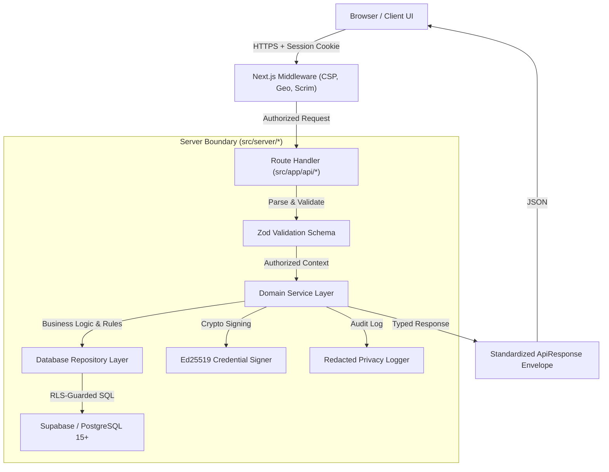

# KAAMSETU ARCHITECTURE DOCUMENTATION (ARCHITECTURE.md)

**System:** KAAMSETU Digital Identity & Worker Empowerment Platform  
**Architecture Style:** Domain-Driven Modular Monolith  
**Framework:** Next.js (App Router, Server Components & Server Actions)  
**Language:** TypeScript (Strict Mode)  
**Database:** PostgreSQL 15+ (Supabase) with Row Level Security (RLS)  
**Cryptographic Trust:** W3C Verifiable Credentials, Ed25519 Asymmetric Signatures, RFC 8785 Canonical JSON  
**Permanent Constitutional Invariant:** `platform_commission_amount = 0.00` on artisan wages  
**Operating Scope:** `CLASS_B_CONTROLLED_ROLLOUT` (Guwahati Urban & Shillong Urban)  
**Specification Version:** 3.0 (Phase 37 Architecture Modernization)

---

## 1. Architectural Principles

1. **Constitutional Invariant Enforcement:** `platform_commission_amount = 0.00` is enforced at the database level (`CHECK` constraints and triggers), service level, and API response level. No platform fee may ever be deducted from worker wages.
2. **Fail-Closed Security & Zero Secret Leakage:** Configuration errors, rate limit checks, and missing environment secrets fail closed immediately without exposing internal variable names, stack traces, or credentials to end users.
3. **Domain-Driven Modular Monolith:** Code is structured into self-contained domain features (`authentication`, `onboarding`, `worker-identity`, `contractors`, `institutions`, `bookings`, `payouts`, `credentials`, `governance`) rather than horizontal code dumps.
4. **Strict Separation of Concerns:**
   - **UI Layer (`src/components/`, `src/app/`):** Presentation, user interactions, accessibility, responsive layout. No direct privileged database queries or financial calculations.
   - **Feature Layer (`src/features/`):** Domain components, custom hooks, presentation schemas, domain actions.
   - **Service Layer (`src/server/services/`):** Business operations, domain rules, transactional workflows, immutable ledgers.
   - **Data-Access Layer (`src/server/database/`):** Typed query functions, RLS enforcement, parameterized SQL operations.
   - **Core Libraries (`src/lib/`):** Centralized error classes, formatting utilities, validation helpers.
5. **Worker Sovereignty & Data Minimization:** Workers retain absolute cryptographic ownership of their identity cards and work records. Zero raw 12-digit Aadhaar storage; one-way SHA-256 HMAC hashing for rate limiting and fraud deterrence.

---

## 2. Target Directory Hierarchy

```text
kaamsetu/
│
├── public/                     # Static public assets (images, icons, manifest)
│
├── src/
│   ├── app/                    # Next.js App Router (pages and API handlers)
│   │   ├── (public)/           # Informational & marketing routes (/, /about, /explore, /terms, /privacy)
│   │   ├── (auth)/             # Authentication entry points (/login, /signup)
│   │   ├── (worker)/           # Artisan surfaces (/onboarding, /dashboard, /profile/[slug])
│   │   ├── (customer)/         # Customer booking workbench (/customer/bookings)
│   │   ├── (contractor)/       # Commercial contractor portal (/contractor/dashboard)
│   │   ├── (institution)/      # State vocational institute portal (/institution/dashboard)
│   │   └── api/                # REST API route handlers
│   │
│   ├── components/             # Shared UI components
│   │   ├── ui/                 # Accessible primitives (button, badge, dialog, skeleton)
│   │   ├── forms/              # Reusable form controls
│   │   ├── layout/             # Institutional header, footer, navigation bars
│   │   ├── feedback/           # Alert banners, empty states
│   │   └── identity/           # Sovereign card, trust badges, KaamScore gauge
│   │
│   ├── features/               # Domain-driven feature modules
│   │   ├── authentication/     # OTP lifecycle, login forms, demo switcher
│   │   ├── onboarding/         # Vernacular voice recorder, extraction editor, draft state
│   │   ├── worker-identity/    # Profile management, work history, skill showcase
│   │   ├── contractors/        # Crew management, roster assignments, subscription invoices
│   │   ├── institutions/       # Trainee cohorts, consent telemetry, course credentials
│   │   ├── bookings/           # Direct booking requests, status workflows
│   │   ├── payouts/            # Payout disbursement ledger, zero-commission guarantee
│   │   └── credentials/        # Ed25519 signature issuance, QR verification
│   │
│   ├── server/                 # Server-only execution boundaries
│   │   ├── configuration/      # Centralized environment validation (fail-closed)
│   │   ├── auth/               # Server-side session verification & RBAC guards
│   │   ├── database/           # Typed database repositories (Supabase / Postgres)
│   │   ├── services/           # Core domain services (Worker, Contractor, Onboarding, etc.)
│   │   ├── security/           # Rate limiting, HMAC validation, audit logging
│   │   └── logging/            # Redacted privacy logger with correlation IDs
│   │
│   ├── lib/                    # Shared pure utilities and shared types
│   │   ├── errors/             # Typed application errors (ValidationError, AuthError, etc.)
│   │   ├── utilities/          # Phone normalization, formatting, currency, cryptography
│   │   └── constants/          # Trade taxonomy, rollout boundaries, legal notices
│   │
│   ├── schemas/                # Zod request & domain validation schemas
│   ├── types/                  # TypeScript interface contracts & database definitions
│   └── middleware.ts           # Edge security routing, rate-limit headers, CSP
│
├── supabase/
│   ├── migrations/             # 31 forward-only SQL migrations
│   └── seed.sql                # Ground-truth test fixtures and national trades
│
├── tests/
│   ├── unit/                   # Pure business logic and calculation tests
│   ├── integration/            # Route handlers, database queries, OTP lifecycle
│   ├── security/               # RLS policies, cryptographic signatures, rate limiting
│   └── e2e/                    # Multi-viewport browser verification tests
│
├── docs/                       # Project documentation dossiers (Phase 13 through Phase 37)
├── DESIGN.md                   # Visual design system tokens & anti-slop rules
├── ARCHITECTURE.md             # This document
├── CONTRIBUTING.md             # Engineering conventions & contribution guidelines
└── package.json                # Project dependencies, build scripts, test suites
```

---

## 3. Data Flow & Security Boundaries



---

## 4. Layered Responsibilities & Anti-Patterns

### 4.1 UI Components (`src/components/`, `src/features/*/components/`)
- **Allowed:** State for open/closed modals, tab selections, input change events, accessible keyboard handlers, responsive grid breakpoints.
- **Prohibited:** Direct calls to `supabase.from()`, raw SQL execution, calculation of GST tax or platform commission, client-side cryptographic signing, writing to `process.env`.

### 4.2 Route Handlers (`src/app/api/*/route.ts`)
- **Allowed:** Parsing query params and JSON bodies, validating input against Zod schemas, obtaining session context, passing validated parameters to a service, returning typed `createApiResponse()`.
- **Prohibited:** Giant multi-step orchestration blocks (over 50 lines), direct DB table joins written inline, ignoring catch blocks.

### 4.3 Service Layer (`src/server/services/*`)
- **Allowed:** Domain business rules, checking rollout geographic eligibility, enforcing zero-commission constraints, generating cryptographic signature manifests, transactional coordination.
- **Prohibited:** Importing React, JSX, or browser-specific APIs (`window`, `localStorage`, `navigator`).

### 4.4 Repository Layer (`src/server/database/*`)
- **Allowed:** Typed queries against PostgreSQL tables, execution of database transactions, parameterized filters.
- **Prohibited:** Exposing the `SUPABASE_SERVICE_ROLE_KEY` to client components; bypassing user ownership checks without explicit administrative justification.

---

## 5. Centralized Error Handling Specification

All API routes utilize typed exceptions mapped to appropriate HTTP status codes:

| Error Class | Status Code | Error Code | Description |
|---|---|---|---|
| `ValidationError` | 400 | `VALIDATION_ERROR` | Request body or query parameters failed Zod schema parsing. |
| `AuthenticationError` | 401 | `UNAUTHENTICATED` | Missing or invalid session token; mobile OTP verification required. |
| `AuthorizationError` | 403 | `FORBIDDEN` | Caller lacks necessary role or attempts cross-tenant/cross-worker access. |
| `NotFoundError` | 404 | `NOT_FOUND` | Target entity (worker, booking, cohort, project) does not exist. |
| `ConflictError` | 409 | `CONFLICT` | Concurrent state transition conflict (e.g. payout already finalized). |
| `RateLimitError` | 429 | `RATE_LIMIT_EXCEEDED` | Request threshold exceeded; client must wait before retrying. |
| `ExternalServiceError` | 502 | `GATEWAY_ERROR` | Upstream partner failure (Gemini, SMS Gateway, DigiLocker). |
| `DatabaseError` | 500 | `DATABASE_ERROR` | Database connection or constraint failure (sanitized; no internals leaked). |
| `ConfigurationError` | 500 | `CONFIG_ERROR` | Missing server environment key in production (fails closed safely). |

### Standardized `ApiResponse<T>` Schema
```typescript
export type ApiResponse<T> =
  | {
      success: true;
      data: T;
      meta?: {
        page?: number;
        pageSize?: number;
        total?: number;
        requestId?: string;
        timestamp: string;
      };
    }
  | {
      success: false;
      error: {
        code: string;
        message: string;
        requestId?: string;
        details?: unknown;
        timestamp: string;
      };
    };
```

---

## 6. Environment Configuration Architecture

Environment variables are partitioned into:
1. **Public Client Tokens (`NEXT_PUBLIC_*`):** Non-sensitive client identifiers (`NEXT_PUBLIC_SUPABASE_URL`, `NEXT_PUBLIC_SUPABASE_ANON_KEY`, `NEXT_PUBLIC_APP_URL`, `NEXT_PUBLIC_ENABLE_DEMO_AUTH`).
2. **Server-Only Secret Keys:** Sensitive credentials strictly inaccessible from browser code (`SUPABASE_SERVICE_ROLE_KEY`, `RATE_LIMIT_HMAC_SECRET`, `ED25519_ISSUER_PRIVATE_KEY_PEM`, `GEMINI_API_KEY`, `DATABASE_URL`).

Validation is executed at startup in `src/server/configuration/environment.ts`. In production (`NODE_ENV === "production"`), missing server keys immediately throw a `ConfigurationError` that triggers fail-closed security barriers.

---

## 7. Migration & Compatibility Strategy

To ensure zero regression for existing mobile artisans and enterprise contractors:
- All 99 public API endpoints maintain backward-compatible route URLs.
- Legacy page aliases (`/auth/login`, `/bookings`, `/explore-professions`, `/worker/[slug]`) are preserved as lightweight re-exports.
- All 31 database migrations are immutable and preserved forward-only.
- Permanent zero-commission invariant is asserted by continuous regression tests.
