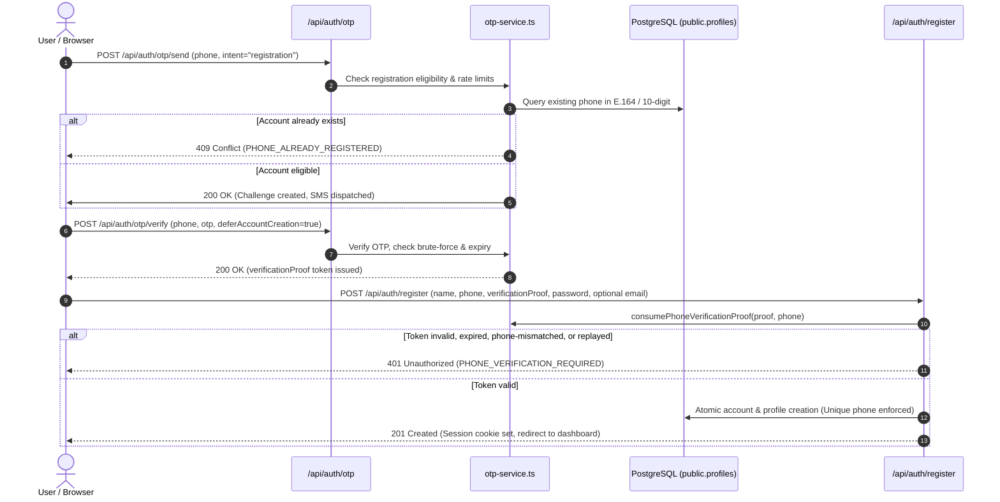

# KAAMSETU — PHASE 53: PHONE VERIFICATION IMPLEMENTATION
**Classification:** `CLASS_B_CONTROLLED_ROLLOUT` (Guwahati Urban & Shillong Urban)  
**Permanent Economic Invariant:** `platform_commission_amount = 0.00`  
**Date:** 2026-11-26  
**Module:** Authentication, OTP Lifecycle & Telecom Gateway Integration

---

## 1. Architectural Overview

Phone verification is the mandatory foundation of identity in KAAMSETU. The system operates on the invariant:
**One Verified Mobile Phone Number = Exactly One Primary User Account**.

The implementation decouples OTP verification from final account credentialing via a cryptographically signed, single-use verification proof (`verificationProof`). This allows users to fill in registration details (name, role, optional email, password), verify their physical phone via OTP, and submit the unified registration payload atomically without leaving partial or unverified account records in the database.

---

## 2. Phone Normalization & E.164 Standards

All phone inputs are validated and normalized through `src/lib/utilities/phone.ts`:

```ts
export function normalizePhoneNumber(rawPhone: string, defaultCountryCode = "+91"): NormalizedPhone;
```

### Invariants Enforced:
1. **Canonical E.164 Storage:** All valid Indian numbers are stored as `+91XXXXXXXXXX` (13 characters).
2. **Format Equivalence:**
   - Raw 10-digit (`9876543210`) -> `+919876543210`
   - Spaced (`+91 98765 43210`) -> `+919876543210`
   - Hyphenated (`+91-98765-43210`) -> `+919876543210`
   - Zero-prefixed domestic STD (`09876543210`) -> `+919876543210`
   - Prefixed without plus (`919876543210`) -> `+919876543210`
3. **Invalid Prefix Rejection:** Reject numbers beginning with 0, 1, 2, 3, 4, 5. Only valid Indian telecom prefixes (6, 7, 8, 9) are accepted for domestic numbers.
4. **International E.164 Support:** Valid international numbers with country calling code (e.g., `+14155552671`, `+447911123456`) are normalized and validated against `^\+[1-9]\d{6,14}$`.
5. **Alphabetic & Malformed Rejection:** Input containing letters or invalid characters is rejected immediately.

---

## 3. Two-Step Registration & Verification Proof Protocol



### Cryptographic Proof Structure:
The verification proof is generated in `src/lib/auth/otp-service.ts`:
- **Payload:** `{ phone: "+919876543210", intent: "registration", verificationMethod: "sms", phoneVerified: true, exp: now + 900, nonce: uuid }`
- **Signature:** HMAC-SHA256 calculated using `RATE_LIMIT_HMAC_SECRET`.
- **Single-Use Enforcement:** The server maintains an anti-replay store (`consumedProofNonces`). Once a nonce is used in `POST /api/auth/register`, it is burned and cannot be replayed.

---

## 4. OTP Lifecycle & Defense Parameters

| Parameter | Specification | Implementation / Location |
| :--- | :--- | :--- |
| **Code Length** | Exactly 6 numeric digits | `crypto.randomInt(100000, 999999)` |
| **Challenge Expiry** | 5 minutes (300 seconds) | `otp-service.ts` line 105 |
| **Verification Proof Validity** | 15 minutes (900 seconds) | `signPhoneVerificationProof` |
| **Max Verification Attempts** | 5 attempts per challenge | Locked out via `validateOtpVerifyAttempt` |
| **Resend Cooldown** | 60 seconds | `validateOtpSendRateLimit` (HTTP 429) |
| **Anti-Enumeration** | Generic timing & error responses | Constant-time comparison, no user leakage |
| **Single-Use Consumption** | Marked consumed immediately | Atomic update in PostgreSQL & memory |

---

## 5. Telecom Gateway & Production Sandbox Lockdown

- **Production Gateway:** When `AUTH_VERIFICATION_MODE=sms`, OTP delivery routes through Twilio Verify or configured Indian SMS gateway.
- **Missing Credentials:** If telecom credentials (`TWILIO_ACCOUNT_SID`, etc.) are absent in production, `sendOtp` returns an honest HTTP 503 `LIVE_TELECOM_GATEWAY_REQUIRED`. It **never** silently falls back to a sandbox code.
- **Zero Leakage:** In production, `sandboxCode` is explicitly omitted from JSON responses.
- **Fail-Closed Verification:** `verifyOtp` rejects any sandbox verification attempt in production unless the fatal override `ALLOW_INSECURE_SANDBOX_IN_PRODUCTION === "true"` is set (which triggers a `FATAL SECURITY VIOLATION` crash in `validateEnvironmentSafety()`).
