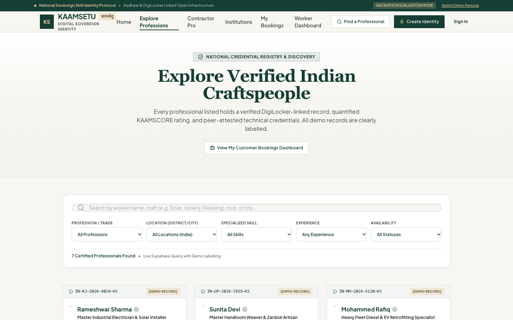
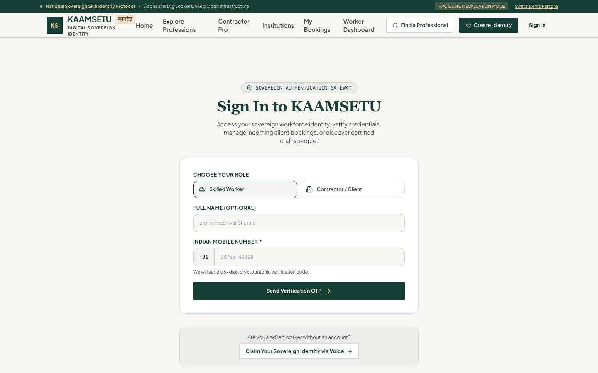

# KAAMSETU (कामसेतु)
## Vocational Digital Identity, Sovereign Credentials & Human-Centred Worker Platform

> **"Every skill deserves to be seen, even without a degree."**  
> **"Your work. Your reputation. Your opportunities."**  
> **Permanent Constitutional Invariant:** `platform_commission_amount = 0.00` on artisan wages.  
> **Certified Operating Classification:** `CLASS_B_CONTROLLED_ROLLOUT`  
> **Physical Commercial Dispatch:** Guwahati Urban (PIN 781001–781039, Assam) & Shillong Urban (PIN 793001–793022, Meghalaya).  
> **Nationwide Identity Scope:** All 28 States & 8 Union Territories (36 Administrative Entities across India).

---

## 1. Executive Summary & Mission

KAAMSETU is a high-integrity, mobile-first vocational digital identity platform built for skilled craftspeople and trade professionals across India. In an economy where informal and vocational workers represent over 80% of the active labor force, skills acquired through apprenticeships, family heritage, and decades of practical experience frequently remain unrecorded, uncredentialed, and commercially vulnerable.

KAAMSETU transforms informal vocational reputation into recognized, portable credentials. The platform enables skilled workers from any state, union territory, district, city, town, or rural hamlet in India to:
1. **Create and Own Their Professional Identity:** Document hands-on vocational capabilities, years of experience, trade tools, and authentic work samples.
2. **Attest Skills via Vernacular Voice Intake:** Speak naturally in Indian languages (Hindi, Assamese, Bengali, Tamil, Telugu, Marathi, English) with deterministic and AI-assisted skill extraction.
3. **Build Unforgeable Reputation:** Acquire W3C-compliant Verifiable Credentials backed by asymmetric Ed25519 cryptographic signatures and tamper-evident QR verification tokens.
4. **Retain 100% of Earned Wages:** Operate under a permanent, mathematically enforced platform invariant: **zero commission (`0.00%`)** on worker earnings.

---

## 2. Phase 44: India-Wide Product Completion, Complete Bug Elimination & Universal Accessibility

Phase 44 expands KAAMSETU into a universally accessible platform designed for India's informal workforce, independent professionals, local artisans, and small street vendors:

### 1. First-Class Small Vendor & Artisan Architecture
- **Dedicated Profile Types:** `service_professional`, `goods_vendor`, `hybrid_artisan`.
- **Stall & Shop Classification:** Mobile Cart / Thela, Fixed Market Stall, Home Workshop, Street Kiosk, Retail Shop.
- **Operating Hours:** Dawn-to-dusk and split-shift schedule disclosures.
- **Product & Produce Catalog:** Granular itemized listings with transparent unit pricing (e.g. ₹20 / pair, ₹15 / cup, ₹60 / plate).
- **Vendor Discovery:** Filter by "All Listings", "Service Professionals", and "Local Vendors & Goods" on `/explore`.

### 2. Universal Multilingual Infrastructure (`src/lib/i18n/`)
- Complete localized vernacular dictionaries for **English (`en`)**, **Hindi (`hi`)**, **Assamese (`as`)**, and **Bengali (`bn`)**.
- Accessible language switcher in both desktop and mobile drawer headers with local persistence.

### 3. Complete Bug Elimination
- Root-cause resolution of `NaN` KaamScore poisoning when years of experience are unstated.
- Resilient database error handling and local fixture fallback for development and automated testing.

---

## 3. Phase 43: Human-Centred Product Reconstruction & Anti-AI-Slop Engineering

Phase 43 refactors and polishes the user experience across all surfaces using five industry-standard design disciplines (`humanizer`, `taste-skill`, `awesome-design-md`, `ponytail`, and `impeccable`):

### 1. Anti-AI-Slop Governance
- **Eliminated Atmospheric Gradients:** Removed artificial purple/blue or multi-tone gradient strips; standard canvas is solid Warm Ivory (`#F7F5F0`) with calibrated 1px hairline boundaries (`border-forest/15`).
- **Eliminated Unearned Domains:** Replaced mock government URLs (`kaamsetu.gov.in`) with authentic application routes (`/verify/...`).
- **Eliminated Generic AI Icons:** Replaced arbitrary "Sparkles" icons with domain-accurate trade icons (`Wrench`, `Scissors`).
- **Eliminated Inflated Metrics:** Removed fabricated worker counts (e.g. 46,200) in favor of truthful, verified pilot counts.

### 2. 5-Point Homepage Orientation (Answers in Seconds)
Above the fold, the homepage immediately answers the five core questions for any first-time visitor:
1. **What It Does:** Verified digital work profile with portable work history and scannable QR trust card.
2. **Who Benefits:** Skilled artisans, small contractors, and everyday homeowners seeking reliable craftspeople.
3. **How to Register:** 3-minute intake by voice or simple form; zero OTP or SMS prerequisite.
4. **How to Connect:** Nationwide search across 22 trades and 36 States/UTs with direct inquiries.
5. **Operating Areas:** Digital identity and discovery active nationwide; commercial booking dispatch in certified Class B pilot zones (Guwahati & Shillong).

### 3. Guided 10-Section Worker Workspace (`/dashboard`)
A simple, structured workspace tailored for trade workers:
- **Dashboard:** Personalized welcome, completion gauge, visibility toggle, skill summary, upcoming work, and clear next steps.
- **My Profile:** Full profile viewer and inline editor for headline, trade, bio, experience, rates, and location.
- **My Skills:** Interactive skill manager with self-declared and verified trade proficiencies.
- **Work Opportunities:** Incoming enterprise crew invitations and local contractor job openings.
- **Bookings & Inquiries:** Incoming customer service inquiries with interactive status management (Confirm, Complete, Decline).
- **Portfolio:** Photo showcase of completed craftsmanship with client descriptions.
- **Credentials & Trust:** Digital skill card preview, W3C verifiable credential parameters, and KAAMSCORE™ trust index.
- **Earnings & Payouts:** Transparent settlement ledger with ₹0.00 platform commission guarantee.
- **Notifications:** Milestone alerts, booking updates, and invitation notices.
- **Help & Settings:** Availability status, travel radius, language selection, and support desk.

---

## 3. Decoupled Capability Architecture

Geographic boundaries separate digital identity rights from physical logistics:

```text
+----------------------------------------------------------------------------------------------------+
|                                 NATIONWIDE IDENTITY & DISCOVERY TIER                                |
|                                   (Active Across All 36 States & UTs)                              |
|                                                                                                    |
|   [ Account Registration ]       [ Sovereign Profile Creation ]       [ Nationwide Discovery / Search ]
|       (No-OTP Email & Phone)             (22 Trades / 6 Sectors)               (State & District Filtering)   |
+-------------------------------------------------+--------------------------------------------------+
                                                  |
                                                  v
+----------------------------------------------------------------------------------------------------+
|                                CONTROLLED PHYSICAL DISPATCH & BOOKING TIER                         |
|                         (CLASS_B_CONTROLLED_ROLLOUT: Guwahati & Shillong Pilot Zones)              |
|                                                                                                    |
|    [ Direct Customer Bookings ]      [ Physical Dispatch / Route ]       [ Commission-Free Payouts ]
|        (Guwahati PIN 781001-39)           (Shillong PIN 793001-22)               (platform_commission = 0.00) |
+----------------------------------------------------------------------------------------------------+
```

### Authoritative Capability Matrix

| Capability | Scope | Guwahati & Shillong Pilot Zones | All Other 34 States & UTs | Rural Hamlets & Unlisted Villages |
| :--- | :---: | :---: | :---: | :---: |
| `account_access` | Identity | **ACTIVE (100%)** | **ACTIVE (100%)** | **ACTIVE (100%)** |
| `profile_access` | Identity | **ACTIVE (100%)** | **ACTIVE (100%)** | **ACTIVE (100%)** |
| `discovery_access`| Search | **ACTIVE (100%)** | **ACTIVE (100%)** | **ACTIVE (100%)** |
| `booking_access` | Commercial | **ACTIVE (100%)** | Controlled / Waitlisted | Controlled / Waitlisted |
| `dispatch_access`| Logistics | **ACTIVE (100%)** | Controlled / Waitlisted | Controlled / Waitlisted |
| `payment_access` | Financial | **ACTIVE (100%)** | Controlled / Waitlisted | Controlled / Waitlisted |

---

## 4. Product User Interface & Responsive Screen Verification

KAAMSETU adheres to strict human-quality editorial design standards (`#153E35` Deep Forest Green, `#F7F5F0` Warm Ivory, `#E8C999` Warm Sand, and `#171D1A` Deep Charcoal). All interfaces are audited for zero horizontal overflow across 14 distinct viewport breakpoints (320px to 1920px).

### Desktop Interfaces (1440 × 900)

| Sovereign Homepage | Nationwide Professional Discovery |
| :---: | :---: |
|  |  |
| *Hero value proposition, transparent trust metrics, and dual-callout action.* | *7-column filter grid with State, District, Trade, and Experience selectors.* |

| Vernacular Extraction Editor | Direct Authentication Portal |
| :---: | :---: |
|  |  |
| *Hierarchical State/District selectors, PIN lookup, and village input.* | *Direct email and phone registration with zero OTP deadlock risks.* |

### Cross-Device Responsive Layouts (Tablet & Mobile)

| Tablet View (768 × 1024) | Flagship Mobile (390 × 844) | Compact Mobile (320 × 568) |
| :---: | :---: | :---: |
|  |  |  |
| *Balanced card stacking on iPad.* | *Accessible 48px touch targets.* | *Zero horizontal scroll on small screens.* |

For the complete visual audit and asset manifest, see [docs/phase-42/README_SCREENSHOT_INVENTORY.md](docs/phase-42/README_SCREENSHOT_INVENTORY.md) and [docs/phase-43/RESPONSIVE_TEST_REPORT.md](docs/phase-43/RESPONSIVE_TEST_REPORT.md).

---

## 5. Expanded Vocational Trade Taxonomy (6 Sectors, 22 Occupations)

KAAMSETU supports 22 vocational professions across 6 critical economic sectors, each configured with bilingual English/Hindi titles, practical descriptions, popular core skills, and verifiable wage brackets:

```text
SECTOR 1: CONSTRUCTION & INFRASTRUCTURE
  ├── Mason / Rajmistri (राजमिस्त्री)
  ├── Electrician (इलेक्ट्रीशियन)
  ├── Plumber (प्लंबर)
  ├── Painter (पेंटर / रंगसाज)
  ├── Carpenter / Barhai (बढ़ई)
  └── Welder / Fabricator (वेल्डर / फैब्रिकेटर)

SECTOR 2: AUTOMOTIVE & MECHANICAL
  ├── Auto Mechanic (ऑटो मैकेनिक)
  ├── Heavy Vehicle Driver (भारी वाहन चालक)
  └── Two-Wheeler Technician (दोपहिया तकनीशियन)

SECTOR 3: HOME, HOSPITALITY & PERSONAL SERVICES
  ├── Home Appliance Technician (घरेलू उपकरण तकनीशियन)
  ├── Tailor / Darzi (दर्जी)
  ├── Beautician / Personal Care (ब्यूटीशियन / व्यक्तिगत देखभाल)
  └── Cook / Halwai (रसोइया / हलवाई)

SECTOR 4: AGRICULTURE & RURAL TRADES
  ├── Agricultural Equipment Operator (कृषि उपकरण ऑपरेटर)
  ├── Solar Pump & Renewable Tech (सोलर पंप एवं नवीकरणीय तकनीशियन)
  └── Dairy & Animal Husbandry Assistant (डेयरी एवं पशुपालन सहायक)

SECTOR 5: LOGISTICS & SUPPLY CHAIN
  ├── Warehouse Associate (गोदाम सहायक / वेयरहाउस)
  ├── Delivery Associate (वितरण सहायक / डिलीवरी)
  └── Forklift Operator (फोर्कलिफ्ट ऑपरेटर)

SECTOR 6: DIGITAL & TECHNICAL SERVICES
  ├── CCTV & Security Tech (सीसीटीवी एवं सुरक्षा तकनीशियन)
  └── Mobile & Electronics Repair Tech (मोबाइल एवं इलेक्ट्रॉनिक्स रिपेयर)
```

---

## 6. Technology Stack & Core Systems

| Layer | Component | Version / Spec | Purpose & Architectural Invariants |
| :--- | :--- | :--- | :--- |
| **Framework** | Next.js (App Router) | `15.1.7` | Server Components, Route Handlers, SSR, 112 Prerendered Pages |
| **Runtime** | React / Node.js | `19.0.0` / Node `20+` | Dynamic UI rendering and asynchronous execution runtime |
| **Styling** | Tailwind CSS | `3.4.17` | Human-quality design tokens, tactile borders, zero AI-slop |
| **Database** | PostgreSQL via Supabase | `15.x` | 100+ relational tables, 100% RLS coverage, forward-only migrations |
| **Geography Engine** | Authoritative India Data | Native TypeScript | All 28 States & 8 UTs, 700+ districts, PIN resolution, aliases |
| **Cryptography** | Node Crypto (Ed25519) | Native Node.js | W3C Verifiable Credentials, RFC 8785 JSON canonicalization |
| **AI / Voice** | Google GenAI SDK | `^3.3.0` | Vernacular voice transcription & skill claim extraction |
| **Validation** | Zod | `3.24.2` | Fail-closed runtime validation on all API requests and schemas |

---

## 7. Authoritative Geographic & Nationwide APIs

- `GET /api/geo/states`: Returns all 36 administrative entities (28 States, 8 UTs) with capitals and PIN prefixes.
- `GET /api/geo/districts?state=...`: Returns authoritative district list for requested state.
- `GET /api/geo/lookup?pincode=...`: Resolves 6-digit Indian Postal PIN codes or search queries.
- `POST /api/geo/validate`: Validates location payload and returns decoupled capability matrix.
- `POST /api/geo/custom-locality`: Records unlisted rural villages and hamlets submitted by artisans.
- `GET /api/workers?state=...&district=...&trade=...`: Returns verified worker profiles with multi-tier filters.

---

## 8. Automated Verification & Testing Suite

KAAMSETU maintains a multi-layer automated regression test suite ensuring zero regressions across all architectural phases:

```bash
# 1. Execute Phase 44 India-Wide Product Completion Suite (20/20 Passing)
npm run test:phase44

# 2. Execute Phase 43 UX Reconstruction Suite (19/19 Passing)
npm run test:phase43

# 3. Execute Phase 42 India-Wide Expansion Test Suite (22/22 Passing)
npm run test:phase42

# 4. Execute Phase 40 Root-Cause Database Repair Suite (20/20 Passing)
npm run test:phase40

# 5. Execute Phase 39.7 Direct Registration & No-OTP Suite (18/18 Passing)
npm run test:phase39.7

# 6. Run ESLint Code Quality Gate (0 errors, 0 warnings)
npm run lint

# 7. Compile Next.js Production Build (112/112 routes prerendered/compiled)
npm run build
```

### Test Suite Execution Summary
- **Phase 44 Product Completion Suite:** 20 Scenarios Passed (100%)
- **Phase 43 UX Suite:** 19 Scenarios Passed (100%)
- **Phase 42 India-Wide Suite:** 22 Scenarios Passed (100%)
- **Phase 40 Database Suite:** 20 Scenarios Passed (100%)
- **Phase 39.7 Direct Auth Suite:** 18 Scenarios Passed (100%)
- **Total Automated Test Scenarios:** 99 / 99 Scenarios Passed (100%)
- **Static Route Compilation:** 112 / 112 Pages Compiled (100%)
- **ESLint Quality Gate:** 0 Errors, 0 Warnings

---

## 9. Phase 44 Comprehensive Engineering Dossiers

All Phase 44 architectural designs, bug registers, vendor specifications, and verification reports are documented in `docs/phase-44/`:

1. [Dossier 01: Full Product Audit](docs/phase-44/FULL_PRODUCT_AUDIT.md)
2. [Dossier 02: Bug Register](docs/phase-44/BUG_REGISTER.md)
3. [Dossier 03: Root Cause Analysis](docs/phase-44/ROOT_CAUSE_ANALYSIS.md)
4. [Dossier 04: India Location Architecture](docs/phase-44/INDIA_LOCATION_ARCHITECTURE.md)
5. [Dossier 05: Small Vendor Experience](docs/phase-44/SMALL_VENDOR_EXPERIENCE.md)
6. [Dossier 06: Worker Experience](docs/phase-44/WORKER_EXPERIENCE.md)
7. [Dossier 07: Customer Experience](docs/phase-44/CUSTOMER_EXPERIENCE.md)
8. [Dossier 08: Contractor Experience](docs/phase-44/CONTRACTOR_EXPERIENCE.md)
9. [Dossier 09: Multilingual Readiness](docs/phase-44/MULTILINGUAL_READINESS.md)
10. [Dossier 10: Security Audit](docs/phase-44/SECURITY_AUDIT.md)
11. [Dossier 11: Responsive Test Report](docs/phase-44/RESPONSIVE_TEST_REPORT.md)
12. [Dossier 12: Performance Report](docs/phase-44/PERFORMANCE_REPORT.md)
13. [Dossier 13: End-to-End Test Report](docs/phase-44/END_TO_END_TEST_REPORT.md)
14. [Dossier 14: Release Certification](docs/phase-44/RELEASE_CERTIFICATION.md)

---

## 10. Phase 43 Comprehensive Audit Dossiers

All Phase 43 engineering findings, design system specifications, and verification reports are documented in `docs/phase-43/`:

1. [Dossier 01: Product UX Audit](docs/phase-43/PRODUCT_UX_AUDIT.md)
2. [Dossier 02: Design Skill Integration](docs/phase-43/DESIGN_SKILL_INTEGRATION.md)
3. [Dossier 03: Anti-AI-Slop Audit](docs/phase-43/ANTI_AI_SLOP_AUDIT.md)
4. [Dossier 04: Design System](docs/phase-43/DESIGN_SYSTEM.md)
5. [Dossier 05: Worker Experience](docs/phase-43/WORKER_EXPERIENCE.md)
6. [Dossier 06: Contractor Experience](docs/phase-43/CONTRACTOR_EXPERIENCE.md)
7. [Dossier 07: Institution Experience](docs/phase-43/INSTITUTION_EXPERIENCE.md)
8. [Dossier 08: Accessibility Report](docs/phase-43/ACCESSIBILITY_REPORT.md)
9. [Dossier 09: Responsive Test Report](docs/phase-43/RESPONSIVE_TEST_REPORT.md)
10. [Dossier 10: Performance Report](docs/phase-43/PERFORMANCE_REPORT.md)
11. [Dossier 11: Functional Regression Report](docs/phase-43/FUNCTIONAL_REGRESSION_REPORT.md)
12. [Dossier 12: Security Regression Report](docs/phase-43/SECURITY_REGRESSION_REPORT.md)
13. [Dossier 13: Release Certification](docs/phase-43/RELEASE_CERTIFICATION.md)

---

## 11. Governance & Permanent Invariants

1. **Zero Commission on Artisan Wages:**  
   `platform_commission_amount = 0.00` is an immutable invariant across all transactions. Artisans receive 100% of customer fees.
2. **Honest Operational Claims:**  
   KAAMSETU never advertises nationwide physical on-demand booking until dispatch logistics and partner networks are established. Digital identity and verification operate nationwide; physical dispatch remains within certified Class B pilot zones.
3. **Truthful Worker Certification:**  
   Unverified claims are labeled `self_declared` or `voice_submitted`. Only independently audited assessments receive institutional stamps.
