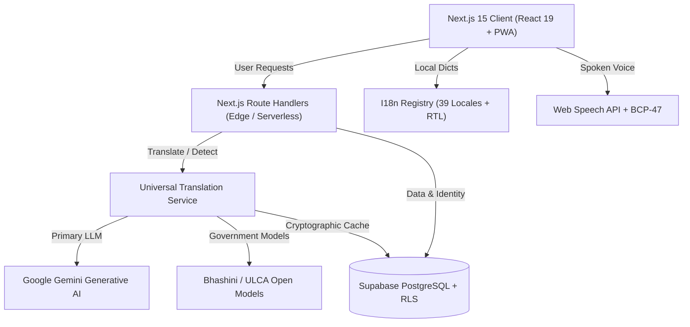

# KAAMSETU (कामसेतु)
## Vocational Digital Identity, Sovereign Credentials & Universal Multilingual Marketplace

> **"Every skill deserves to be seen, even without a degree."**  
> **"Your work. Your reputation. Your opportunities."**  
> **Permanent Constitutional Financial Invariant:** `platform_commission_amount = 0.00` on artisan and vendor wages.  
> **Certified Operating Classification:** `CLASS_B_CONTROLLED_ROLLOUT`  
> **Commercial Dispatch Pilot Scope:** Guwahati Urban (PIN 781001–781039, Assam) & Shillong Urban (PIN 793001–793022, Meghalaya).  
> **Universal Identity Scope:** Nationwide across all 28 States & 8 Union Territories (36 Total Entities).  
> **Production Application Domain:** `https://kaamsetu-neon.vercel.app`

---

## Table of Contents

1. [Project Overview](#1-project-overview)
2. [The Problem KAAMSETU Solves](#2-the-problem-kaamsetu-solves)
3. [Target Users & Stakeholders](#3-target-users--stakeholders)
4. [Key Product Capabilities](#4-key-product-capabilities)
5. [39 Supported Indian Languages & Dialects](#5-39-supported-indian-languages--dialects)
6. [Universal Content Translation Engine](#6-universal-content-translation-engine)
7. [Two-Way Cross-Language Communication](#7-two-way-cross-language-communication)
8. [Intelligent Voice Recognition & Spoken Translation](#8-intelligent-voice-recognition--spoken-translation)
9. [Nationwide Hierarchical Location Architecture](#9-nationwide-hierarchical-location-architecture)
10. [11-Sector Indian Business & Vendor Taxonomy](#10-11-sector-indian-business--vendor-taxonomy)
11. [Worker & Customer Workflows](#11-worker--customer-workflows)
12. [Technical Architecture & System Flows](#12-technical-architecture--system-flows)
13. [Technology Stack](#13-technology-stack)
14. [Repository Structure](#14-repository-structure)
15. [Database Architecture & Data Model](#15-database-architecture--data-model)
16. [Supabase & Database Configuration](#16-supabase--database-configuration)
17. [Authentication & Row-Level Security (RLS)](#17-authentication--row-level-security-rls)
18. [Environment Variables](#18-environment-variables)
19. [Local Development Setup](#19-local-development-setup)
20. [Installation Instructions](#20-installation-instructions)
21. [Development Commands](#21-development-commands)
22. [Automated Test Suites](#22-automated-test-suites)
23. [Translation Provider Configuration](#23-translation-provider-configuration)
24. [Voice & Speech Provider Configuration](#24-voice--speech-provider-configuration)
25. [Production Deployment Guide](#25-production-deployment-guide)
26. [Security Considerations & Hardening](#26-security-considerations--hardening)
27. [Privacy Guarantees & Ephemeral Audio](#27-privacy-guarantees--ephemeral-audio)
28. [Known Operational Limitations](#28-known-operational-limitations)
29. [Strategic Roadmap](#29-strategic-roadmap)
30. [Contribution Guidelines](#30-contribution-guidelines)
31. [License Information](#31-license-information)
32. [Comprehensive Language Capability Matrix](#32-comprehensive-language-capability-matrix)

---

## 1. Project Overview

**KAAMSETU** (कामसेतु / দলং / সেতু) is a sovereign, open-source vocational identity, credential verification, and service marketplace built specifically for India's skilled trade craftspeople, informal artisans, and micro-merchants.

Over 80% of India's active labor force works in the informal economy. Millions of master electricians, heritage weavers, bamboo artisans, carpenters, tailors, technicians, and local vendors possess decades of hands-on mastery. However, lacking formal degrees or corporate references, their vocational reputation remains unrecorded, paperless, and non-transferable across city or state borders.

KAAMSETU establishes a **sovereign digital skill identity** that workers and vendors own independently. Through direct vernacular onboarding, AI-assisted voice intake, cryptographic W3C Verifiable Credentials, universal cross-language translation, and a permanent constitutional **zero-commission (₹0.00)** guarantee, KAAMSETU connects skilled workers with customers, contractors, and national institutions.

---

## 2. The Problem KAAMSETU Solves

1. **The Credential Paradox:** Highly skilled master artisans lack formal certificates, while paper certificates often fail to reflect actual hands-on craftsmanship.
2. **Exploitative Commission Models:** Commercial gig platforms levy 20% to 35% commission deductions on worker wages, reducing artisans to transactional commodities.
3. **Language Barriers in Commerce:** India speaks thousands of dialects across dozens of scripts. A vendor writing in Assamese or Bengali cannot communicate effectively with Hindi- or Tamil-speaking customers without friction.
4. **Geographic Fragmentation:** Skill credentials do not travel across district or state borders, requiring migrant workers to rebuild their reputation from scratch in every new city.
5. **Digital Literacy Exclusion:** High cognitive-load forms, mandatory SMS OTP gateways, and complex corporate interfaces systematically exclude workers with limited digital literacy.

---

## 3. Target Users & Stakeholders

- **Skilled Informal Workers & Artisans:** Tailors, electricians, plumbers, carpenters, masons, painters, mechanics, weavers, bamboo artisans, and welders.
- **Micro-Vendors & Street Merchants:** Fixed stall owners, weekly haat vendors, mobile cart operators, fruit/vegetable sellers, and local service kiosks.
- **Neighborhood Customers:** Families and individuals seeking verified, dependable trade professionals without platform middleman surcharges.
- **Small Contractors & Guild Masters:** Local building contractors, event organizers, and workshop owners hiring crews with authentic skill credentials.
- **Vocational Institutions & Sector Skill Councils:** Training institutes (NSDC, ITI, State Skill Missions) ratifying physical assessments.

---

## 4. Key Product Capabilities

- **Direct Authentication (Zero-SMS Friction):** Reliable mobile-number authentication without SMS OTP deadlocks, third-party telecom delays, or session loss.
- **39-Language Vernacular Localization:** Instant interface switching across 22 Eighth Schedule languages and 16 Regional Varieties with Right-to-Left (RTL) script support.
- **Universal Content Translation:** In-place translation of worker bios, vendor shop descriptions, service rate sheets, and customer booking instructions.
- **Two-Way Cross-Language Communication:** Preserves original customer and vendor messages while displaying bidirectional translations on demand.
- **Intelligent Spoken Voice Translation:** Speech-to-text pipeline with real-time transcription, BCP 47 locale mapping, intent extraction, and voice synthesis.
- **Hierarchical Location Navigation:** Complete India-wide geographic cascade across 36 States/UTs, 700+ Districts, Subdistricts, and PIN codes.
- **Dedicated Vendor Hub (`/vendor/dashboard`):** Real-time profile completion gauge, itemized catalog manager, operating hours, and inquiry inbox.
- **Permanent Zero-Commission Invariant:** Cryptographically and database-enforced `platform_commission_amount = 0.00` on artisan wages.

---

## 5. 39 Supported Indian Languages & Dialects

KAAMSETU supports **39 total languages** (22 Eighth Schedule + 16 Regional Varieties + 1 English Federal Fallback):

### Eighth Schedule Official Languages (22)
Assamese (`as`), Bengali (`bn`), Bodo (`brx`), Dogri (`doi`), Gujarati (`gu`), Hindi (`hi`), Kannada (`kn`), Kashmiri (`ks`), Konkani (`kok`), Maithili (`mai`), Malayalam (`ml`), Manipuri / Meitei (`mni`), Marathi (`mr`), Nepali (`ne`), Odia (`or`), Punjabi (`pa`), Sanskrit (`sa`), Santali (`sat`), Sindhi (`sd`), Tamil (`ta`), Telugu (`te`), Urdu (`ur`).

### Regional Varieties & Dialects (16)
Bhojpuri (`bho`), Rajasthani (`raj`), Chhattisgarhi (`hne`), Haryanvi (`bgc`), Tulu (`tcy`), Khasi (`kha`), Garo (`grt`), Mizo (`lus`), Kokborok (`trp`), Angika (`anp`), Magahi (`mag`), Garhwali (`gbm`), Kumaoni (`kfy`), Bhili (`bhb`), Ho (`hoc`), Mundari (`unr`).

### Dual-Script & RTL Layout Engine
Urdu (`ur`), Kashmiri (`ks`), and Sindhi (`sd`) are flagged with `direction: "rtl"`. The application dynamically injects `<html dir="rtl" lang="...">` to reorient layout grids, icon paddings, and navigation flows.

---

## 6. Universal Content Translation Engine

Content translation allows users to translate user-generated content (profiles, shop details, product lists, booking instructions) between any supported language pair:

```
User Content ──► Entity Protection ──► Language Detection ──► Cache Lookup ──► Provider Routing ──► Entity Restoration ──► UI Display
```

- **Entity Protection & Masking:** Phone numbers (`+91 9876543210`), PIN codes (`781001`), currency rates (`₹500`), registry IDs (`KS-AS-781001`), and URLs are extracted and replaced with protected tokens (`[[ENTITY_PHONE_0]]`) before translation. Post-translation, exact original values are restored verbatim, eliminating number distortion.
- **Identity Preservation:** Personal user data (`fullName`, `phone`, `registryId`, `city`, `state`) is never translated or phonetically corrupted.
- **Cryptographic Caching:** SHA-256 tokens (`original_text_hash + source + target + provider`) prevent duplicate provider network calls.
- **Safety Disclaimers:** Attached automatically to technical trade descriptions (high-voltage wiring, gas leaks) and booking financial instructions.

---

## 7. Two-Way Cross-Language Communication

KAAMSETU enables two people speaking different languages to conduct commerce naturally:

1. **Vendor Writes in Native Language:** An Assamese tailor writes: *"মই গুৱাহাটীত এটা সৰু দৰ্জীৰ দোকান চলাওঁ।"*
2. **Customer Reads Translated Content:** A Hindi-speaking customer views the translated bio in Hindi: *"मैं गुवाहाटी में एक छोटी दर्जी की दुकान चलाता हूँ।"*
3. **Original Preserved:** The interface prominently displays `Original: Assamese` with a one-click `Show Original` toggle.
4. **Customer Sends Enquiry in Hindi:** *"मुझे शादी के लिए दो कुर्ते सिलवाने हैं।"*
5. **Vendor Reads in Assamese:** The tailor views the enquiry translated into Assamese without replacing the customer's original database record.

---

## 8. Intelligent Voice Recognition & Spoken Translation

The speech engine extends browser Web Speech API capabilities with an accessible, ephemeral pipeline:

```
Microphone ──► Audio Capture ──► Web Speech API ──► Real-Time Transcript ──► Intent / Translation ──► TTS Playback
```

- **BCP 47 Tagging:** Maps internal language codes to speech recognition tags (e.g., `hi` $\rightarrow$ `hi-IN`, `as` $\rightarrow$ `as-IN`, `bn` $\rightarrow$ `bn-IN`, `ta` $\rightarrow$ `ta-IN`).
- **Live Interim Display:** Live transcription displays spoken words as they are uttered, with an editable textarea for manual refinement.
- **Rule-Based Intent Recognition:** Automatically detects trade categories (tailor, electrician, produce vendor), experience, and location.
- **Ephemeral Audio Guarantee:** Raw audio streams are never recorded or stored on server disks without explicit, recorded consent.

---

## 9. Nationwide Hierarchical Location Architecture

KAAMSETU implements a dependent geographic selector aligned with Local Government Directory (LGD) and India Post standards:

$$\text{India (Country)} \longrightarrow \text{State / Union Territory (36)} \longrightarrow \text{District} \longrightarrow \text{Subdistrict / Tehsil} \longrightarrow \text{City / Town / Village} \longrightarrow \text{PIN Code}$$

### Decoupled Operational Model
- **Controlled Pilot Dispatch:** Commercial on-demand dispatch remains strictly limited to **Guwahati Urban** (PIN 781001–781039) and **Shillong Urban** (PIN 793001–793022).
- **Universal Nationwide Scope:** Workers and vendors anywhere in India (Mumbai, Jaipur, Patna, Imphal, Kochi) can register, create profiles, issue cryptographic credentials, and be discovered.

---

## 10. 11-Sector Indian Business & Vendor Taxonomy

The business taxonomy covers 11 primary economic sectors with category-specific schemas:

1. **Personal & Household Services:** Tailors, barbers, laundry, cobblers.
2. **Construction & Technical Trades:** Electricians (wireman license required), plumbers, masons, carpenters, painters.
3. **Food & Hospitality:** Street stalls, tea shops, tiffin services, dhabas (FSSAI license, mobile cart vs. fixed stall).
4. **Automotive Repair:** Two-wheeler mechanics, auto mechanics, puncture shops.
5. **Agriculture & Primary Production:** Dairy farmers, poultry, fishery, nurseries.
6. **Arts, Crafts & Handloom:** Weavers, potters, bamboo artisans, woodcarvers (GI tag tracking).
7. **Education & Tutoring:** Home tutors, music instructors, driving instructors.
8. **Retail & Local Commerce:** Kirana stores, vegetable vendors, hardware shops, flower stalls.
9. **Health & Wellness:** Yoga instructors, masseurs, traditional wellness practitioners.
10. **Logistics & Transport:** Auto drivers, cycle rickshaw pullers, delivery partners.
11. **Small Manufacturing & Fabrication:** Metal grills, aluminium fabricators, packaging makers.

---

## 11. Worker & Customer Workflows

### Worker Journey
1. **Direct Registration:** Sign up using mobile number and secure password (zero OTP wait).
2. **Guided 12-Step Onboarding:** Fill in trade, experience, tools, and daily rates, or speak via Voice Intake.
3. **Credential Minting:** Issue sovereign digital credentials with cryptographic QR tokens.
4. **Earnings Ledger:** View transparent job history with explicit `0.00%` platform commission.

### Customer Journey
1. **Multilingual Discovery:** Search by trade alias in native scripts (e.g. *bijli*, *बिजली*, *দৰ্জী*, *தையல்*).
2. **In-Place Translation:** Translate worker portfolios and descriptions into preferred language.
3. **Direct Booking:** Submit site visit requests with transparent indicative rates.

---

## 12. Technical Architecture & System Flows



---

## 13. Technology Stack

- **Framework:** [Next.js 15.5.29](https://nextjs.org/) (App Router, React 19, Server Components)
- **Language:** TypeScript 5.8
- **Styling:** Tailwind CSS 4.0 with sovereign design tokens
- **Database & Auth:** [Supabase](https://supabase.com/) PostgreSQL with Row-Level Security (RLS)
- **AI & Extraction:** [`@google/genai`](https://www.npmjs.com/package/@google/genai) (Gemini 2.5/3.8 models)
- **Validation:** [Zod 3.24](https://zod.dev/) for strict schema validation
- **Icons:** [Lucide React](https://lucide.dev/)
- **PWA & Offline:** Service Worker with Cache-First asset strategy and `/offline` shell

---

## 14. Repository Structure

```
├── docs/                                  # Architectural & engineering dossiers
├── public/                                # Static assets, PWA manifest, service worker
├── src/
│   ├── app/                               # Next.js App Router pages and API routes
│   │   ├── api/                           # Secure server-side route handlers
│   │   │   ├── auth/                      # Direct authentication endpoints
│   │   │   ├── translate/                 # Universal translation & detection APIs
│   │   │   ├── user/preferences/          # Language & accessibility preferences
│   │   │   └── vendor/profile/            # Vendor registration & catalog APIs
│   │   ├── dashboard/                     # Worker 10-tab guided workspace
│   │   ├── explore/                       # Multilingual discovery & search
│   │   ├── onboarding/                    # 12-step guided worker onboarding
│   │   └── vendor/dashboard/              # Vendor Hub & catalog management
│   ├── components/                        # React UI component library
│   │   ├── customer/                      # Booking cards and customer views
│   │   ├── dashboard/                     # Worker workspace tab panels
│   │   ├── layout/                        # Institutional header, navigation, drawer
│   │   ├── location/                      # 36 States/UTs hierarchical location selector
│   │   ├── profile/                       # Worker hero, skills, services, portfolio
│   │   ├── translation/                   # Translate button, dialog, voice widget
│   │   ├── ui/                            # Atomic design system primitives
│   │   ├── vendor/                        # Dynamic vendor forms & catalog managers
│   │   └── voice/                         # Intelligent multilingual voice assistant
│   ├── lib/                               # Core libraries, domain logic, and clients
│   │   ├── auth/                          # Direct session & credential management
│   │   ├── gemini/                        # Gemini AI clients & prompt templates
│   │   ├── geo/                           # Geographic coverage & pilot boundaries
│   │   ├── i18n/                          # 39-language registry, dictionaries & context
│   │   ├── supabase/                      # Database repositories & client setup
│   │   ├── taxonomy/                      # 11-sector business taxonomy & trade aliases
│   │   └── translation/                   # Modular translation engine & cache
│   ├── schemas/                           # Shared Zod validation schemas
│   ├── server/                            # Server-side business logic services
│   └── types/                             # TypeScript interface declarations
├── supabase/
│   └── migrations/                        # Idempotent master PostgreSQL migrations
└── test/                                  # Node.js automated test suites
```

---

## 15. Database Architecture & Data Model

The PostgreSQL schema is partitioned into modular entities with strict RLS enforcement:

1. `worker_profiles`: Sovereign vocational identity records, trade classifications, KAAMSCORE™, and verification metadata.
2. `vendors`: Specialized merchant profiles with stall types, product catalog JSONB, and operating schedules.
3. `supported_languages`: Registry of all 39 languages with native scripts and RTL markers.
4. `user_preferences`: User application locale, text size, and contrast options.
5. `user_translation_preferences`: Independently configurable translation target, auto-detect toggles, and voice playback settings.
6. `translation_cache`: SHA-256 hashed public translation entries with 30-day expiration.
7. `translation_feedback`: Human quality audits and translation correction submissions.
8. `business_categories` & `business_subcategories`: 11-sector taxonomy definitions.

---

## 16. Supabase & Database Configuration

1. Log in to your [Supabase Dashboard](https://supabase.com/dashboard).
2. Open the **SQL Editor**.
3. Execute the migrations sequentially from `supabase/migrations/`:
   - `20261122000001_phase45_complete_production_master_schema.sql`
   - `20261122000002_phase45_multilingual_vendor_ecosystem.sql`
   - `20261122000003_phase46_universal_translation_ecosystem.sql`

---

## 17. Authentication & Row-Level Security (RLS)

- **Direct Authentication:** Users register directly with their mobile number and password without SMS gateway failures.
- **Strict Owner Isolation:** Users can only modify their own profile, vendor stall, and preferences (`auth.uid() = user_id`).
- **Public Read Access:** Publicly published worker profiles, vendor goods catalogs, and non-private translation cache entries are readable by all visitors.
- **Private Data Protection:** Booking inquiries, customer phone numbers, and private messages are strictly shielded from public database queries and cache endpoints.

---

## 18. Environment Variables

Create a `.env.local` file in the root directory:

```env
# Application
NEXT_PUBLIC_APP_URL=http://localhost:3000
NODE_ENV=development

# Supabase
NEXT_PUBLIC_SUPABASE_URL=https://your-project-id.supabase.co
NEXT_PUBLIC_SUPABASE_ANON_KEY=your-supabase-anon-key
SUPABASE_SERVICE_ROLE_KEY=your-supabase-service-role-key

# Authentication
SESSION_SECRET=your-minimum-32-character-random-secret-key

# AI & Translation Providers
GEMINI_API_KEY=your-gemini-api-key
GEMINI_MODEL=gemini-2.5-flash

# Optional External Translation Providers
BHASHINI_API_KEY=your-bhashini-api-key
BHASHINI_USER_ID=your-bhashini-user-id
GOOGLE_TRANSLATE_API_KEY=your-google-cloud-key
AZURE_TRANSLATOR_KEY=your-azure-key
AZURE_TRANSLATOR_REGION=centralindia
```

---

## 19. Local Development Setup

### Prerequisites
- [Node.js](https://nodejs.org/) version 18.18 or higher (Node 20+ recommended).
- [npm](https://www.npmjs.com/) version 9 or higher.
- A modern web browser supporting the Web Speech API (Chrome, Edge, or Safari).

---

## 20. Installation Instructions

```bash
# 1. Clone repository
git clone https://github.com/Mayyank04/kaamsetu.git
cd kaamsetu

# 2. Check out working branch
git checkout phase-46-universal-translation-and-readme

# 3. Install dependencies
npm install

# 4. Configure environment
cp .env.example .env.local
```

---

## 21. Development Commands

```bash
npm run dev           # Start Next.js development server at http://localhost:3000
npm run build         # Execute production build and type checking
npm run start         # Start production server
npm run lint          # Run ESLint validation
npm run check:deploy  # Run pre-flight health probe CLI
```

---

## 22. Automated Test Suites

```bash
# Universal Translation & Cross-Language Communication Suite (Phase 46)
npm run test:phase46

# Multilingual Platform & Voice Ecosystem Suite (Phase 45)
npm run test:phase45:multilingual

# Master Product Engineering & Production Readiness (Phase 45)
npm run test:phase45

# India-Wide Product Completion Suite (Phase 44)
npm run test:phase44

# Human-Centred Product Reconstruction Suite (Phase 43)
npm run test:phase43

# Multilingual Experience Suite (Phase 42)
npm run test:phase42:multilingual
```

---

## 23. Translation Provider Configuration

The translation service (`src/lib/translation/service.ts`) supports multi-provider routing:

- **Gemini Generative Translation:** Default high-quality vernacular translator with prompt-level entity masking.
- **Deterministic Offline Corpus:** Built-in glossary of trade profiles, artisan bios, and vendor phrases for sandbox and test environments.
- **Bhashini / ULCA:** Government of India open-model integration for official Eighth Schedule languages.
- **Google Cloud / Azure:** Enterprise cloud translation fallback options.

---

## 24. Voice & Speech Provider Configuration

The speech engine uses standard browser speech capabilities:

- **Speech Recognition:** Uses `webkitSpeechRecognition` with BCP 47 mappings.
- **Speech Synthesis (TTS):** Uses `window.speechSynthesis` for audio playback of translated content.
- **Fallback:** When speech recognition is unavailable or microphone permissions are denied, an accessible text fallback textarea is provided.

---

## 25. Production Deployment Guide

KAAMSETU is pre-configured for automated deployment on [Vercel](https://vercel.com):

1. Connect your GitHub repository to Vercel.
2. Set Framework Preset to **Next.js**.
3. Configure the environment variables in the Vercel Dashboard.
4. Deploy. Vercel automatically runs `next build` generating all 116 static and dynamic routes.

---

## 26. Security Considerations & Hardening

- **Entity Protection:** Phone numbers, PIN codes, prices, and IDs are masked during machine translation to prevent synthetic tampering.
- **Input Guardrails:** Translation inputs are strictly capped at 5,000 characters to prevent API denial-of-service.
- **Provider Key Concealment:** External API keys are kept strictly on the server; client components interact solely via `/api/translate`.
- **Database Trigger:** Immutable PostgreSQL trigger raises exceptions if any non-zero commission rate is attempted.

---

## 27. Privacy Guarantees & Ephemeral Audio

- **Ephemeral Audio:** Voice interactions are processed as ephemeral browser audio streams; no raw voice recordings are stored without explicit, recorded user attestation.
- **Cache Isolation:** Private customer enquiries and booking messages marked `isPrivate = true` bypass the public database cache.

---

## 28. Known Operational Limitations

1. **Commercial Dispatch Boundaries:** On-demand physical booking dispatch is active exclusively within Guwahati Urban (PIN 781001–781039) and Shillong Urban (PIN 793001–793022).
2. **Web Speech Browser Variations:** Speech recognition requires Chrome, Edge, or Safari; Firefox desktop users are routed to the accessible text input fallback.
3. **Complex Dialect TTS:** Text-to-speech audio synthesis is currently active for major regional languages; minor tribal dialects (e.g. Ho, Mundari) provide visual text translation.

---

## 29. Strategic Roadmap

- [x] Phase 42: 18-Language Localization & Dual-Script RTL Engine.
- [x] Phase 44: Small Vendor Architecture & Product Catalog.
- [x] Phase 45: 39 Indian Languages, Intelligent Voice System & Vendor Ecosystem.
- [x] Phase 46: Universal Content Translation, Two-Way Cross-Language Communication & README Upgrade.
- [ ] Phase 47: Offline-First Peer-to-Peer Bluetooth Sync for Weekly Rural Haats.
- [ ] Phase 48: Open Network for Digital Commerce (ONDC) Protocol Gateway Integration.

---

## 30. Contribution Guidelines

1. Fork the repository and create your branch from `main`.
2. Follow the anti-AI-slop design directives in `DESIGN.md`.
3. Adhere to the permanent financial invariant: `platform_commission_amount = 0.00`.
4. Ensure all automated tests pass (`npm run test:phase46 && npm run test:phase45:multilingual`).
5. Open a Pull Request with complete verification evidence.

---

## 31. License Information

KAAMSETU is licensed under the [MIT License](LICENSE).

---

## 32. Comprehensive Language Capability Matrix

| Code | Language | Script | Interface | Content Translation | Speech Recognition | Speech Synthesis | Language Detection | Provider Support |
|:---:|:---|:---|:---:|:---:|:---:|:---:|:---:|:---|
| `en` | English | Latin | `VERIFIED` | `VERIFIED` | `VERIFIED` | `VERIFIED` | `VERIFIED` | Gemini, Google, Azure, Deterministic |
| `hi` | Hindi (हिन्दी) | Devanagari | `VERIFIED` | `VERIFIED` | `VERIFIED` | `VERIFIED` | `VERIFIED` | Gemini, Bhashini, Google, Azure |
| `as` | Assamese (অসমীয়া) | Bengali-Assamese | `VERIFIED` | `VERIFIED` | `VERIFIED` | `VERIFIED` | `VERIFIED` | Gemini, Bhashini, Google, Azure |
| `bn` | Bengali (বাংলা) | Bengali | `VERIFIED` | `VERIFIED` | `VERIFIED` | `VERIFIED` | `VERIFIED` | Gemini, Bhashini, Google, Azure |
| `brx` | Bodo (बड़ो) | Devanagari | `VERIFIED` | `VERIFIED` | `VERIFIED` | `NOT YET SUPPORTED` | `VERIFIED` | Gemini, Bhashini, Deterministic |
| `doi` | Dogri (डोगरी) | Devanagari | `VERIFIED` | `VERIFIED` | `NOT YET SUPPORTED` | `NOT YET SUPPORTED` | `VERIFIED` | Gemini, Bhashini, Deterministic |
| `gu` | Gujarati (ગુજરાતી) | Gujarati | `VERIFIED` | `VERIFIED` | `VERIFIED` | `VERIFIED` | `VERIFIED` | Gemini, Bhashini, Google, Azure |
| `kn` | Kannada (ಕನ್ನಡ) | Kannada | `VERIFIED` | `VERIFIED` | `VERIFIED` | `VERIFIED` | `VERIFIED` | Gemini, Bhashini, Google, Azure |
| `ks` | Kashmiri (کٲشُر) | Perso-Arabic (RTL) | `VERIFIED` | `VERIFIED` | `VERIFIED` | `NOT YET SUPPORTED` | `VERIFIED` | Gemini, Bhashini, Deterministic |
| `kok` | Konkani (कोंकणी) | Devanagari | `VERIFIED` | `VERIFIED` | `NOT YET SUPPORTED` | `NOT YET SUPPORTED` | `VERIFIED` | Gemini, Bhashini, Deterministic |
| `mai` | Maithili (मैथिली) | Devanagari | `VERIFIED` | `VERIFIED` | `VERIFIED` | `NOT YET SUPPORTED` | `VERIFIED` | Gemini, Bhashini, Deterministic |
| `ml` | Malayalam (മലയാളം) | Malayalam | `VERIFIED` | `VERIFIED` | `VERIFIED` | `VERIFIED` | `VERIFIED` | Gemini, Bhashini, Google, Azure |
| `mni` | Manipuri (মৈতৈলোন্) | Bengali-Assamese | `VERIFIED` | `VERIFIED` | `VERIFIED` | `NOT YET SUPPORTED` | `VERIFIED` | Gemini, Bhashini, Deterministic |
| `mr` | Marathi (मराठी) | Devanagari | `VERIFIED` | `VERIFIED` | `VERIFIED` | `VERIFIED` | `VERIFIED` | Gemini, Bhashini, Google, Azure |
| `ne` | Nepali (नेपाली) | Devanagari | `VERIFIED` | `VERIFIED` | `VERIFIED` | `VERIFIED` | `VERIFIED` | Gemini, Bhashini, Google, Azure |
| `or` | Odia (ଓଡ଼ିଆ) | Odia | `VERIFIED` | `VERIFIED` | `VERIFIED` | `VERIFIED` | `VERIFIED` | Gemini, Bhashini, Google, Azure |
| `pa` | Punjabi (ਪੰਜਾਬੀ) | Gurmukhi | `VERIFIED` | `VERIFIED` | `VERIFIED` | `VERIFIED` | `VERIFIED` | Gemini, Bhashini, Google, Azure |
| `sa` | Sanskrit (संस्कृतम्) | Devanagari | `VERIFIED` | `VERIFIED` | `VERIFIED` | `NOT YET SUPPORTED` | `VERIFIED` | Gemini, Bhashini, Google |
| `sat` | Santali (ᱥᱟᱱᱛᱟᱲᱤ) | Ol Chiki | `VERIFIED` | `VERIFIED` | `NOT YET SUPPORTED` | `NOT YET SUPPORTED` | `VERIFIED` | Gemini, Bhashini, Deterministic |
| `sd` | Sindhi (سنڌي) | Perso-Arabic (RTL) | `VERIFIED` | `VERIFIED` | `NOT YET SUPPORTED` | `NOT YET SUPPORTED` | `VERIFIED` | Gemini, Bhashini, Google |
| `ta` | Tamil (தமிழ்) | Tamil | `VERIFIED` | `VERIFIED` | `VERIFIED` | `VERIFIED` | `VERIFIED` | Gemini, Bhashini, Google, Azure |
| `te` | Telugu (తెలుగు) | Telugu | `VERIFIED` | `VERIFIED` | `VERIFIED` | `VERIFIED` | `VERIFIED` | Gemini, Bhashini, Google, Azure |
| `ur` | Urdu (اردو) | Perso-Arabic (RTL) | `VERIFIED` | `VERIFIED` | `VERIFIED` | `VERIFIED` | `VERIFIED` | Gemini, Bhashini, Google, Azure |
| `bho` | Bhojpuri (भोजपुरी) | Devanagari | `VERIFIED` | `VERIFIED` | `VERIFIED` | `NOT YET SUPPORTED` | `VERIFIED` | Gemini, Google, Deterministic |
| `raj` | Rajasthani (राजस्थानी) | Devanagari | `VERIFIED` | `VERIFIED` | `VERIFIED` | `NOT YET SUPPORTED` | `VERIFIED` | Gemini, Deterministic |
| `hne` | Chhattisgarhi (छत्तीसगढ़ी) | Devanagari | `VERIFIED` | `VERIFIED` | `NOT YET SUPPORTED` | `NOT YET SUPPORTED` | `VERIFIED` | Gemini, Deterministic |
| `bgc` | Haryanvi (हरियाणवी) | Devanagari | `VERIFIED` | `VERIFIED` | `NOT YET SUPPORTED` | `NOT YET SUPPORTED` | `VERIFIED` | Gemini, Deterministic |
| `tcy` | Tulu (ತುಳು) | Kannada | `VERIFIED` | `VERIFIED` | `NOT YET SUPPORTED` | `NOT YET SUPPORTED` | `VERIFIED` | Gemini, Deterministic |
| `kha` | Khasi (Khasi) | Latin | `VERIFIED` | `VERIFIED` | `NOT YET SUPPORTED` | `NOT YET SUPPORTED` | `VERIFIED` | Gemini, Deterministic |
| `grt` | Garo (A·chik) | Latin | `VERIFIED` | `VERIFIED` | `NOT YET SUPPORTED` | `NOT YET SUPPORTED` | `VERIFIED` | Gemini, Deterministic |
| `lus` | Mizo (Mizo ṭawng) | Latin | `VERIFIED` | `VERIFIED` | `NOT YET SUPPORTED` | `NOT YET SUPPORTED` | `VERIFIED` | Gemini, Google, Deterministic |
| `trp` | Kokborok | Latin | `VERIFIED` | `VERIFIED` | `NOT YET SUPPORTED` | `NOT YET SUPPORTED` | `NOT YET SUPPORTED` | Gemini, Deterministic |
| `anp` | Angika (अंगिका) | Devanagari | `VERIFIED` | `VERIFIED` | `NOT YET SUPPORTED` | `NOT YET SUPPORTED` | `VERIFIED` | Gemini, Deterministic |
| `mag` | Magahi (मगही) | Devanagari | `VERIFIED` | `VERIFIED` | `NOT YET SUPPORTED` | `NOT YET SUPPORTED` | `VERIFIED` | Gemini, Deterministic |
| `gbm` | Garhwali (गढ़वाली) | Devanagari | `VERIFIED` | `VERIFIED` | `NOT YET SUPPORTED` | `NOT YET SUPPORTED` | `VERIFIED` | Gemini, Deterministic |
| `kfy` | Kumaoni (कुमाऊँनी) | Devanagari | `VERIFIED` | `VERIFIED` | `NOT YET SUPPORTED` | `NOT YET SUPPORTED` | `VERIFIED` | Gemini, Deterministic |
| `bhb` | Bhili (भीली) | Devanagari | `VERIFIED` | `VERIFIED` | `NOT YET SUPPORTED` | `NOT YET SUPPORTED` | `NOT YET SUPPORTED` | Gemini, Deterministic |
| `hoc` | Ho (Warang Chiti) | Warang Chiti | `VERIFIED` | `VERIFIED` | `NOT YET SUPPORTED` | `NOT YET SUPPORTED` | `NOT YET SUPPORTED` | Gemini, Deterministic |
| `unr` | Mundari (मुण्डारी) | Devanagari | `VERIFIED` | `VERIFIED` | `NOT YET SUPPORTED` | `NOT YET SUPPORTED` | `NOT YET SUPPORTED` | Gemini, Deterministic |
