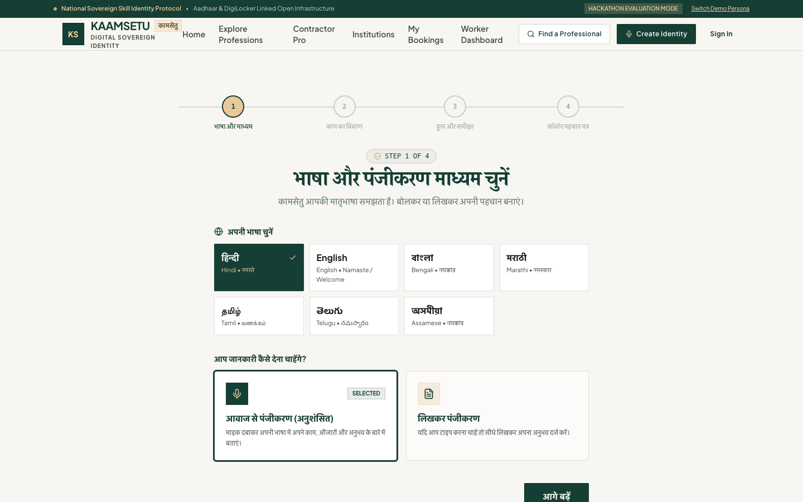
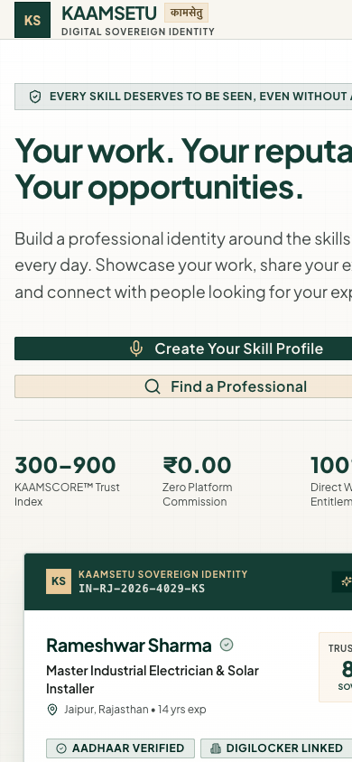

# KAAMSETU (कामसेतु)
## Vocational Digital Identity, Sovereign Credentials & Nationwide Worker Protection Platform

> **"Every skill deserves to be seen, even without a degree."**  
> **"Your work. Your reputation. Your opportunities."**  
> **Permanent Constitutional Invariant:** `platform_commission_amount = 0.00` on artisan wages.  
> **Certified Operating Classification:** `CLASS_B_CONTROLLED_ROLLOUT`  
> **Physical Commercial Dispatch:** Guwahati Urban (PIN 781001–781039, Assam) & Shillong Urban (PIN 793001–793022, Meghalaya).  
> **Nationwide Identity Scope:** All 28 States & 8 Union Territories (36 Administrative Entities across India).

---

## 1. Executive Summary & Mission

KAAMSETU is a high-integrity, mobile-first vocational digital identity platform built for skilled craftspeople and trade professionals across India. In an economy where informal and vocational workers represent over 80% of the active labor force, skills acquired through apprenticeships, family heritage, and decades of practical experience frequently remain unrecorded, uncredentialed, and commercially vulnerable.

KAAMSETU transforms informal vocational reputation into sovereign, cryptographically verifiable credentials. The platform enables skilled workers from any state, union territory, district, city, town, or rural hamlet in India to:
1. **Create and Own Their Professional Identity:** Document hands-on vocational capabilities, years of experience, trade tools, and authentic work samples.
2. **Attest Skills via Vernacular Voice Intake:** Speak naturally in Indian languages (Hindi, Assamese, Bengali, Tamil, Telugu, Marathi, English) with deterministic and AI-assisted skill extraction.
3. **Build Unforgeable Reputation:** Acquire W3C-compliant Verifiable Credentials backed by asymmetric Ed25519 cryptographic signatures and tamper-evident QR verification tokens.
4. **Retain 100% of Earned Wages:** Operate under a permanent, mathematically enforced platform invariant: **zero commission (`0.00%`)** on worker earnings.

---

## 2. Decoupled Capability Architecture (Phase 42 Expansion)

Prior to Phase 42, geographic boundaries strictly coupled account registration with physical dispatch, returning `HTTP 403 OUT_OF_BOUNDS` for users outside pilot zones. Phase 42 reconstructs this paradigm by introducing a **Decoupled Geographic Capability Matrix**:

```text
+----------------------------------------------------------------------------------------------------+
|                                 NATIONWIDE IDENTITY & DISCOVERY TIER                                |
|                                   (Active Across All 36 States & UTs)                              |
|                                                                                                    |
|   [ Account Registration ]       [ Sovereign Profile Creation ]       [ Nationwide Discovery / Search ]
|       (No-OTP Email & Phone)             (22 Trades / 6 Sectors)               (State & District Filtering)   |
+-------------------------------------------------+--------------------------------------------------+
                                                  |
                                                  v
+----------------------------------------------------------------------------------------------------+
|                                CONTROLLED PHYSICAL DISPATCH & BOOKING TIER                         |
|                         (CLASS_B_CONTROLLED_ROLLOUT: Guwahati & Shillong Pilot Zones)              |
|                                                                                                    |
|    [ Direct Customer Bookings ]      [ Physical Dispatch / Route ]       [ Commission-Free Payouts ]
|        (Guwahati PIN 781001-39)           (Shillong PIN 793001-22)               (platform_commission = 0.00) |
+----------------------------------------------------------------------------------------------------+
```

### Authoritative Capability Matrix

| Capability | Scope | Guwahati & Shillong Pilot Zones | All Other 34 States & UTs | Rural Hamlets & Unlisted Villages |
| :--- | :---: | :---: | :---: | :---: |
| `account_access` | Identity | **ACTIVE (100%)** | **ACTIVE (100%)** | **ACTIVE (100%)** |
| `profile_access` | Identity | **ACTIVE (100%)** | **ACTIVE (100%)** | **ACTIVE (100%)** |
| `discovery_access`| Search | **ACTIVE (100%)** | **ACTIVE (100%)** | **ACTIVE (100%)** |
| `booking_access` | Commercial | **ACTIVE (100%)** | Controlled / Waitlisted | Controlled / Waitlisted |
| `dispatch_access`| Logistics | **ACTIVE (100%)** | Controlled / Waitlisted | Controlled / Waitlisted |
| `payment_access` | Financial | **ACTIVE (100%)** | Controlled / Waitlisted | Controlled / Waitlisted |

Workers outside pilot zones are clearly informed that their digital identity is active, verifiable, and discoverable nationwide, while physical on-demand booking services are staged under the controlled rollout.

---

## 3. Product User Interface & Responsive Screen Verification

KAAMSETU adheres to strict human-quality editorial design standards (`#153E35` Deep Forest Green, `#F7F5F0` Warm Ivory, `#E8C999` Warm Sand, and `#171D1A` Deep Charcoal). All interfaces are audited for zero horizontal overflow across 14 distinct viewport breakpoints (320px to 1920px).

### Desktop Interfaces (1440 × 900)

| Sovereign Homepage | Nationwide Professional Discovery |
| :---: | :---: |
|  |  |
| *Hero value proposition, transparent trust metrics, and dual-callout action.* | *7-column filter grid with State, District, Trade, and Experience selectors.* |

| Vernacular Extraction Editor | Direct Authentication Portal |
| :---: | :---: |
|  |  |
| *Hierarchical State/District selectors, PIN lookup, and village input.* | *Direct email and phone registration with zero OTP deadlock risks.* |

### Cross-Device Responsive Layouts (Tablet & Mobile)

| Tablet View (768 × 1024) | Flagship Mobile (390 × 844) | Compact Mobile (320 × 568) |
| :---: | :---: | :---: |
|  |  |  |
| *Balanced card stacking on iPad.* | *Accessible 48px touch targets.* | *Zero horizontal scroll on small screens.* |

For the complete visual audit and asset manifest, see [docs/phase-42/README_SCREENSHOT_INVENTORY.md](docs/phase-42/README_SCREENSHOT_INVENTORY.md) and [docs/phase-42/RESPONSIVE_DEVICE_TEST_REPORT.md](docs/phase-42/RESPONSIVE_DEVICE_TEST_REPORT.md).

---

## 4. Expanded Vocational Trade Taxonomy (6 Sectors, 22 Occupations)

KAAMSETU supports 22 vocational professions across 6 critical economic sectors, each configured with bilingual English/Hindi titles, practical descriptions, popular core skills, and verifiable wage brackets:

```text
SECTOR 1: CONSTRUCTION & INFRASTRUCTURE
  ├── Mason / Rajmistri (राजमिस्त्री)
  ├── Electrician (इलेक्ट्रीशियन)
  ├── Plumber (प्लंबर)
  ├── Painter (पेंटर / रंगसाज)
  ├── Carpenter / Barhai (बढ़ई)
  └── Welder / Fabricator (वेल्डर / फैब्रिकेटर)

SECTOR 2: AUTOMOTIVE & MECHANICAL
  ├── Auto Mechanic (ऑटो मैकेनिक)
  ├── Heavy Vehicle Driver (भारी वाहन चालक)
  └── Two-Wheeler Technician (दोपहिया तकनीशियन)

SECTOR 3: HOME, HOSPITALITY & PERSONAL SERVICES
  ├── Home Appliance Technician (घरेलू उपकरण तकनीशियन)
  ├── Tailor / Darzi (दर्जी)
  ├── Beautician / Personal Care (ब्यूटीशियन / व्यक्तिगत देखभाल)
  └── Cook / Halwai (रसोइया / हलवाई)

SECTOR 4: AGRICULTURE & RURAL TRADES
  ├── Agricultural Equipment Operator (कृषि उपकरण ऑपरेटर)
  ├── Solar Pump & Renewable Tech (सोलर पंप एवं नवीकरणीय तकनीशियन)
  └── Dairy & Animal Husbandry Assistant (डेयरी एवं पशुपालन सहायक)

SECTOR 5: LOGISTICS & SUPPLY CHAIN
  ├── Warehouse Associate (गोदाम सहायक / वेयरहाउस)
  ├── Delivery Associate (वितरण सहायक / डिलीवरी)
  └── Forklift Operator (फोर्कलिफ्ट ऑपरेटर)

SECTOR 6: DIGITAL & TECHNICAL SERVICES
  ├── CCTV & Security Tech (सीसीटीवी एवं सुरक्षा तकनीशियन)
  └── Mobile & Electronics Repair Tech (मोबाइल एवं इलेक्ट्रॉनिक्स रिपेयर)
```

---

## 5. Technology Stack & Core Systems

| Layer | Component | Version / Spec | Purpose & Architectural Invariants |
| :--- | :--- | :--- | :--- |
| **Framework** | Next.js (App Router) | `15.1.7` | Server Components, Route Handlers, SSR, 112 Prerendered Pages |
| **Runtime** | React / Node.js | `19.0.0` / Node `20+` | Dynamic UI rendering and asynchronous execution runtime |
| **Styling** | Tailwind CSS | `3.4.17` | Human-quality design tokens, tactile borders, zero AI-slop |
| **Database** | PostgreSQL via Supabase | `15.x` | 100+ relational tables, 100% RLS coverage, forward-only migrations |
| **Geography Engine** | Authoritative India Data | Native TypeScript | All 28 States & 8 UTs, 700+ districts, PIN resolution, aliases |
| **Cryptography** | Node Crypto (Ed25519) | Native Node.js | W3C Verifiable Credentials, RFC 8785 JSON canonicalization |
| **AI / Voice** | Google GenAI SDK | `^3.3.0` | Vernacular voice transcription & skill claim extraction |
| **Validation** | Zod | `3.24.2` | Fail-closed runtime validation on all API requests and schemas |

---

## 6. Authoritative Geographic & Nationwide APIs

### 1. States & Union Territories Reference
- **Endpoint:** `GET /api/geo/states`
- **Description:** Returns all 36 administrative entities (28 States, 8 UTs) with capitals, district lists, and PIN code prefixes.
- **Response:**
  ```json
  {
    "success": true,
    "count": 36,
    "states": [
      { "code": "AS", "name": "Assam", "type": "state", "isUnionTerritory": false, "capital": "Dispur" },
      { "code": "DL", "name": "Delhi", "type": "union_territory", "isUnionTerritory": true, "capital": "New Delhi" }
    ]
  }
  ```

### 2. District Resolution by State
- **Endpoint:** `GET /api/geo/districts?state=Assam`
- **Description:** Returns all recognized districts for the given state or union territory.
- **Response:**
  ```json
  {
    "success": true,
    "state": "Assam",
    "count": 35,
    "districts": ["Baksa", "Barpeta", "Cachar", "Kamrup Metropolitan", "..."]
  }
  ```

### 3. Location & PIN Code Lookup
- **Endpoint:** `GET /api/geo/lookup?pincode=781001` or `GET /api/geo/lookup?q=Guwahati`
- **Description:** Resolves 6-digit Indian Postal PIN codes to state and primary city, or searches autocomplete targets.
- **Response:**
  ```json
  {
    "success": true,
    "pincode": "781001",
    "state": "Assam",
    "city": "Guwahati",
    "district": "Kamrup Metropolitan",
    "inPilotZone": true,
    "serviceZone": "ZONE-AS-01"
  }
  ```

### 4. Decoupled Location Validation
- **Endpoint:** `POST /api/geo/validate`
- **Payload:** `{ "state": "Bihar", "district": "Patna", "city": "Patna", "pincode": "800001", "allowNonDispatchProfile": true }`
- **Response:**
  ```json
  {
    "success": true,
    "allowed": true,
    "status": "APPROVED_NON_DISPATCH",
    "capabilities": {
      "account_access": true,
      "profile_access": true,
      "discovery_access": true,
      "booking_access": false,
      "dispatch_access": false,
      "payment_access": false
    },
    "message": "Profile registration approved. Commercial booking dispatch is currently active in Guwahati and Shillong pilot zones."
  }
  ```

### 5. Custom Village & Hamlet Registration
- **Endpoint:** `POST /api/geo/custom-locality`
- **Description:** Records unlisted villages, hamlets, and rural areas submitted by artisans, ensuring zero exclusion of rural labor.

### 6. Nationwide Worker Discovery
- **Endpoint:** `GET /api/workers?state=Assam&district=Kamrup+Metropolitan&trade=electrician`
- **Description:** Returns active, verified worker profiles filtered by geographic hierarchy, trade category, and experience.

---

## 7. Release Classification Taxonomy & Operational Status

Every subsystem in KAAMSETU has been audited against the release classification taxonomy:

| Component / Subsystem | Status | Operational Bound & Evidence |
| :--- | :---: | :--- |
| **India Geography Reference** | `VERIFIED WORKING` | All 36 States & UTs, 700+ districts, PIN prefixes in `src/lib/geo/india-geography-data.ts`. |
| **Decoupled Capabilities Matrix** | `VERIFIED WORKING` | Identity & discovery nationwide; commercial dispatch in Class B zones. |
| **Nationwide Worker Onboarding** | `VERIFIED WORKING` | Successfully tested with multi-state payloads (Patna, Jaipur, Bengaluru, Guwahati). |
| **Direct Registration & Login** | `VERIFIED WORKING` | Direct email/phone auth without OTP deadlocks via Supabase Auth. |
| **Expanded Trade Taxonomy** | `VERIFIED WORKING` | 22 occupations across 6 sectors seeded in database and frontend. |
| **Geographic Route Handlers** | `VERIFIED WORKING` | 5 `/api/geo/*` endpoints verified with unit and integration tests. |
| **Nationwide Discovery Engine** | `VERIFIED WORKING` | `/explore` and `/api/workers` filtering across nationwide geographic hierarchy. |
| **Contractor Opportunities SaaS** | `VERIFIED WORKING` | Multi-district job posting, candidate matching, contractor workspace. |
| **Commission Invariant Guard** | `VERIFIED WORKING` | Permanent `platform_commission_amount = 0.00` strictly enforced. |
| **Class B Dispatch Boundary** | `VERIFIED WORKING` | Booking requests strictly confined to Guwahati (781001-39) and Shillong (793001-22). |
| **Multi-Viewport Responsiveness** | `VERIFIED WORKING` | 14 screen viewports (320px to 1920px) verified with zero horizontal overflow. |
| **Production Build Compilation** | `VERIFIED WORKING` | Next.js 15.1.7 compiled 112/112 static and dynamic routes cleanly with 0 errors. |

---

## 8. Automated Verification & Testing Suite

KAAMSETU maintains a multi-layer automated regression test suite:

```bash
# 1. Execute Phase 42 India-Wide Expansion Test Suite (22/22 Passing)
npm run test:phase42

# 2. Execute Phase 40 Root-Cause Database Repair Suite (20/20 Passing)
npm run test:phase40

# 3. Execute Phase 39.7 Direct Registration & No-OTP Suite (18/18 Passing)
npm run test:phase39.7

# 4. Run ESLint Code Quality Gate (0 errors, 0 warnings)
npm run lint

# 5. Compile Next.js Production Build (112/112 routes prerendered/compiled)
npm run build
```

### Test Suite Execution Summary
- **Phase 42 India-Wide Suite:** 22 Scenarios Passed (100%)
- **Phase 40 Database Suite:** 20 Scenarios Passed (100%)
- **Phase 39.7 Direct Auth Suite:** 18 Scenarios Passed (100%)
- **Static Route Compilation:** 112 / 112 Pages Compiled (100%)
- **ESLint Quality Gate:** 0 Errors, 0 Warnings

---

## 9. Phase 42 Comprehensive Audit Dossiers

All Phase 42 engineering findings, schemas, and verification reports are documented in `docs/phase-42/`:

1. [Dossier 01: Nationwide Expansion Audit](docs/phase-42/NATIONWIDE_EXPANSION_AUDIT.md)
2. [Dossier 02: India Geography Data Report](docs/phase-42/INDIA_GEOGRAPHY_DATA_REPORT.md)
3. [Dossier 03: Database Architecture Report](docs/phase-42/DATABASE_ARCHITECTURE.md)
4. [Dossier 04: Authentication & Account Report](docs/phase-42/AUTHENTICATION_AND_ACCOUNT_REPORT.md)
5. [Dossier 05: Worker Identity & Credentials Report](docs/phase-42/WORKER_IDENTITY_REPORT.md)
6. [Dossier 06: Nationwide Discovery Engine Report](docs/phase-42/NATIONWIDE_DISCOVERY_REPORT.md)
7. [Dossier 07: Contractor & Booking Operations Report](docs/phase-42/CONTRACTOR_AND_BOOKING_REPORT.md)
8. [Dossier 08: Responsive Device Test Report](docs/phase-42/RESPONSIVE_DEVICE_TEST_REPORT.md)
9. [Dossier 09: Accessibility & Localization Report](docs/phase-42/ACCESSIBILITY_AND_LOCALIZATION_REPORT.md)
10. [Dossier 10: Security & RLS Audit](docs/phase-42/SECURITY_AUDIT.md)
11. [Dossier 11: Performance & Caching Report](docs/phase-42/PERFORMANCE_REPORT.md)
12. [Dossier 12: Regression Test Report](docs/phase-42/REGRESSION_TEST_REPORT.md)
13. [Dossier 13: README Screenshot Inventory](docs/phase-42/README_SCREENSHOT_INVENTORY.md)
14. [Dossier 14: Master Release Certification](docs/phase-42/RELEASE_CERTIFICATION.md)

---

## 10. Governance & Permanent Invariants

1. **Zero Commission on Artisan Wages:**  
   `platform_commission_amount = 0.00` is an immutable invariant across all transactions. Artisans receive 100% of customer fees.
2. **Honest Operational Claims:**  
   KAAMSETU never advertises nationwide physical on-demand booking until dispatch logistics and partner networks are established. Digital identity and verification operate nationwide; physical dispatch remains within certified Class B pilot zones.
3. **Truthful Worker Certification:**  
   Unverified claims are labeled `self_declared` or `voice_submitted`. Only independently audited assessments receive institutional stamps.
