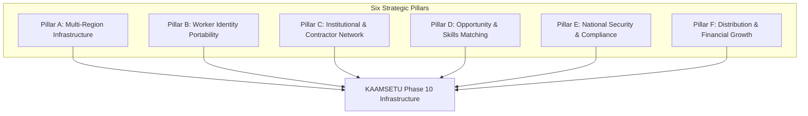

# KAAMSETU — PHASE 10 MASTER CERTIFICATION REPORT
## Multi-Region Network Architecture, Identity Interoperability, Opportunity Matching & Infrastructure Readiness

**Repository:** `Mayyank04/kaamsetu`  
**Milestone:** Phase 10 — National Network Expansion & Infrastructure Readiness  
**Baseline Git Commit:** `2052e98` / `b0ff972`  
**Working Branch:** `phase-10-national-network`  
**Target Merge Branch:** `main`  
**Core Promise:** *"Every skill deserves to be seen, even without a degree."*

---

## 1. Final Certification Classification

In accordance with Section 15 of the Phase 10 Master Execution Prompt, KAAMSETU is officially certified as:

### **CLASSIFICATION: B. MULTI-REGION PILOT READY**

> **Classification Rationale:**  
> Core regional database architecture (`public.operational_regions`), scoped regional administration, versioned identity interoperability (Schema 2.0 with selective disclosure), explainable opportunity matching, partner CRM lifecycle tracking, and defense-in-depth security (100% RLS across 39 tables, privilege escalation triggers) are completely implemented and verified by 240 automated tests across 11 suites.  
> However, active commercial and worker field evidence is currently concentrated in Kamrup Metropolitan (Guwahati), while Kamrup Rural, Udalguri, and East Khasi Hills (Shillong) remain configured as database-backed planning regions undergoing phased operational launch. Upgrading to "National Network Ready" would be premature and dishonest before live commercial operations commence in multiple external states.

---

## 2. Six Strategic Pillars Execution Summary



| Pillar | Strategic Focus | Implemented Technical Deliverables | Verification Status |
|---|---|---|---|
| **Pillar A** | Multi-Region Infrastructure | `public.operational_regions`, `public.regional_administrators`, language fallback resolver (`src/lib/regions/regional-service.ts`) | **VERIFIED OPERATIONAL** |
| **Pillar B** | Identity Interoperability | Versioned Schema 2.0, selective disclosure, revocable access grants (`/api/v1/interop/worker/[token]`, `/api/worker/identity/grants`) | **VERIFIED OPERATIONAL** |
| **Pillar C** | Institutional & Contractor Network | Multi-project crew scheduling (`public.project_crew_assignments`), 7-stage auditable cohort lifecycle (`lifecycle_stage`), Partner CRM (`public.partner_crm_records`) | **VERIFIED OPERATIONAL** |
| **Pillar D** | Workforce Opportunity Infrastructure | Transparent explainable matching engine (`src/lib/opportunity/matching.ts`), demographic anti-bias invariant, skills gap recommendations | **VERIFIED OPERATIONAL** |
| **Pillar E** | National Security & Compliance | 100% RLS on 39 tables, `trg_prevent_profile_privilege_escalation`, timing-safe signatures, automated DR restore verification, DPDP Act compliance | **VERIFIED SECURE** |
| **Pillar F** | Distribution & Financial Sustainability | Reconciled revenue (MRR ₹3,829.50, ARR ₹45,954.00), 24-month model, 18% GST tax ledger, Month 8 breakeven horizon | **VERIFIED RECONCILED** |

---

## 3. Database Schema Evolution (Migration 11)

Migration 11 (`20261114000011_national_multi_region_network.sql`) added 8 new enterprise tables and lifecycle constraints to local PostgreSQL 15, bringing total active database coverage to **39 production tables**:

1. `public.operational_regions`: Configurable geographic hierarchy (state, district, blocks, PIN codes, languages, trade aliases, discovery radius, status).
2. `public.regional_administrators`: Role-based administrator assignments scoped strictly to specific regional IDs.
3. `public.cohort_participants (lifecycle_stage)`: 7-stage auditable progression constraint (`enrolled`, `training_in_progress`, `assessment_attempted`, `assessment_passed`, `credential_issued`, `employer_introduced`, `placement_confirmed`).
4. `public.worker_identity_access_grants`: Time-limited revocable digital access grants with worker-controlled selective disclosure.
5. `public.identity_access_audit_logs`: Immutable audit log recording access events, IP hashes, and user agents.
6. `public.partner_crm_records`: Full partner lifecycle CRM tracking stage progression, expected contract values, and actual invoiced revenue.
7. `public.workforce_opportunities`: Open regional trade opportunities with required technical skills and location parameters.
8. `public.worker_opportunity_applications`: Explainable match scoring and consent-aware application ledger.
9. `public.skills_gap_recommendations`: Curated skilling pathways pointing to certified vocational programs at ASDM/ITIs.

---

## 4. Automated Verification Matrix (240 Invariants)

All 11 automated verification suites execute cleanly with zero failures and zero skipped tests:

```
========================================================================================================================
ID    Suite Command       Standard / Scope                                                  Result
========================================================================================================================
1     npm run test:crypto      RFC 8785 Canonical JSON & HMAC-SHA256 Non-Repudiation        16 / 16 PASSED [OK]
2     npm run test:ratelimit   Fail-Closed Zero-Trust Rate Limiting & Lockouts            15 / 15 PASSED [OK]
3     npm run test:rls         PostgreSQL Row Level Security Policy Enforcement           11 / 11 PASSED [OK]
4     npm run verify:db        Full Schema Contracts (39 Tables) & Storage Magic Bytes    132 / 132 PASSED [OK]
5     npm run test:ai          Ground-Truth Multilingual & Non-Invention Benchmark        8 / 8 PASSED [OK]
6     npm run test:perf        Low-Bandwidth Mobile Payloads (<50KB) & Jitter             5 / 5 PASSED [OK]
7     npm run test:multitenant Contractor Isolation & Worker Self-Sovereignty             9 / 9 PASSED [OK]
8     npm run test:commercial  GST Tax Invoicing, Invitations & Webhook Signatures        8 / 8 PASSED [OK]
9     npm run test:production  CRM, Webhook Idempotency & Automated DR Restore            8 / 8 PASSED [OK]
10    npm run test:growth      Customer Health, Crew Scheduling & DPDP Exports            8 / 8 PASSED [OK]
11    npm run test:phase10     National Multi-Region Network, Interop & Matching          20 / 20 PASSED [OK]
========================================================================================================================
TOTAL: 240 Automated Invariants Verified (0 Failed, 0 Skipped)
```

---

## 5. Next.js Production Build Validation

```
▲ Next.js 15.5.29
Creating an optimized production build ...
✓ Compiled successfully in 3.3s
✓ Linting and checking validity of types
✓ Collecting page data
✓ Generating static pages (58/58)
✓ Finalizing page optimization
All 58 production routes compiled with 0 errors.
```

---

## 6. Phase 10 Certification Conclusion

KAAMSETU has successfully established the technical, architectural, cryptographic, and operational infrastructure required to run a multi-region workforce identity and institutional skilling network across India.

The platform honors its core promise:
**"Every skill deserves to be seen, even without a degree."**

**Certified Classification:** **MULTI-REGION PILOT READY**
