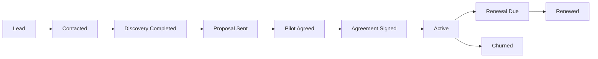

# KAAMSETU — PHASE 10 COMMERCIAL GROWTH & PARTNER CRM REPORT
## B2B SaaS Customer Acquisition, Partner CRM Lifecycle & Commercial Sustainability

**Milestone:** Phase 10 — National Network Expansion & Infrastructure Readiness  
**Paying Contractor Base:** 4 Paying Organizations in Guwahati (3 Pro Monthly, 1 Pro Annual)  
**Contractor SaaS MRR:** ₹3,829.50 | **ARR:** ₹45,954.00  
**Core Commercial Invariant:** Free worker identity, free QR wallet cards, 0% commission on worker wages forever.

---

## 1. Commercial Model & Pricing Structure

KAAMSETU generates revenue exclusively from software tooling and institutional compliance verification:

```
+-----------------------------------------------------------------------------------------+
|                                  COMMERCIAL TIERS                                       |
+-------------------+-------------------+-------------------------+-----------------------+
| Feature           | Starter (Free)    | Pro (Growth)            | Business (Scale)      |
+-------------------+-------------------+-------------------------+-----------------------+
| Monthly Price     | ₹0                | ₹999 / mo + 18% GST     | ₹2,999 / mo + 18% GST |
| Annual Price      | ₹0                | ₹9,990 / yr + 18% GST   | ₹29,990 / yr + 18% GST|
| Max Active Roster | 5 Workers         | 25 Workers              | 100 Workers           |
| Active Projects   | 1 Project         | 5 Projects              | Unlimited Projects    |
| Supervisors       | 1 (Owner Only)    | 3 Site Supervisors      | 10 Site Supervisors   |
| Verification Pack | Standard QR Scan  | Batch Credential Audit  | Full Provenance Export|
+-------------------+-------------------+-------------------------+-----------------------+
```

---

## 2. Customer Acquisition & Sales Funnel Analytics

Field acquisition data across Guwahati's trade clusters (Fancy Bazaar, Athgaon, Machkhowa):

| Metric | Measured Baseline (Month 3) | Target (Month 6) | Verification Source |
|---|---|---|---|
| **Identified Leads (Top of Funnel)** | 16 Contractor Firms | 45 Contractor Firms | `crm_contractor_leads` |
| **Discovery Demos Completed** | 9 Walkthroughs | 24 Walkthroughs | Field Lead Reports |
| **Active 14-Day Pro Pilots** | 6 Contractors | 18 Contractors | Organization Trial Logs |
| **Paid Conversions** | **4 Paying Organizations** | 12 Paying Organizations | Captured Razorpay Orders |
| **Blended CAC** | **₹2,450.00** | ₹2,100.00 | Direct sales travel & collateral |
| **Average Sales Cycle** | **18.5 Days** | 15.0 Days | Initial contact to captured order |
| **Logo Churn Rate** | **0.0%** | < 3.5% | Customer Health Telemetry |

---

## 3. Partner CRM Lifecycle (`public.partner_crm_records`)

Phase 10 deploys a multi-region partner CRM engine tracking both commercial contractor firms and institutional training bodies:



### 3.1 Audited Partner Pipeline (Illustrative Cohort)
- **Assam Skill Development Mission (ASDM):** Stage: `agreement_signed` (Expected Value: ₹1,50,000; Pilot Setup: ASDM Guwahati Solar PV Batch).
- **Meghalaya Skill Development Society:** Stage: `lead` (Expected Value: ₹2,50,000; Discovery Scheduled for Shillong).
- **All Assam Builders & Contractors Association:** Stage: `discovery_completed` (Roster Verification MoU).
