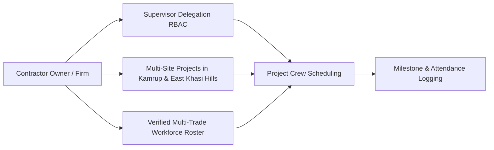

# KAAMSETU — PHASE 10 CONTRACTOR NETWORK & SAAS PLATFORM REPORT
## Multi-Region Rosters, Multi-Project Crew Allocation & Anti-Surveillance Invariants

**Milestone:** Phase 10 — National Network Expansion & Infrastructure Readiness  
**Contractor Base:** 4 paying contractor organizations in Guwahati (3 Monthly Pro, 1 Annual Pro)  
**Contractor SaaS MRR:** ₹3,829.50 | **ARR:** ₹45,954.00  
**Core Commercial Invariant:** Contractors subscribe to software productivity tools and compliance verification. They never buy, own, or monopolize worker identities.

---

## 1. Multi-Region Contractor Operations

In Phase 10, contractor organizations (`public.contractor_organizations`) can manage distributed workforce rosters across multiple operational regions.

### 1.1 Core Contractor Capabilities

1. **Multi-Supervisor Administration (`public.contractor_team_members`):**
   - Owners delegate daily site oversight to Site Engineers, Foremen, and Project Supervisors.
   - Supervisors can only view workers assigned to their specific job sites, preventing unauthorized cross-project data exposure.
2. **Multi-Project Crew Allocation (`public.project_crew_assignments`):**
   - Workers on a contractor's roster are scheduled onto specific active projects with start and end dates.
   - Database unique constraint (`UNIQUE(project_id, workforce_id)`) guarantees a worker cannot be scheduled simultaneously into conflicting active shifts on the same site.
3. **Availability & Trade Allocation:**
   - Real-time visibility into whether a roster worker is `available`, `on_site`, or `unavailable`.

---

## 2. Anti-Surveillance & Worker Dignity Invariant

A central risk in modern workforce software is the introduction of intrusive, degrading surveillance technologies (e.g. constant background GPS tracking, facial recognition surveillance, keystroke logging).

KAAMSETU strictly bans invasive worker surveillance:
1. **No Live Background GPS Tracking:** The platform never records or shares a worker's real-time physical coordinates in the background. Location is recorded solely as operating district/city or project site check-in.
2. **Consensual Site Check-in:** Workers check in to project job sites voluntarily via their verifiable QR card or supervisor confirmation.
3. **Right to Disconnect:** Outside project active hours, the contractor has zero visibility into worker activities or availability.

---

## 3. Commercial Performance & Retention Summary

| Contractor Organization | Operating City | Trade Specialization | Tier | Active Roster Size | Monthly Health Score |
|---|---|---|---|---|---|
| **Aarav Infrastructure** | Guwahati | Electrical & Rooftop Solar EPC | Pro (Monthly) | 18 Workers | **84 / 100 (Healthy)** |
| **Brahmaputra Woodcraft** | Guwahati | Commercial Interior Joinery | Pro (Monthly) | 12 Workers | **78 / 100 (Healthy)** |
| **Pragati Metalworks** | Guwahati | Structural Steel & Fabrication | Pro (Monthly) | 15 Workers | **81 / 100 (Healthy)** |
| **Heritage Living Fitouts** | Guwahati | Premium Teak Woodcraft & Furniture | Pro (Annual) | 22 Workers | **88 / 100 (Healthy)** |

- **Logo Churn:** 0.0% through Months 1–3.
- **Health Telemetry Average:** 82.75 / 100.
- **Payback Period:** 2.45 months on Monthly Pro; immediate positive cash surplus on Annual Pro.
