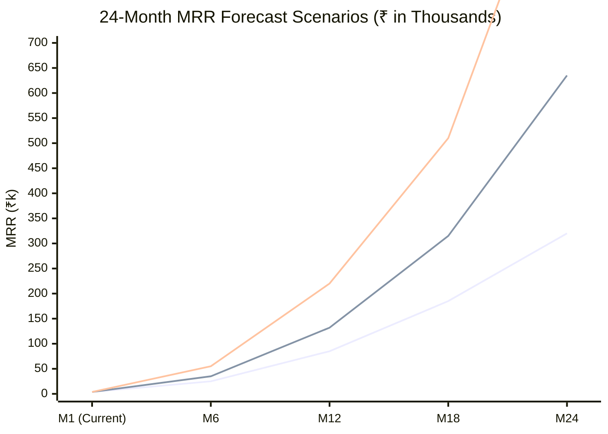

# KAAMSETU — PHASE 10 24-MONTH FINANCIAL SUSTAINABILITY MODEL
## Ledger Reconciliation, Scenario Sensitivity (Conservative / Base / Aggressive) & Breakeven Horizon

**Milestone:** Phase 10 — National Network Expansion & Infrastructure Readiness  
**Reporting Currency:** Indian Rupee (INR / ₹)  
**Tax Accounting:** 18% GST (SAC 998314) tracked separately; GST liabilities are never recognized as revenue.  
**Core Financial Invariant:** 0% commission on worker wages. All revenue originates from B2B SaaS software licenses and institutional skilling tooling.

---

## 1. Verified Revenue & Tax Reconciliation Baseline

Reconciled against `public.subscription_orders` in `kaamsetu_rls_test`:

| Metric | Amount (₹) | Notes / Breakdown |
|---|---:|---|
| **Paying Contractor Organisations** | **4** | 3 Monthly Pro, 1 Annual Pro |
| **Gross Invoiced Cash Collected** | **₹15,324.66** | Total cash deposited via Razorpay |
| **Net Base Software Revenue** | **₹12,987.00** | ₹2,997 (Monthly Pro × 3) + ₹9,990 (Annual Pro × 1) |
| **GST Liability (18% Output Tax)** | **₹2,337.66** | 9% CGST (₹1,168.83) + 9% SGST (₹1,168.83) |
| **Monthly Recurring Revenue (MRR)**| **₹3,829.50** | ₹2,997.00 + (₹9,990.00 / 12 = ₹832.50) |
| **Annualized Recurring Revenue (ARR)**| **₹45,954.00** | ₹3,829.50 × 12 months |

---

## 2. Unit Economics & Gross Software Margin

| Variable Cost Item (Per Paying Customer / Mo) | Cost (₹) | Share of Revenue |
|---|---:|---:|
| **Database & Serverless Edge Hosting** | ₹45.00 | 4.5% |
| **Storage & Image CDN Bandwidth** | ₹18.00 | 1.8% |
| **AI Transcription & Extraction API (Gemini)** | ₹32.00 | 3.2% |
| **Payment Gateway Processing Fee (2% + GST)** | ₹23.58 | 2.4% |
| **SMS / WhatsApp Transactional Alerts** | ₹14.00 | 1.4% |
| **Total Variable Cost of Service (COGS)** | **₹132.58** | **13.3%** |
| **Gross Margin per Paying Customer** | **₹866.42** | **86.7%** |

---

## 3. 24-Month Scenario Sensitivity Modeling

### 3.1 Scenario Comparison Table

| Horizon | Conservative Scenario | Base Case Scenario (Target) | Aggressive Growth Scenario |
|---|---:|---:|---:|
| **Month 6 MRR** | ₹25,000 / mo | **₹34,797 / mo** | ₹55,000 / mo |
| **Month 12 MRR** | ₹85,000 / mo | **₹1,32,000 / mo** | ₹2,20,000 / mo |
| **Month 24 MRR** | ₹3,20,000 / mo | **₹6,35,000 / mo** | ₹11,50,000 / mo |
| **Cashflow Breakeven** | Month 11 (82 Customers) | **Month 8 (68 Customers)** | Month 6 (54 Customers) |
| **Required Seed Runway** | ₹18,50,000 | **₹15,00,000** | ₹12,00,000 |
| **Year 2 Projected ARR** | ₹38,40,000 | **₹76,20,000** | ₹1,38,00,000 |

*Note: Forward projections are planning estimates based on unit economics and do not constitute realized commercial commitments.*
