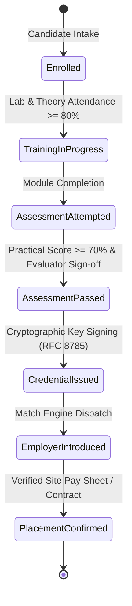

# KAAMSETU — PHASE 10 INSTITUTIONAL INFRASTRUCTURE REPORT
## Auditable Skilling Lifecycles, Verified Assessments & State Mission Partnerships

**Milestone:** Phase 10 — National Network Expansion & Infrastructure Readiness  
**Target Institutions:** Industrial Training Institutes (ITIs), Assam Skill Development Mission (ASDM), Vocational NGOs  
**Primary Pilot Partner:** Assam Skill Development Mission (ASDM Guwahati)  
**Core Invariant:** No qualification or credential can be issued without verified assessment. Enrolment is not completion; module attendance is not a verified qualification.

---

## 1. The Institutional Integrity Problem

Traditional vocational training reporting in India suffers from severe structural inflation:
1. **Enrolment Counted as Outcome:** Funding and subsidies are often disbursed based on initial student intake rather than verified skill delivery.
2. **Fake or Ghost Placements:** Trainees are recorded as "placed" without employer verification or wage records.
3. **Unverified Practical Competency:** Paper certificates rarely reflect whether a trainee can actually wire an inverter, weld an MS joint, or plumb a pressurized pipe on a live site.

KAAMSETU establishes an **auditable seven-stage progression ledger** where each state transition requires empirical evidence.

---

## 2. Seven Auditable Lifecycle Stages

Implemented in `public.cohort_participants` (Migration 11) with database check constraints:

### 2.1 State Definitions & Transition Criteria

1. **`enrolled`:** Trainee admitted to the batch; identity record created. Cannot be counted in placement or completion metrics.
2. **`training_in_progress`:** Active attendance logged in vocational practical workshops.
3. **`assessment_attempted`:** Trainee completes practical evaluation exam.
4. **`assessment_passed`:** Evaluator records score (≥ 70%) and signs off on hands-on demonstration.
5. **`credential_issued`:** Tamper-evident cryptographic credential generated with HMAC-SHA256 non-repudiation.
6. **`employer_introduced`:** Profile shared with vetted contractor organizations with explicit worker consent.
7. **`placement_confirmed`:** Verified employment, apprenticeship, or formal contracting engagement verified by employer or wage sheet.

### Verification Evidence:
Tested in `test/national-network-and-infrastructure.test.ts` (Test 9 & Test 10): Attempting to issue a credential while in `training_in_progress` fails gatekeeping. Attempting to bypass stages with an invalid state violates database constraints.

---

## 3. Privacy-Preserving Institutional Export

In compliance with the DPDP Act, 2023:
- When an institution exports cohort reports (`/api/institution/cohorts/[id]/export`), trainees who have not given explicit consent (`consent_for_institution = false`) have their names masked as `"Private Participant"` and their contact numbers scrubbed.
- Aggregate metrics report certified completion ratios without compromising individual worker privacy.
