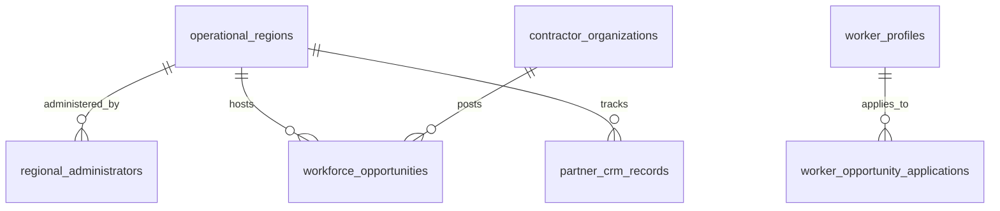

# KAAMSETU — PHASE 10 MULTI-REGION ARCHITECTURE
## Configurable Database-Backed Regional Hierarchy, Localisation & Discovery Radius

**Milestone:** Phase 10 — National Network Expansion & Infrastructure Readiness  
**Core Invariant:** Geographic neutrality. No hardcoded default state, city, wage, or PIN code. All regional configurations are database-backed and permission-scoped.  
**Operational Regions Configured:**
1. Kamrup Metropolitan, Assam (`IN-AS-KMP-METRO`) — Status: `active`
2. Kamrup Rural, Assam (`IN-AS-KMP-RURAL`) — Status: `planning`
3. Udalguri, Assam (`IN-AS-UDL`) — Status: `planning`
4. East Khasi Hills, Meghalaya (`IN-ML-EKH`) — Status: `planning`

---

## 1. Regional Architecture & Data Model

Prior to Phase 10, geographic parameters were often assumed or defaulted to "Guwahati, Assam". Phase 10 establishes a database-backed regional data model via `public.operational_regions` (Migration 11).



### 1.1 Schema Definition (`public.operational_regions`)

- **`region_code` (TEXT UNIQUE):** ISO-style standard identifier (e.g. `IN-AS-KMP-METRO`, `IN-ML-EKH`).
- **`state` (TEXT):** Primary Indian state / UT.
- **`district` (TEXT):** Primary administrative district.
- **`subdistrict_blocks` (TEXT[]):** Array of administrative blocks/taluks (e.g. `['Dispur', 'Guwahati', 'Chandrapur', 'Dimoria']`).
- **`primary_city` (TEXT):** Primary urban or commercial trading hub.
- **`pin_codes` (TEXT[]):** Array of postal PIN codes belonging to the region.
- **`supported_languages` (TEXT[]):** Array of ISO language codes actively supported (e.g. `['as', 'en', 'bn', 'hi']`).
- **`trade_aliases` (JSONB):** Local vernacular mappings of trade terminology (e.g. `{"carpenter": ["কাঠমিস্ত্ৰী", "বঢ়ৈ", "woodworker"]}`).
- **`discovery_radius_km` (INTEGER):** Configurable geographic discovery envelope (default: 25 km to 40 km).
- **`status` (TEXT):** Administrative state: `planning`, `active`, `suspended`, `deactivated`.
- **`feature_flags` (JSONB):** Fine-grained regional toggles (`voice_onboarding`, `offline_kiosk_print`, `direct_booking`, `opportunity_matching`).

---

## 2. Regional Administrator Permissions (`public.regional_administrators`)

Cross-region access is governed strictly by Row Level Security (RLS) and database constraints:

| Role | Operational Scope | Permissions |
|---|---|---|
| **`regional_director`** | Entire designated district | Read/write CRM, manage regional feature flags, approve local training cohorts |
| **`field_coordinator`** | Local trade hubs & blocks | Onboard workers, verify trade portfolios, manage kiosk printing stations |
| **`compliance_auditor`** | Regional audit logs | Read-only inspection of verifiable credentials and DPDP export logs |
| **`support_agent`** | Regional support desk | Worker profile corrections, dispute resolution intake |

### Verification Evidence:
Tested in `test/national-network-and-infrastructure.test.ts` (Test 2): A field coordinator assigned to `IN-AS-KMP-METRO` is strictly barred from modifying parameters or accessing administrative data in `IN-ML-EKH`.

---

## 3. Localisation & Dialect Fallback Architecture

Language resolution follows a three-stage deterministic fallback pipeline (`src/lib/regions/regional-service.ts`):

```
1. Requested User Preference (e.g. 'kha' Khasi)
        │
        ▼ (If unsupported or unknown)
2. Regional Operational Default ('kha' for East Khasi Hills, 'as' for Kamrup)
        │
        ▼ (If regional config missing)
3. Platform National Fallback ('en' English)
```

### 3.1 Tested Languages & Dialects
- **Assamese (`as`):** Standard Eastern Nagari orthography + Kamrupi colloquial vocabulary.
- **Khasi (`kha`):** Latin-based orthography used across East Khasi Hills (Shillong, Sohra).
- **Bengali (`bn`):** Widely spoken across trade merchants in Athgaon and Fancy Bazaar.
- **Hindi (`hi`):** Common inter-state lingua franca across construction sites.
- **English (`en`):** Technical terms and official institutional communication.

---

## 4. Regional Rollout Controls

Newly created regions start in `planning` status. A region cannot be switched to `active` until:
1. At least 1 named `regional_director` or `field_coordinator` is assigned.
2. Verified local trade aliases and PIN codes are mapped.
3. At least 1 partner institution or contractor association signs an MoU.
4. Dialect validation tests pass with zero AI hallucinations.
