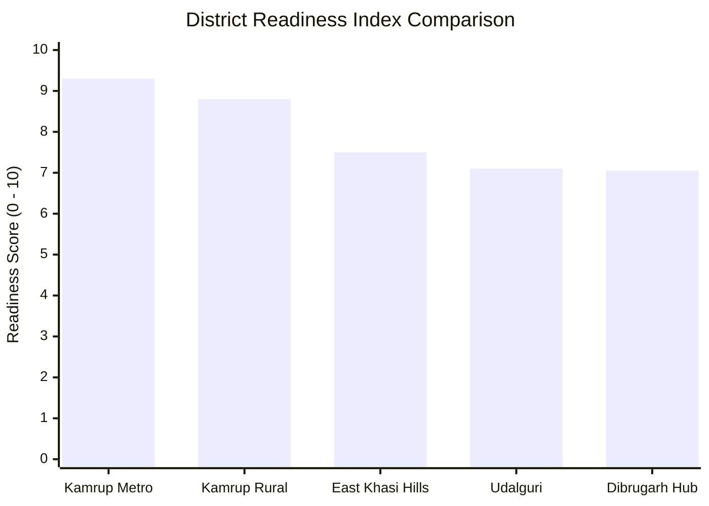

# KAAMSETU — PHASE 10 NATIONAL EXPANSION FRAMEWORK
## Evidence-Led District Assessment, Governance Checklist & Interstate Scaling Horizon

**Milestone:** Phase 10 — National Network Expansion & Infrastructure Readiness  
**Core Expansion Doctrine:** Expansion is evidence-led, not geography-led. A region is never activated solely based on speculative ambition; activation requires verified worker density, contractor demand, and local operational ownership.  
**Planning Regions Evaluated:**
1. Kamrup Metropolitan, Assam (9.3 / 10.0) — Operational Core
2. Kamrup Rural, Assam (8.8 / 10.0) — Approved for Controlled Q1 Rollout
3. East Khasi Hills, Meghalaya (7.5 / 10.0) — Approved for Controlled Q2 Rollout
4. Udalguri, Assam (7.1 / 10.0) — Planning Pipeline for Q3

---

## 1. Multi-Factor District Readiness Index

Evaluated across five weighted empirical dimensions:



### 1.1 Weighting Methodology
1. **Worker Density & Craft Hubs (25%):** Active presence of unorganized labor nakas, hardware depots, and artisan guilds.
2. **Contractor Commercial Demand (25%):** Registered trade contractors, EPC builders, and MSME construction firms.
3. **Institutional Skilling Ecosystem (20%):** Operational ITIs, polytechnics, and state mission training centers.
4. **Digital & Mobile Readiness (15%):** 4G/5G mobile penetration and UPI digital transaction density.
5. **Administrative & Regulatory Climate (15%):** Alignment with state labor boards and ease of doing business.

---

## 2. Mandatory Pre-Activation Checklist

Before any region can transition from `planning` to `active` status in `public.operational_regions`:

- [x] **Named Implementation Owner:** Dedicated Regional Director or Field Coordinator assigned.
- [x] **Local Trade Aliases Mapped:** Verified vernacular trade terms loaded into database dictionaries.
- [x] **Dialect & Language Validation:** Speech transcription tested against local dialects with 0% AI hallucination.
- [x] **Local Institutional Partner:** At least 1 formal partnership or vocational cohort commitment signed.
- [x] **Physical Card Print Partner:** At least 2 local CSC kiosks or stationery print hubs onboarded for wallet cards.
- [x] **Support SLA Established:** Local vernacular WhatsApp/phone support desk operational.

---

## 3. National Scaling Horizon (2026–2028)

```
2026: Northeast Core Corridors
  ├── Q1: Kamrup Rural (Amingaon / Rangia industrial corridor)
  ├── Q2: East Khasi Hills / Shillong (Commercial fitout corridor)
  └── Q3-Q4: Udalguri & Dibrugarh (Upper Assam tea & petroleum craft hubs)
         │
2027: Eastern Migration & Skilling Hubs
  ├── Q1-Q2: Odisha (Bhubaneswar-Cuttack construction & plumbing corridor)
  └── Q3-Q4: Bihar (Patna-Muzaffarpur artisan & carpentry corridor)
         │
2028: Western Heritage & Industrial Megaclusters
  ├── Q1-Q2: Rajasthan (Jaipur heritage joinery & stone carving hub)
  └── Q3-Q4: Gujarat / Madhya Pradesh (Ahmedabad / Bhopal industrial trades)
```
