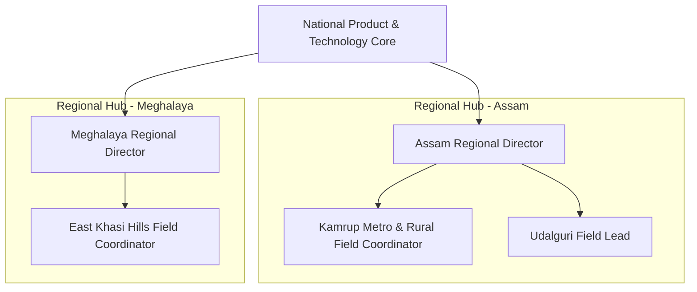

# KAAMSETU — PHASE 10 MULTI-REGION OPERATING PLAYBOOK
## Regional Hub Operations, Support SLAs, DevOps Cadence & Field Governance

**Milestone:** Phase 10 — National Network Expansion & Infrastructure Readiness  
**Operating Topology:** Regional Hubs (Kamrup Metro Core + Regional Field Leads)  
**Support Desk Coverage:** WhatsApp Business, Toll-Free Telephony, In-App Web

---

## 1. Multi-Region Hub Operating Topology

KAAMSETU organizes regional expansion around semi-autonomous regional hubs connected to a centralized cloud core:

### 1.1 Field Coordinator Responsibilities
1. **Morning Labor Naka Outreach (07:00 – 09:30):** Conduct live voice onboarding demonstrations at designated trade gathering points.
2. **Kiosk & CSC Operator Enablement:** Ensure local cyber café operators maintain laminated PVC card print supplies.
3. **Contractor Site Supervisor Training:** Assist contractor site foremen in setting up multi-project crew schedules.
4. **Dispute & Profile Verification Intake:** Facilitate in-person identity corrections for workers without smartphones.

---

## 2. Multi-Tier Support SLAs

| Tier | Priority / Audience | Channel | First Response | Target Resolution | Coverage |
|---|---|---|---|---|---|
| **P1** | Platform Outage / Security Threat | PagerDuty / Direct SMS | < 5 minutes | < 30 minutes | 24 / 7 / 365 |
| **P2** | Payment Webhook / Billing Failure | Engineering Slack / CS | < 15 minutes | < 2 hours | 07:00 – 21:00 IST |
| **P3** | Paid Contractor Operational Issue | WhatsApp Business + Phone | < 15 minutes | < 4 hours | 07:00 – 20:00 IST |
| **P4** | Worker Profile / Dispute Intake | WhatsApp Voice / Kiosk | < 1 hour | < 24 hours | 08:00 – 18:00 IST |
| **P5** | General Inquiries & FAQ | Web / Bot | < 4 hours | < 48 hours | Standard Business Hours |

---

## 3. DevOps & Maintenance Cadences

- **Daily (00:00 UTC):** Recalculate customer health scores (`contractor_customer_health`) and run webhook idempotency cleanups.
- **Weekly (Sundays 02:00 IST):** Execute automated non-destructive database backup restore drill in sandbox.
- **Monthly (1st to 5th):** Reconcile GSTR-1 and GSTR-3B tax ledgers, review Regional Readiness Index, and update institutional placement audits.
- **Quarterly:** Rotate master HMAC signing keys (`CREDENTIAL_SIGNING_KEY_V1` & `V2`) and publish independent social impact audits.
