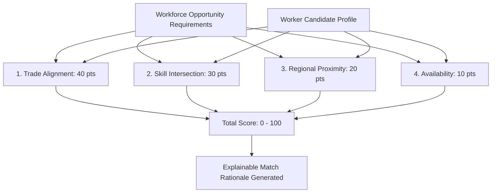

# KAAMSETU — PHASE 10 OPPORTUNITY MATCHING & SKILLS GAP REPORT
## Explainable Workforce Allocation, Demographic Neutrality & Curated Skilling Pathways

**Milestone:** Phase 10 — National Network Expansion & Infrastructure Readiness  
**Core Invariant:** Complete algorithmic fairness. No protected characteristic (caste, religion, gender, disability, age) is ever used to rank or evaluate workers. Zero penalties for missing degrees, smartphones, or review histories.  
**Matching APIs:** `/api/worker/opportunities` and `/api/contractor/opportunities`

---

## 1. Algorithmic Integrity & Anti-Bias Mandate

Traditional employment matching algorithms frequently encode historical prejudices and societal biases:
1. **Degree Gatekeeping:** Rejecting master craftsmen because they lack a formal matriculation or diploma certificate.
2. **Review Penalty Trap:** New or informal workers are permanently trapped at the bottom of search results because they lack a history of 5-star app ratings.
3. **Demographic Bias:** Proxy variables (caste surnames, residential localities, religious identities) inadvertently influencing ranking scores.

KAAMSETU's opportunity engine operates under strict **Demographic Neutrality**:
- The matching function input schema physically excludes caste, religion, gender, disability, and age.
- Newly onboarded workers with 0 reviews receive full baseline scoring parity based entirely on stated and verified craftsmanship.

---

## 2. Transparent Matching Formulation (0–100 Scale)

```
Match Score = Trade Alignment (40 pts) 
            + Technical Skill Intersection (30 pts) 
            + Regional Proximity (20 pts) 
            + Availability State (10 pts)
```



### 2.1 The Four Transparent Pillars
1. **Trade Alignment (40 pts):**
   - Exact trade match (e.g. Electrician to Electrical & Solar): 40 pts.
   - Cross-trade relevance (e.g. Carpentry to Interior Woodwork): 25 pts.
   - Trade mismatch: 0 pts.
2. **Technical Skill Intersection (30 pts):**
   - Proportional to matched required competencies: `(matched_skills / required_skills) * 30`.
3. **Regional Proximity (20 pts):**
   - Same district: 20 pts.
   - Adjacent economic corridor (e.g. Kamrup Metro to Kamrup Rural): 15 pts.
   - Inter-district transit required: 5 pts.
4. **Availability State (10 pts):**
   - `available`: 10 pts.
   - `on_site`: 5 pts.
   - `unavailable`: 0 pts.

### 2.2 Explainable Match Output
Every opportunity match returns human-readable explanations in the worker's regional language:
- `matchReasons`: e.g., *"Core trade aligned: Electrician matches Electrical & Solar"*, *"Possesses 2 of 2 required skills"*, *"Location match in Kamrup Metropolitan"*.
- `missingSkills`: Transparently lists competencies needed so workers understand what they lack.

---

## 3. Skills Gap Recommendations & Vocational Pathways

When a worker's profile shows missing skills for high-demand opportunities in their region, the system generates targeted learning recommendations (`src/lib/opportunity/skills-gap.ts`):

1. **Clear Rationale:** *"82% of commercial EPC opportunities in Kamrup require solar inverter grid synchronization."*
2. **Genuine Institutional Course Links:** Direct links to certified programmes at Assam Skill Development Mission (ASDM) or Government ITI Guwahati.
3. **AI Labeling Invariant:** Every recommendation is explicitly marked `isAiGenerated = true`. A suggested skill is never represented as an acquired qualification until certified by an authorized institution.
