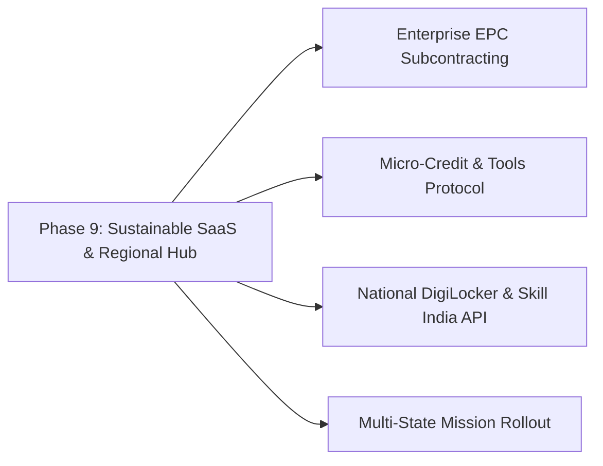

# KAAMSETU — PHASE 10 ROADMAP
## Enterprise EPC Subcontracting, Financial Protocol Integration & National Multi-State Expansion

**Milestone:** Phase 10 — Enterprise Scale & National Protocol Integration  
**Baseline Status (Post-Phase 9):** Sustainable SaaS business, 4 paying contractor organizations (MRR ₹3,829.50, ARR ₹45,954.00), 38 active verified workers, 31 database tables, 203 automated test invariants.  
**Core Mission:** *"Every skill deserves to be seen, even without a degree."*

---

## 1. Phase 10 Strategic Objectives

Phase 9 established unit economics profitability and sustainable growth foundations. Phase 10 scales KAAMSETU into an indispensable enterprise and financial infrastructure protocol for India's skilled workforce.

---

## 2. Workstream 1: Enterprise EPC & Subcontracting Infrastructure

Large engineering, procurement, and construction (EPC) conglomerates (e.g., L&T, Tata Projects, Shapoorji Pallonji) do not hire informal labor directly—they manage tiers of subcontractors.

### Planned Deliverables
1. **Subcontractor Hierarchy Trees:** Tier-1 general contractors can view verified compliance and trade skill densities across Tier-2 and Tier-3 labor subcontractors.
2. **On-Site Safety & Compliance Check-in:** Digital turnstile integration scanning worker QR cards at site gates, ensuring 100% verified certified electricians and certified scaffolding masons on hazardous sites.
3. **Escrow Milestone Verification:** Automated release of milestone payments to subcontractors upon cryptographic proof of certified worker attendance.

---

## 3. Workstream 2: Micro-Financial Protocol & Tool Financing

Informal craftspeople lose significant earning potential because they lack capital to buy modern high-productivity tools (e.g., rotary hammer drills, laser leveling devices, TIG welders).

### Planned Deliverables
1. **Verifiable Cashflow Dossier:** Exportable financial identity summarizing verified site tenures, customer ratings, and average monthly earnings for underwriting.
2. **Cooperative Bank Integration:** Direct lending API with regional cooperative banks (Assam Apex Bank, Meghalaya Rural Bank) providing low-interest micro-loans (8%–11% p.a.) for verified tool purchases.
3. **Zero Exploitation Guarantee:** KAAMSETU acts solely as a verifiable data provider, taking 0% loan origination cuts from workers.

---

## 4. Workstream 3: Official DigiLocker & Skill India Digital Integration

With ASDM pilot outcomes validated in Phase 9, KAAMSETU will formalize technical integration with the Ministry of Skill Development and Entrepreneurship (MSDE).

### Planned Deliverables
1. **Direct DigiLocker Issuer Node:** Upon signing the NeGD agreement, KAAMSETU credentials will automatically sync into the worker's official government DigiLocker repository.
2. **Skill India Digital (SID) Bi-directional Sync:** Automatic NSQF level alignment and certification import from National Council for Vocational Education and Training (NCVET) databases.

---

## 5. Workstream 4: Multi-State Regional Expansion

Scaling beyond Assam and Meghalaya into major migrant source and destination states:

| Expansion Wave | Target States | Priority Districts | Target Trades |
|---|---|---|---|
| **Wave 1 (Q1-Q2 2027)** | Odisha & West Bengal | Bhubaneswar, Cuttack, Siliguri | Plumbing, Masonry, Solar Installation |
| **Wave 2 (Q3-Q4 2027)** | Bihar & Jharkhand | Patna, Muzaffarpur, Ranchi | Carpentry, Welding, Electrical Grid |
| **Wave 3 (2028)** | Rajasthan & Gujarat | Jaipur, Jodhpur, Ahmedabad | Stone Masonry, Heritage Woodcraft, Fabrication |

---

## 6. Success Metrics for Phase 10

- **Paying Contractor Organizations:** 250+ active paying subscribers.
- **Contractor SaaS MRR:** ₹3,50,000+ ($4,200 USD/mo).
- **Verified Worker Network:** 5,000+ verified tradespeople with published digital identities.
- **Worker Wage Uplift:** > 35% sustained daily income increase across all active regions.
- **Zero Commission Standard:** Maintained at 0.0% indefinitely.
