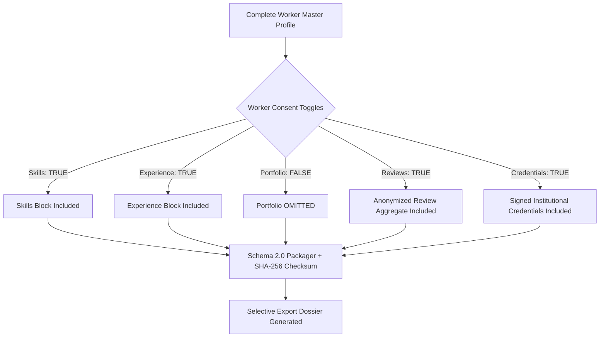

# KAAMSETU — PHASE 10 WORKER IDENTITY INTEROPERABILITY
## Versioned Export Schema 2.0, Selective Disclosure & Revocable Digital Access Grants

**Milestone:** Phase 10 — National Network Expansion & Infrastructure Readiness  
**Core Invariant:** The worker owns their identity. Contractors and institutions receive temporary, revocable access grants with worker-chosen selective disclosure, never permanent identity ownership.  
**Standard:** Digital Personal Data Protection Act (DPDP Act, 2023) Section 12 (Right to Data Portability)

---

## 1. The Interoperability Imperative

In traditional platform economics, marketplaces lock workers inside proprietary "walled gardens". If a worker leaves an agency, their customer ratings, verified work history, and reputation are destroyed.

KAAMSETU establishes an **interoperable identity protocol**:
1. Workers can generate time-limited digital access grants for prospective contractors, state missions, or banks.
2. Workers explicitly choose which sections of their professional dossier to disclose.
3. Access can be unilaterally revoked at any time.
4. Any third party can independently verify the tamper-evident integrity checksum without calling an unauthenticated external database.

---

## 2. Versioned Export Schema 2.0

Schema 2.0 (`ExportDossierV2`) is machine-readable and cryptographically self-verifying:

```json
{
  "schemaVersion": "2.0",
  "issuer": "https://kaamsetu.in",
  "grantId": "99119911-3333-4444-5555-000000000001",
  "granteeName": "Aarav Infrastructure Ltd",
  "granteeType": "contractor",
  "subject": {
    "registryId": "IN-AS-2026-1011-KS",
    "fullName": "Dipak Kalita",
    "primaryTrade": "Electrical & Solar",
    "kaamscore": 745,
    "operatingCity": "Guwahati",
    "operatingState": "Assam",
    "aadhaarMasked": "XXXX-XXXX-1011"
  },
  "disclosedSections": {
    "skills": true,
    "experience": true,
    "portfolio": false,
    "work_history": true,
    "credentials": true
  },
  "skills": [
    { "name": "Solar Inverter Wiring & Synchronization" },
    { "name": "Commercial Distribution Boards (MCB/MCCB)" }
  ],
  "experienceYears": 11,
  "workHistory": {
    "completedJobs": 24,
    "averageRating": 4.9,
    "verifiedReviewsCount": 12
  },
  "credentials": [
    {
      "title": "Solar PV Rooftop Installer (NSQF Level 4)",
      "issuingBody": "Assam Skill Development Mission",
      "nsqfLevel": 4,
      "issuedOn": "2026-06-15",
      "isVerified": true
    }
  ],
  "exportTimestamp": "2026-11-14T17:30:00.000Z",
  "expiresAt": "2026-11-17T17:30:00.000Z",
  "integrityChecksum": "e3b0c44298fc1c149afbf4c8996fb92427ae41e4649b934ca495991b7852b855"
}
```

---

## 3. Selective Disclosure Architecture

Workers maintain granular, checkbox-level control over five independent data blocks:



### 3.1 Strict Exclusion of Sensitive PII
Under zero circumstances do identity exports ever contain:
- Unmasked 12-digit Aadhaar numbers.
- Private mobile phone numbers.
- Private customer home addresses or phone numbers.
- Internal anti-fraud telemetry or risk scores.
- Private institutional disciplinary notes.

---

## 4. Revocable Digital Access Grants (`public.worker_identity_access_grants`)

Instead of handing over permanent PDFs, workers share time-limited digital tokens:

1. **Token Generation:** A 32-byte cryptographically secure random token is generated. Its SHA-256 hash (`access_token_hash`) is stored in the database.
2. **Access Resolution:** When a third party accesses `/api/v1/interop/worker/[token]`, the system matches the hash, checks `status === 'active'` and `expires_at > NOW()`.
3. **Instant Revocation:** The worker can click "Revoke Access" at any moment in their dashboard, updating `status = 'revoked'` and immediately locking down the token.
4. **Audit Trail:** Every access event records timestamp, accessor IP hash, and action in `public.identity_access_audit_logs`.
