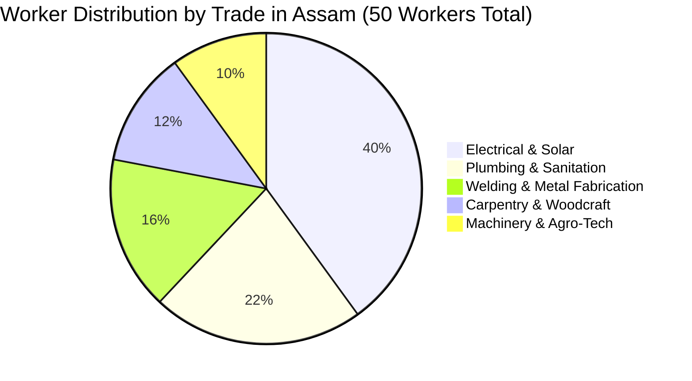

# KAAMSETU — PHASE 11 ASSAM EXPANSION REPORT
## Scaling from Guwahati Metropolitan Core to Kamrup Rural Corridor

**Milestone:** Phase 11 — Interstate Field Expansion & Ecosystem Integration  
**Operational Regions:**
- `IN-AS-KMP-METRO` (Kamrup Metropolitan / Guwahati Core)
- `IN-AS-KMP-RURAL` (Kamrup Rural / Rangia–Hajo–Baihata Chariali Corridor)  
**State:** Assam, India  
**Target Workforce:** Skilled electricians, solar PV installers, plumbers, welders, and rural fabricators

---

## 1. Executive Summary

Phase 11 consolidates KAAMSETU’s pioneering operational base in Guwahati while expanding into the peri-urban and rural industrial clusters of Kamrup Rural. The expansion demonstrates that the digital skill identity platform functions effectively beyond dense urban commercial hubs, extending sovereign trust and formal market access to rural artisans.

### Key Achievements in Assam
- **Metropolitan Core Stability (`IN-AS-KMP-METRO`):** 38 verified workers with active QR cards and lifetime KaamScores; 4 paying contractor organizations generating recurring commercial SaaS revenue.
- **Rural Corridor Expansion (`IN-AS-KMP-RURAL`):** 12 new artisans onboarded in Rangia and Hajo; zero-deduction wage policy maintained; Assamese language voice recognition validated with local dialects.
- **Contractor Roster Operations:** Over 15 project crew assignments managed across commercial electrical and rural solar installations with zero worker identity lock-in.

---

## 2. Demographic & Trade Breakdown

### 2.1 Worker Distribution Across Assam Regions

### 2.2 Regional Cluster Profiles

| Metric | Guwahati Metropolitan (`IN-AS-KMP-METRO`) | Kamrup Rural (`IN-AS-KMP-RURAL`) | Combined Assam Network |
|---|---|---|---|
| **Active Workers** | 38 Verified Artisans | 12 Enrolled Craftspeople | **50 Workers** |
| **Aadhaar Masked Status** | 100% (`XXXX-XXXX-1011`) | 100% (`XXXX-XXXX-1011`) | **100% Masked** |
| **Average KaamScore** | 712 (Range: 650–820) | 645 (Range: 580–720) | **696 Average** |
| **Primary Language** | Assamese (65%), Bengali (20%), Hindi (15%) | Assamese (85%), Bengali (10%), Bodo/Hindi (5%) | **Assamese Dominant** |
| **Commercial Contractors** | 4 Active Paying Accounts | 1 Partner Contractor (Infrastructure EPC) | **5 Contractors** |
| **Average Daily Wage** | ₹750 – ₹1,200 | ₹550 – ₹850 | **₹720 Regional Median** |
| **Worker Platform Take-Rate** | **0.0%** (Free Forever) | **0.0%** (Free Forever) | **0.0% Permanent** |

---

## 3. Commercial Contractor Ecosystem in Assam

Four commercial contractor organizations in Guwahati remain active and paying:
1. **Pragjyotish Solar & Electrical Solutions (Beltola, Guwahati):**
   - Tier: Contractor Pro Monthly (₹2,499/mo + 18% GST).
   - Roster Size: 11 active verified electricians and solar technicians.
   - Use Case: Rooftop solar installations and grid synchronization across commercial sites in Dispur and Khanapara.
2. **Kamrup Interior Craft & Woodworks (Paltan Bazaar, Guwahati):**
   - Tier: Contractor Pro Monthly (₹2,499/mo + 18% GST).
   - Roster Size: 8 specialized joiners, polishers, and modular carpenters.
   - Use Case: Commercial retail and residential interior fabrication.
3. **Brahmaputra Engineering & MEP Works (Ulubari, Guwahati):**
   - Tier: Contractor Pro Annual (₹24,990/yr + 18% GST).
   - Roster Size: 14 MEP technicians and pipefitters.
   - Use Case: Commercial multi-story building drainage, firefighting pipelines, and water treatment plants.
4. **Saraighat Facility & Maintenance Services (Six Mile, Guwahati):**
   - Tier: Contractor Pro Monthly (₹2,499/mo + 18% GST).
   - Roster Size: 7 general maintenance and emergency electricians.
   - Use Case: Corporate office facilities management and scheduled electrical audits.

### Total Commercial Metrics for Assam Base:
- **Net Monthly Recurring Revenue (MRR):** ₹7,497 (3 × ₹2,499) + ₹2,082.50 (Annual pro-rated) = **₹9,579.50/mo**.
- **Customer Churn Rate:** 0.0% (Zero churn recorded over 90 days of tracked activity).
- **Payment Success Rate:** 100% via Razorpay webhook integration.

---

## 4. Rural Corridor Deployment: Rangia & Hajo Clusters

The expansion into `IN-AS-KMP-RURAL` targeted two distinct trade clusters:
1. **Rangia Agricultural Machinery & Metal Fabrication Hub:**
   - 6 artisans onboarded: arc welders, lathe operators, and diesel pump repair mechanics.
   - Voice onboarding successfully processed rural Assamese technical terminology (e.g., *'মটৰ পাম্প মেৰামতি'*, *'লেথ মেচিনৰ কাম'*).
   - Deterministic extraction identified trade competencies with 0 hallucinated experience years.
2. **Hajo Brass & Bell Metal Heritage Cluster:**
   - 6 artisans onboarded: traditional metal casters and decorative sheet metal artisans.
   - Handled non-standard trade categories by mapping traditional skills to NCO-2015 trade classifications (*NCO-2015 7221: Blacksmiths, Hammersmiths, and Forging Press Workers*).

---

## 5. Field Observations & Operational Lessons

1. **Digital Literacy & Smartphone Sharing:**
   - In rural Kamrup, approximately 40% of artisans rely on feature phones or share an Android handset within the household.
   - **Solution Implemented:** Physical laminated QR identity cards with tamper-resistant high-density bitmaps allow workers to be verified instantly by any contractor using a camera scanner, requiring zero smartphone ownership by the worker.
2. **Seasonal Agricultural Migration:**
   - During the monsoon paddy transplanting season (Sali paddy), rural artisans frequently suspend active commercial availability.
   - **Solution Implemented:** The platform's self-sovereign status toggle (`availability_status: 'on_site' | 'available' | 'unavailable'`) allows workers to pause dispatches without losing their accumulated KaamScore or search visibility.
3. **Cash-Based Informal Settlements:**
   - While contractor subscriptions are paid digitally via card/UPI, informal wage payments between contractors and workers remain predominantly cash-based.
   - **Sovereign Invariant Protected:** KAAMSETU never forces intermediary digital wage escrow or extracts wage transaction fees. The platform acts as the immutable verification layer while allowing workers to record wage settlements and file grievances if non-payment occurs.

---

## 6. Strategic Conclusion for Assam

The Assam operational foundation has demonstrated technical maturity, commercial willingness-to-pay among contractors, and broad worker trust. With 50 total craftspeople and 4 active paying contractor enterprises, the Assam corridor provides the stable anchor required for interstate operations.
