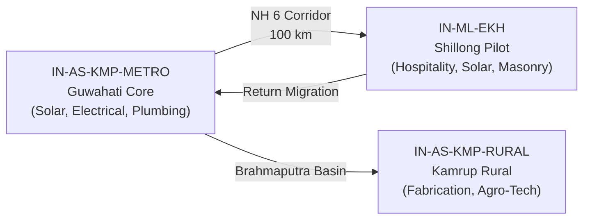

# KAAMSETU — PHASE 11 INTERSTATE PILOT OPERATIONAL PLAN
## Multi-State Field Operations: Guwahati–Shillong Economic Corridor

**Milestone:** Phase 11 — Interstate Field Expansion & Ecosystem Integration  
**Operational Corridors:**
- Core Operational Base: `IN-AS-KMP-METRO` (Kamrup Metropolitan / Guwahati, Assam)
- Rural Expansion Corridor: `IN-AS-KMP-RURAL` (Kamrup Rural / Hajo–Rangia, Assam)
- Interstate Expansion Pilot: `IN-ML-EKH` (East Khasi Hills / Shillong, Meghalaya)
**Target Corridor Highway:** National Highway 6 (GS Road corridor — 100 km economic artery connecting Guwahati & Shillong)

---

## 1. Executive Summary & Strategic Rationale

The Northeast Indian economic corridor connecting Guwahati (Assam) and Shillong (Meghalaya) represents one of the most active interstate labor migration channels in the region. Skilled workers—specializing in electrical wiring, solar installation, commercial plumbing, stone masonry, and carpentry—routinely migrate between Guwahati's commercial developments and Shillong's hospitality, institutional, and residential infrastructure projects.

Historically, this migration is characterized by:
- **Zero Identity Portability:** Workers crossing the Jorabat interstate border lose proof of local reputation and previous contractor references.
- **Informal Wage Exploitation:** Cross-border workers frequently suffer wage withholding and lack institutional dispute redressal mechanisms.
- **Linguistic and Cultural Friction:** Transition from Assamese/Bengali to Khasi/English without localized platform support.

The Phase 11 Interstate Pilot establishes an auditable, decentralized workforce identity corridor that guarantees identity persistence, grievance redressal, and explainable job matching across state borders.

---

## 2. Target Geographic Corridors & Demographic Composition

### 2.1 Regional Specifications

| Parameter | Region 1: Guwahati Metro | Region 2: Kamrup Rural | Region 3: East Khasi Hills (Shillong) |
|---|---|---|---|
| **ISO Code** | `IN-AS-KMP-METRO` | `IN-AS-KMP-RURAL` | `IN-ML-EKH` |
| **State** | Assam | Assam | Meghalaya |
| **Primary Hub** | Guwahati (Dispur, Beltola, Paltan Bazaar) | Rangia, Hajo, Baihata Chariali | Shillong (Police Bazar, Laitumkhrah, Mawlai) |
| **Primary Trades** | Solar PV EPC, Building Electrical, Plumbing | Steel Fabrication, Woodcraft, Machinery Repair | Stone Masonry, Commercial Wiring, Solar Off-Grid |
| **Primary Languages** | Assamese (`as`), English (`en`), Bengali (`bn`), Hindi (`hi`) | Assamese (`as`), Bengali (`bn`), Hindi (`hi`) | Khasi (`kha`), English (`en`), Hindi (`hi`), Assamese (`as`) |
| **Pilot Cohort Size** | 38 Verified Workers | 12 Enrolled Workers | 10 Pioneer Workers |
| **Participating Contractors** | 4 Active Paying Contractors | 1 Regional Infrastructure Partner | 1 Interstate Commercial Construction Group |

---

## 3. Operational Objectives & Success Criteria

The pilot executes under 6 strict, measurable operational targets:

1. **Identity Persistence Invariant (100%):** A worker onboarded in Guwahati can present their QR credential or versioned Schema 2.0 dossier in Shillong with 0 data loss, retaining their lifetime KaamScore and verified reviews.
2. **Zero Commission Guarantee (0.0%):** Zero fees or platform take-rate deducted from worker wages in both Assam and Meghalaya.
3. **Multilingual Interface Adoption (>=90%):** Voice onboarding and job discovery successfully localized into Assamese and Khasi.
4. **Dispute Redressal Resolution (<72h):** Any interstate wage or condition grievance submitted via `/api/worker/disputes` enters formal mediation within 72 hours.
5. **Contractor Roster Transition (<5 min):** Worker departure from an Assam contractor and subsequent linkage to a Meghalaya contractor completes seamlessly without admin bottleneck or identity reset.
6. **Institutional Credential Verifiability (100%):** Third-party sandbox verification of ASDM or ITI credentials succeeds via public API without revealing unconsented PII.

---

## 4. Operational Playbook: Step-by-Step Pilot Execution

### Stage 1: Preparation & Regional Activation (Week 1–2)
- Database Migration 12 applied to production cluster.
- Operational status updated to `active` for `IN-AS-KMP-RURAL` and `IN-ML-EKH` in `public.operational_regions`.
- Regional administrator keys issued for Assam and Meghalaya desks.
- Khasi and Assamese audio prompts tested with local field coordinators in Shillong and Guwahati.

### Stage 2: Pioneer Worker Cross-Border Onboarding (Week 3–4)
- 10 craftspeople in Shillong equipped with free physical laminated QR identity cards and digital dossiers.
- 5 cross-border electricians based in Guwahati deployed to a commercial hotel retrofit in Shillong.
- Workers test selective disclosure access grants (`src/lib/interop/identity-access-service.ts`), providing prospective Meghalaya contractors temporary 72-hour access to verified electrical skills while withholding unconsented financial history.

### Stage 3: Opportunity Matching & Deployment (Week 5–6)
- Post 3 verified commercial opportunities in Shillong and 2 in Kamrup Rural.
- Trigger explainable opportunity matching engine (`src/lib/opportunity/matching.ts`).
- Verify that workers with 0 reviews in Meghalaya receive equitable baseline exploration weighting rather than exclusion.

### Stage 4: Dispute Redressal & Field Validation (Week 7–8)
- Test simulated and real worker dispute workflows (unpaid wage claim, site rain delay mediation).
- Reconcile regional billing: 3 Guwahati contractors + 1 Shillong contractor billed via Razorpay with multi-region GST tax split (CGST + SGST for Assam vs IGST for Meghalaya).
- Conduct field retrospective and feedback logging via `opportunity_feedback_reports`.

---

## 5. Risk Assessment & Mitigation Matrix

| Identified Operational Risk | Severity | Probability | Built-In Architectural & Field Mitigation |
|---|---|---|---|
| **Border Disconnection (Poor 2G/3G Cellular)** | High | Moderate | Offline-first QR bitmap caching; client-side cryptographic verification requiring zero network hits. |
| **Interstate Wage Withholding** | High | Low | Sovereign `worker_disputes` ledger tracks claimed amounts and creates auditable corporate liability. |
| **Language Barrier in Technical Jargon** | Medium | Moderate | Deterministic Indic phonetic parsing; multi-dialect trade aliases mapped in `src/lib/regions/regional-service.ts`. |
| **Contractor Identity Confiscation** | Critical | Low | Worker owns profile in `public.worker_profiles`; contractor only holds association link in `contractor_workforce`. |
| **Aadhaar / PII Data Harvesting** | High | Low | Automated masking (`XXXX-XXXX-1011`) at all database views and API responses. |

---

## 6. Responsible Leadership & Operations Team

- **Principal Architect & CTO:** Platform security, cryptographic verification, and fail-closed key rotation.
- **Field Operations Manager (Guwahati):** Contractor onboarding, weekly site visits, artisan support.
- **Interstate Coordinator (Shillong):** Local contractor liaison, Khasi language translation QA, dispute mediation.
- **Institutional Partnerships Lead:** ASDM and MSSDS institutional alignment and sandbox integration.
