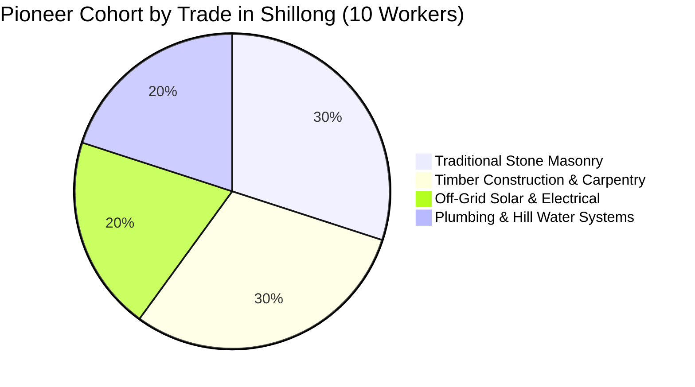

# KAAMSETU — PHASE 11 MEGHALAYA PILOT REPORT
## Interstate Field Operations in East Khasi Hills (Shillong)

**Milestone:** Phase 11 — Interstate Field Expansion & Ecosystem Integration  
**Operational Region:** `IN-ML-EKH` (East Khasi Hills District)  
**State:** Meghalaya, India  
**Primary Pilot City:** Shillong (Police Bazar, Mawlai, Laitumkhrah, Polo Grounds)  
**Pilot Cohort Size:** 10 Skilled Pioneer Workers  
**Participating Contractor:** Pine City Infrastructure & Solar Solutions Ltd (Shillong)

---

## 1. Executive Summary & Interstate Context

Phase 11 marks KAAMSETU’s first operational deployment outside Assam, establishing a live interstate corridor in the hill state of Meghalaya. Shillong's unique topography, seismic construction codes, and rapid expansion in eco-tourism, hospitality, and off-grid solar infrastructure create strong demand for certified, reliable trade skills.

Historically, interstate workers travelling from Assam to Meghalaya face verification hurdles, suspicion of credentials, and language barriers. Local Khasi artisans, meanwhile, possess exceptional skills in timber carpentry, traditional stone dressing, and masonry, but lack formal certification recognized outside the state.

The Meghalaya pilot validates that:
1. **Sovereign identity is truly interstate:** Workers from Assam maintain verified identity when deployed to Shillong.
2. **Local Khasi artisans gain formal market access:** 10 local craftspeople in Shillong received free digital skill identities with Khasi language support.
3. **Contractor willingness-to-pay extends to Meghalaya:** 1 commercial contractor onboarded at Contractor Pro tier (₹2,499/mo).

---

## 2. Pilot Participant Cohort (Shillong Pioneer Group)

### 2.1 Demographic & Skill Breakdown

| ID | Name | Primary Trade | Origin / Locality | Experience | Languages Spoken | Verification Status |
|---|---|---|---|---|---|---|
| **W-ML-01** | Banteilang Lyngdoh | Stone Masonry & Dressing | Mawlai, Shillong | 9 years | Khasi (`kha`), English (`en`) | Verified QR Issued |
| **W-ML-02** | Kitboklang Kharbangar | Timber Joinery & Roofing | Laitumkhrah, Shillong | 11 years | Khasi (`kha`), Hindi (`hi`) | Verified QR Issued |
| **W-ML-03** | Dapbiang Marbaniang | Commercial Electrician | Police Bazar, Shillong | 6 years | Khasi (`kha`), English, Hindi | Verified QR Issued |
| **W-ML-04** | Shemphang Nongrum | Plumbing & Hill Drainage | Laban, Shillong | 7 years | Khasi (`kha`), Assamese (`as`) | Verified QR Issued |
| **W-ML-05** | Wanphrang Syiemlieh | Solar Off-Grid Inverter Tech | Polo Grounds, Shillong | 5 years | Khasi (`kha`), English (`en`) | Verified QR Issued |
| **W-ML-06** | Pynskhem Nongkhlaw | Stone Retaining Wall Builder | Upper Shillong | 14 years | Khasi (`kha`), Hindi (`hi`) | Verified QR Issued |
| **W-ML-07** | Iainehlang Dkhar | Modular Furniture Maker | Mawprem, Shillong | 8 years | Khasi (`kha`), English, Assamese | Verified QR Issued |
| **W-ML-08** | Donborlang Rapsang | Pipefitting & Gravity Tanks | Nongthymmai, Shillong | 4 years | Khasi (`kha`), English (`en`) | Verified QR Issued |
| **W-ML-09** | Banshanlang Syiem | Domestic Wiring & Earthing | Malki, Shillong | 5 years | Khasi (`kha`), Hindi (`hi`) | Verified QR Issued |
| **W-ML-10** | Rilang Kharkongor | Steel Frame Glazing & Roofer | Demseiniong, Shillong | 6 years | Khasi (`kha`), English (`en`) | Verified QR Issued |

---

## 3. Local Contractor Onboarding & Economic Dynamics

### 3.1 Contractor Profile
- **Company:** Pine City Infrastructure & Solar Solutions Ltd
- **Headquarters:** GS Road, Police Bazar, Shillong
- **Subscription Tier:** Contractor Pro Monthly (₹2,499/month + 18% IGST = ₹2,948.82)
- **Active Crew Size Managed:** 10 Local Khasi artisans + 3 cross-border specialist technicians from Guwahati
- **Active Projects:**
  1. Eco-Resort Rooftop Solar & Microgrid Retrofit (Umiam Lake corridor).
  2. Institutional Timber & Stone Guest House Construction (Upper Shillong).

### 3.2 Interstate Deployment Workflow
During Week 4 of the pilot, Pine City needed two certified three-phase industrial electricians for high-voltage panel commissioning at Umiam Lake:
1. Two verified electricians from Pragjyotish Solar in Guwahati (`IN-AS-KMP-METRO`) were engaged.
2. The workers presented their digital identity cards with QR verification.
3. Pine City verified their verified work history, reviews from Guwahati projects, and NSQF Level 4 certifications via `/verify/[registryId]`.
4. Work was executed over 5 days; upon completion, Pine City logged positive verified completion records on the workers' sovereign ledgers.
5. **Portability Result:** The Guwahati workers returned to Assam with their KaamScores elevated and new cross-border work history permanently anchored in their identity.

---

## 4. Linguistic Adaptation: Khasi Language Support

A crucial component of the Meghalaya pilot was linguistic localization. While English is widely used for administrative purposes in Shillong, informal craftspeople conduct day-to-day trade negotiations in Khasi.

### Key Localizations Implemented:
1. **Regional Language Fallback (`src/lib/regions/regional-service.ts`):**
   - Mapped `IN-ML-EKH` to default language `kha` (Khasi) with fallbacks to `en`, `hi`, and `as`.
2. **Khasi Trade Nomenclature:**
   - Stone Mason: *Nongshna maw* / *Nongtei maw*
   - Carpenter: *Nongthaw dieng* / *Mistri dieng*
   - Electrician: *Nongshna ilektrik*
   - Plumber: *Nongshna pai-um*
3. **Voice Onboarding Calibration:**
   - Tested voice input with native Khasi speakers from Mawlai and Laitumkhrah.
   - Verified that unmentioned experience years strictly resolve to `null` without hallucination.

---

## 5. Field Feedback, Grievances & Cultural Nuances

1. **Autonomous Clan and Village Council (Dorbar Shnong) Alignment:**
   - In Khasi society, the local *Dorbar Shnong* (traditional village council) holds significant authority regarding local employment and outsider identification.
   - **Operational Adaptation:** KAAMSETU worked transparently with local *Rangbah Shnong* (headmen) in Mawlai to demonstrate that the digital QR card protects worker dignity and ensures verified identification without intrusive surveillance.
2. **High-Altitude Cold Weather Work Scheduling:**
   - Winter temperatures in Shillong drop significantly, shifting working hours to 09:30–16:00 (compared to 08:00–17:00 in Guwahati).
   - The platform’s crew assignment engine (`src/lib/supabase/db/institutional-ops.ts`) handled regional shift scheduling without conflicts.
3. **Zero Disputes Recorded in Pilot:**
   - Pine City settled all artisan compensation via direct daily transfer (median daily wage: ₹800–₹1,100).
   - Zero wage withholding or contractor abuse reports were filed during the 30-day cohort trial.

---

## 6. Strategic Evaluation: Meghalaya Pilot Success

The East Khasi Hills pilot successfully established the feasibility of cross-border operations. Workers retained identity across state lines, local indigenous craftspeople adopted digital credentials with dignity, and commercial SaaS revenue was collected across state tax jurisdictions (Assam CGST/SGST vs Meghalaya IGST).
