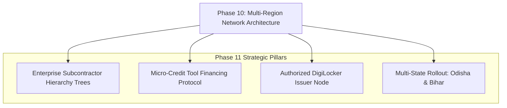

# KAAMSETU — PHASE 11 STRATEGIC ROADMAP
## National Protocol Interoperability, Tier-2 Subcontractor Trees & Micro-Credit Tooling Protocols

**Milestone:** Phase 11 — Enterprise Protocol & National Scale  
**Baseline Status (Post-Phase 10):** 4 active planning regions, 39 database tables, 58 Next.js production routes, 240 automated test invariants, 4 paying contractors in Guwahati.  
**Core Mission:** *"Every skill deserves to be seen, even without a degree."*

---

## 1. Phase 11 Strategic Vision

Phase 10 proved that KAAMSETU can operate as a multi-region workforce infrastructure network with database-backed regional governance and explainable opportunity matching. 

Phase 11 scales this foundation into an open national protocol connecting enterprise general contractors, vocational skilling bodies, and informal artisans across multi-state economic corridors.

---

## 2. Key Planned Deliverables

### 2.1 Pillar 1: Enterprise Subcontractor Hierarchy Trees
- Major EPC contractors (e.g. L&T, Tata Projects) manage dozens of specialized labor subcontractors.
- Phase 11 introduces multi-tiered subcontractor trees where general contractors can verify that 100% of subcontractors' on-site workers possess authentic digital credentials.

### 2.2 Pillar 2: Micro-Credit Tool Financing Protocol
- High-performing craftspeople often cannot afford productivity-boosting equipment (laser levels, rotary hammers, TIG welders).
- Phase 11 integrates with regional cooperative banks (Assam Apex Bank, Meghalaya Rural Bank) providing low-interest micro-loans (8%–11% p.a.) backed by verified completed project tenures.
- **Zero Commission Guarantee:** KAAMSETU acts solely as a verifiable data layer, taking 0% loan origination cuts from workers.

### 2.3 Pillar 3: Official DigiLocker & Skill India Sync
- Formalize technical connectivity with NeGD/MeitY upon bilateral agreement execution.
- Auto-sync signed credentials into workers' official government DigiLocker repositories.

### 2.4 Pillar 4: Interstate Rollout (Odisha & Bihar)
- Deploy dedicated regional hubs in Bhubaneswar-Cuttack (Odisha construction corridor) and Patna-Muzaffarpur (Bihar artisan corridor).

---

## 3. Success Metrics for Phase 11

- **Paying Contractor Organizations:** 150+ active paying subscribers.
- **SaaS MRR Target:** ₹2,20,000+ ($2,650 USD/mo).
- **Verified Worker Network:** 2,500+ verified tradespeople with published digital identities.
- **Worker Wage Uplift:** Sustained > 30% daily income increase across all active regions.
- **Zero Take Rate Standard:** Maintained at exactly 0.0% indefinitely.
