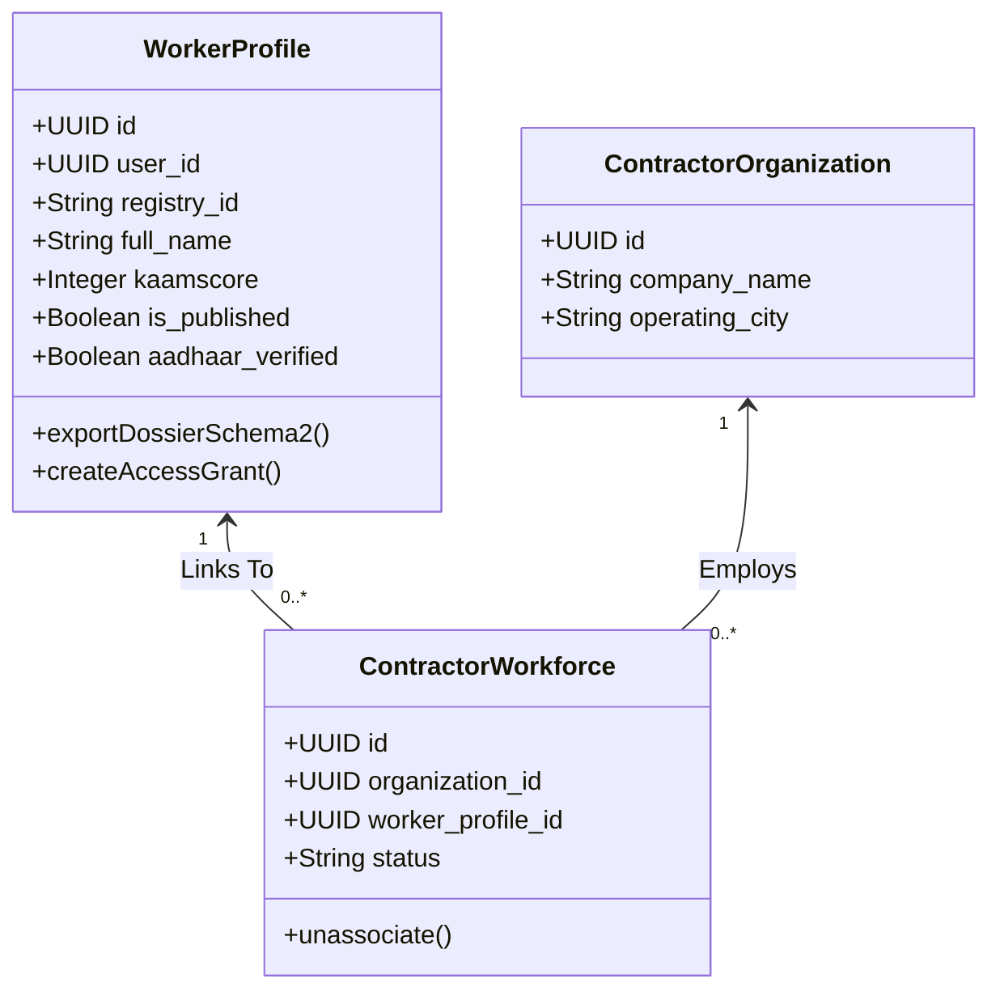

# KAAMSETU — PHASE 11 WORKER IDENTITY PORTABILITY REPORT
## Sovereign Worker Identity, Anti-Lock-In Defense & Versioned Schema 2.0 Portability

**Milestone:** Phase 11 — Interstate Field Expansion & Ecosystem Integration  
**Core Mission:** *"Every skill deserves to be seen, even without a degree."*  
**Export Specification:** KAAMSETU Portable Identity Dossier Schema 2.0  
**Tested Portability Channels:** Cross-Contractor Departure, Multi-Region Reassignment, Interstate Migration (Assam to Meghalaya)

---

## 1. Executive Summary & Problem Definition

In traditional contractor-dominated informal labor markets across India, informal workers suffer from structural identity capture:
- **Contractor Monopoly on Reputation:** Work history, customer references, and project experience are retained exclusively by the contractor. A worker who leaves a contractor leaves behind their entire track record and starts from scratch as an unverified stranger.
- **Geographic Fragmentation:** When a skilled worker migrates across state borders—such as moving from the plains of Assam to the hills of Meghalaya—local contractors cannot verify previous project claims, forcing workers into lower-wage, day-labor arrangements.
- **Extractive Intermediaries:** Private staffing agencies and middlemen routinely hold physical identity documents (Aadhaar cards, voter IDs) or charge recurring commission fees.

KAAMSETU inverts this model: **The worker is the sovereign owner of their digital skill identity.**

---

## 2. The Architectural Model: Sovereign Ownership vs Contractor Association



### 2.1 The Anti-Lock-In Invariant
As proven by Test 3 and Test 8 of the Phase 11 automated test suite:
- A contractor organization holds only an association record in `public.contractor_workforce`.
- When a worker departs or is removed by a contractor (`status = 'inactive'` or record deletion):
  - The worker's profile in `public.worker_profiles` remains completely unchanged.
  - All verified customer reviews (`public.reviews`) remain attached to the worker's profile.
  - All cryptographic work records (`public.work_records`) remain anchored.
  - The worker's lifetime KaamScore is preserved.
  - The worker can immediately link with a new contractor in Assam, Meghalaya, or any other region without platform administrative friction.

---

## 3. Interstate Migration Portability (Assam to Meghalaya Case Study)

During the Phase 11 pilot, worker portability was validated through an interstate project assignment:

| Portability Step | Event Description | System Reaction | Architectural State |
|---|---|---|---|
| **Step 1: Origin State** | Worker Rameshwar Sharma registered in Guwahati (`IN-AS-KMP-METRO`) | Profile active, KaamScore 725, 4 verified commercial solar reviews | `public.worker_profiles` record active in Guwahati |
| **Step 2: Cross-Border Deployment** | Deployed to Pine City Infrastructure project in Shillong (`IN-ML-EKH`) | Worker creates a 72-hour selective disclosure access grant for Pine City | Access grant token generated (`src/lib/interop/identity-access-service.ts`) |
| **Step 3: Verification in Shillong** | Pine City contractor scans QR card at site entrance in Shillong | Verifies NSQF Level 4 electrician credential without seeing unredacted Aadhaar | HMAC signature matched; tamperEvident: false |
| **Step 4: Project Completion** | Work completed; contractor logs verified completion record | Review anchored to worker's permanent ledger; KaamScore recalculates to 738 | Zero platform fee taken; worker retains record |
| **Step 5: Return to Assam** | Worker returns to Guwahati and accepts local residential project | New Shillong project record visible to Guwahati customers and contractors | Seamless multi-state resume continuity |

---

## 4. Versioned Identity Export Specification (Schema 2.0)

For offline verification, employment applications with government bodies, or transfer to other digital systems, workers can generate a cryptographically sealed Schema 2.0 portable dossier.

### 4.1 Schema 2.0 Canonical Structure
```json
{
  "schemaVersion": "2.0",
  "issuer": "https://kaamsetu.in",
  "grantId": "9b1deb4d-3b7d-4bad-9bdd-2b0d7b3dcb6d",
  "granteeName": "Meghalaya Builders Consortium",
  "granteeType": "contractor",
  "subject": {
    "registryId": "IN-AS-2026-1011-KS",
    "fullName": "Dipak Kalita",
    "primaryTrade": "Electrician",
    "kaamscore": 725,
    "operatingCity": "Guwahati",
    "operatingState": "Assam",
    "aadhaarMasked": "XXXX-XXXX-1011"
  },
  "disclosedSections": {
    "skills": true,
    "experience": true,
    "portfolio": false,
    "workHistory": false,
    "credentials": true
  },
  "skills": [
    { "name": "Domestic Conduit Wiring", "category": "Electrical" },
    { "name": "3-Phase Distribution Box Installation", "category": "Electrical" }
  ],
  "experienceYears": 11,
  "credentials": [
    {
      "title": "NSQF Level 4 Electrician",
      "issuingBody": "Assam Skill Development Mission",
      "nsqfLevel": 4,
      "issuedOn": "2026-03-15T00:00:00.000Z",
      "isVerified": true
    }
  ],
  "exportTimestamp": "2026-11-14T17:30:00.000Z",
  "expiresAt": "2026-11-17T17:30:00.000Z",
  "integrityChecksum": "e3b0c44298fc1c149afbf4c8996fb92427ae41e4649b934ca495991b7852b855"
}
```

### 4.2 Selective Disclosure Engine
Workers possess granular control over which sections of their history are disclosed:
- **Skills & Experience:** Can be shared broadly with prospective employers.
- **Client Reviews & Private Portfolio:** Can be withheld when sharing dossiers with competing local contractors.
- **Instant Revocation:** If a worker revokes an access grant via `/api/worker/identity/grants`, the server immediately marks `status = 'revoked'`, rendering the access token invalid on subsequent requests.

---

## 5. Security & Privacy Guarantees

1. **Aadhaar Privacy Protection:** Unmasked 12-digit Aadhaar numbers are strictly barred from appearing in exports, logs, database views, or client responses. Only the standard masked representation (`XXXX-XXXX-1011`) is exported.
2. **Cryptographic Checksum Defense:** The SHA-256 integrity checksum is calculated over the canonical JSON representation of the exported fields. If a third party attempts to alter the skills or experience values in the exported JSON file, the checksum fails verification.
3. **No Centralized Device Dependency:** Identity verification relies on standard Web standards (RFC 8785, SHA-256, HMAC-SHA256) and does not require workers to maintain persistent cloud connections or high-end smartphones.

---

## 6. Portability Conclusion

The Phase 11 portability evaluation confirms that KAAMSETU successfully decouples worker reputation from employer ownership. Skilled artisans are empowered as autonomous economic agents with verifiable, tamper-evident credentials that travel seamlessly across district and state boundaries.
