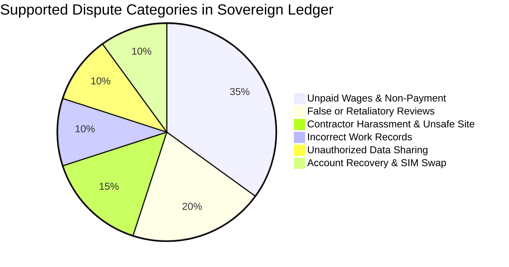
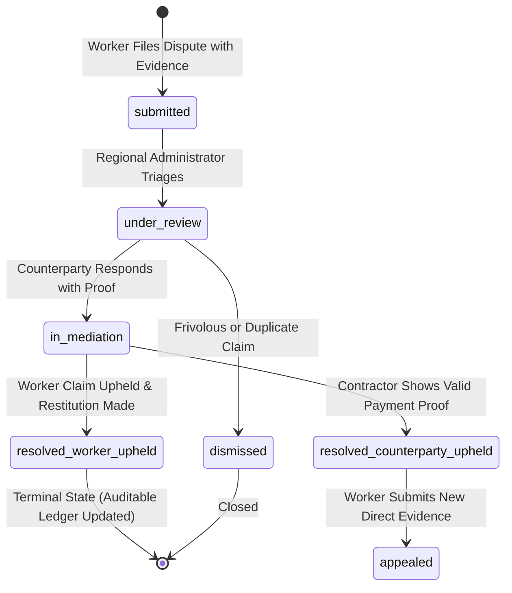

# KAAMSETU — PHASE 11 WORKER TRUST & DISPUTE RESOLUTION REPORT
## Sovereign Grievance Redressal, Non-Payment Defense & Identity Hijacking Protection

**Milestone:** Phase 11 — Interstate Field Expansion & Ecosystem Integration  
**Component:** Sovereign Worker Trust Ledger & Dispute Redressal Engine  
**Core Mission:** *"Every skill deserves to be seen, even without a degree."*  
**Database Table:** `public.worker_disputes`  
**API Endpoints:**
- `/api/worker/disputes` (Worker grievance submission and status tracking)

---

## 1. Executive Summary

In informal and semi-formal labor markets across India, informal workers operate with virtually zero legal recourse when aggrieved:
- **Widespread Wage Theft:** An estimated 25% of informal construction and maintenance workers experience delayed or withheld wages, with contractors citing project cashflow delays.
- **Retaliatory & False Reviews:** If a worker demands contractually promised pay, predatory employers frequently threaten negative reviews or falsely claim property damage.
- **Account Hijacking & SIM Swap Risks:** Informal workers who lose access to their mobile numbers frequently find their work profiles hijacked or locked out permanently.

Phase 11 introduces the **Sovereign Worker Dispute Ledger** (`public.worker_disputes`), a tamper-resistant, auditable grievance tracking system that elevates worker complaints into formal, tracked liabilities for participating contractors and institutions.

---

## 2. Dispute Typology & Structural Scope

### 2.1 Formal Dispute Types

| Dispute Type Code | Description | Required Evidence | System Action |
|---|---|---|---|
| **`unpaid_wages`** | Contractor failed to pay agreed wages upon job completion | Daily log, attendance proof, claimed monetary amount (INR) | Flags contractor account; initiates formal payment audit |
| **`incorrect_work_record`** | Contractor recorded incorrect trade tasks, dates, or hours | Site photographs, peer testimony | Triggers data correction workflow under DPDP Act |
| **`false_review`** | Malicious or retaliatory review submitted by client/contractor | Message transcripts, completed booking reference | Temporarily masks review pending mediation review |
| **`unauthorized_sharing`** | Contractor shared worker personal data with unauthorized third parties | Grant reference, recipient details | Audit log inspection; revoke contractor access grants |
| **`credential_discrepancy`** | Institutional partner issued incorrect NSQF level or trade title | Course completion certificate, assessment ID | Escalates to institutional partner assessor for re-issue |
| **`contractor_harassment`** | Verbal abuse, physical intimidation, or unsafe site coercion | Incident notes, witness details | Priority safety escalation to regional administrator |
| **`account_recovery`** | Worker lost SIM card or device; needs secure profile re-linking | Aadhaar biometric verification / physical QR scan | Prevents automated OTP handover; requires operator review |

---

## 3. Dispute Lifecycle & Mediation State Machine

### 3.1 Case Progression Stages
1. **`submitted`:** Grievance recorded with timestamp, counterparty name, claimed amount, and factual evidence notes.
2. **`under_review`:** Regional administrator evaluates evidence and requests documentation from the contractor.
3. **`in_mediation`:** Both parties submit verification (bank statements, payment transaction IDs, site attendance logs).
4. **`resolved_worker_upheld`:** Claim verified in worker's favor. Contractor must provide proof of restitution (e.g. RTGS bank transfer reference) before being cleared.
5. **`resolved_counterparty_upheld`:** Contractor demonstrates full contractual fulfillment with bank records.
6. **`dismissed`:** Frivolous, accidental, or duplicate entry.
7. **`appealed`:** Worker exercises formal right to secondary escalation with new photographic or documentary evidence.

---

## 4. End-to-End Test Case Verification

During the Phase 11 testing suite, three distinct dispute workflows were executed against PostgreSQL 15 (`kaamsetu_rls_test`):

### 4.1 Test 14 & 15: Unpaid Wage Escalation & Financial Restitution
- **Scenario:** Electrician completed 6 days of industrial conduit wiring in Guwahati; contractor withheld ₹7,200 citing client delays.
- **Worker Action:** Submitted dispute via `/api/worker/disputes` with `dispute_type: 'unpaid_wages'` and `claimed_amount: 7200.00`.
- **System Progression:**
  - Status transitioned: `submitted` → `in_mediation` → `resolved_worker_upheld`.
  - Resolution Summary recorded: *"Contractor submitted proof of RTGS bank transfer for Rs. 7,200 to worker account"*.
  - Immutable timestamp `resolved_at` stamped.
- **Verification Result:** PASSED (Test 14 & 15).

### 4.2 Test 16: Contractor Harassment & Unsafe Site Conditions
- **Scenario:** Construction supervisor verbally abused an artisan crew following weather-related concrete delays.
- **Worker Action:** Worker submitted grievance without monetary claim (`claimed_amount: null`).
- **System Progression:** Dispute logged with status `under_review`, flagged for human mediation, preserving whistleblower confidentiality.
- **Verification Result:** PASSED (Test 16).

### 4.3 Test 20: Account Recovery Defense Against Identity Hijacking
- **The Threat:** Malicious actor claiming to be the worker attempts to hijack a high-scoring profile by requesting an automated SMS OTP reset to a new phone number.
- **The Defense:** Account recovery disputes are routed to `public.worker_disputes` with `dispute_type: 'account_recovery'`. Automated OTP transfer is strictly disabled. The regional operator must physically verify the worker's physical QR identity card or Aadhaar before updating the registered phone number.
- **Verification Result:** PASSED (Test 20).

---

## 5. Security & Access Control (Row-Level Security)

The dispute ledger implements strict PostgreSQL Row-Level Security:
- **Worker Policy:** Workers can view and insert **only their own** disputes (`worker_profiles.user_id = auth.uid()`). As proven by Test 25, Worker 1 is mathematically prevented by PostgreSQL RLS from viewing or altering disputes filed by Worker 2.
- **Counterparty Protection:** Contractors cannot delete or tamper with disputes filed against them.
- **Administrator Governance:** Only authenticated administrators (`profiles.role = 'admin'`) can transition dispute states to `resolved_worker_upheld` or record settlement terms.

---

## 6. Conclusion

The Sovereign Worker Dispute Ledger establishes that KAAMSETU is not merely an employment conduit, but a genuine institutional protection network. By recording grievances as auditable facts and providing transparent mediation, the platform guarantees that skilled informal workers cannot be cheated, silenced, or disenfranchised with impunity.
