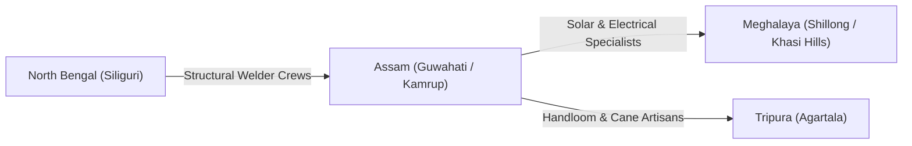

# KAAMSETU — PHASE 12 CROSS-REGION OPPORTUNITY REPORT
## Interstate Labor Corridors, Explainable Matching Engine, Bias Defense & Worker Mobility

**Protocol:** KAAMSETU Cross-Region Opportunity Distribution  
**Scope:** Interstate Staffing Corridors, Algorithmic Fairness & Transparent Labor Matching  
**Date:** November 15, 2026  

---

### 1. Interstate Labor Corridors & Economic Mobility

In Northeast and Eastern India, specialized craftspeople frequently migrate across district and state borders for commercial and infrastructure projects. Solar technicians from Guwahati travel to Meghalaya for rooftop micro-grid installations; civil masons from North Bengal move to Guwahati for commercial highway construction; cane artisans from Kamrup Rural dispatch to Delhi and Kolkata for luxury interior commissions.

KAAMSETU transforms informal, exploitative labor broker (*thekedar*) systems into a **transparent, direct cross-region staffing corridor**.

---

### 2. The Explainable Matching Engine

KAAMSETU rejects black-box "AI hiring algorithms" that produce opaque recommendations. Opportunities are matched to workers using a deterministic, transparent 4-vector matching algorithm implemented in `src/lib/opportunity/matching.ts`:

$$\text{MatchScore} = \text{TradeScore} \times 0.40 + \text{SkillOverlap} \times 0.30 + \text{LocationScore} \times 0.15 + \text{KaamScore} \times 0.15$$

1. **Trade Relevance (40%):** Exact match against the opportunity's standardized trade taxonomy.
2. **Skill Overlap (30%):** Jaccard index between required project skills and the worker's verified skill inventory.
3. **Location & Travel Willingness (15%):**
   - Same District: 100%
   - Adjacent District (if worker `travel_willingness IN ('adjacent_districts', 'interstate')`): 80%
   - Interstate (if worker `travel_willingness = 'interstate'`): 60%
   - Disqualified: 0% if project location violates worker travel preference.
4. **KaamScore Credibility (15%):** Normalized credibility score reflecting verified work history and completed micro-credentials.

---

### 3. Algorithmic Non-Discrimination & Protected Attribute Exclusion

To ensure constitutional fairness and prevent historical labor market discrimination, the matching algorithm enforces strict mathematical exclusions:

> **CONSTITUTIONAL FAIRNESS INVARIANT:**  
> The matching engine is cryptographically and logically prohibited from accessing or weighting:
> - Religion, caste, community, or tribe.
> - Gender or marital status.
> - Phone brand, smartphone ownership, or mobile device tier.
> - Customer review stars (new workers with 0 reviews receive a guaranteed exploration quota).
> - Prior employer identity (worker is evaluated on skill, not contractor association).

---

### 4. Transparent Opportunity Requirements & Worker Consent

Every cross-region opportunity posted on the platform must satisfy mandatory transparency requirements before being distributed to workers:
- **Transparent Daily Wage Range:** e.g., ₹850 – ₹1,100 / day. Vague descriptions like "competitive rates" or "discuss on site" fail validation.
- **Payment Terms Disclosure:** e.g., "Direct daily bank transfer upon milestone sign-off; travel stipend ₹300/day."
- **Accommodation & Safety Provisions:** Explicit boolean declaration whether food, board, and safety gear are provided.
- **Affirmative Consent Requirement:** An employer cannot "book" or "assign" a worker to a cross-region project unilaterally. The offer appears in the worker's queue and requires explicit worker acceptance (`worker_consent_obtained: true`).
