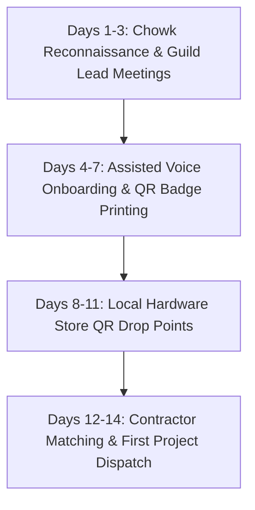

# KAAMSETU — PHASE 12 DISTRIBUTION & PARTNERSHIP PLAYBOOK
## Grassroots Worker Distribution, Labor Chowk Strategy, Institutional Partnerships & Scaling Playbook

**Protocol:** KAAMSETU National Distribution & Growth Architecture  
**Target Audience:** Regional Expansion Directors, Field Coordinators & Community Organizers  
**Date:** November 15, 2026  

---

### 1. Executive Summary & Distribution Philosophy

Informal craftspeople do not browse app stores or download enterprise SaaS products from social media ads. They discover livelihood opportunities through **trusted community nodes**: morning labor chowks, local hardware supply stores, vocational training centers, and trade guild networks.

KAAMSETU's distribution strategy relies on a **three-tier organic trust funnel**:
1. **Grassroots Worker Onboarding:** In-person field coordinators equipped with bilingual voice assistance visiting morning labor hubs.
2. **Institutional Student Conversion:** Partnering with accredited ITIs and skilling centers to issue graduation micro-credentials.
3. **Contractor Workforce Aggregation:** Converting commercial subcontractors through word-of-mouth project demonstrations.

---

### 2. Labor Chowk & Field Onboarding Playbook

Every district launch follows a standardized 14-day field deployment protocol:

#### Step 1: Identification of High-Density Labor Nodes
- Identify the primary morning gathering spots (*chowks* / *nakas*) where electricians, carpenters, plumbers, and masons assemble between 6:30 AM and 9:00 AM.
- Engage local guild heads (*shansi*, *chowk sirdars*) and explain the core promise: "Free digital proof of your real experience; no fees, no smartphone needed."

#### Step 2: Voice-First Assisted Profile Extraction
- Field coordinators use the KAAMSETU Voice Onboarding interface.
- Worker speaks for 45–60 seconds in their native language (Assamese, Bengali, Khasi, Hindi, Nepali, etc.).
- Non-invention engine extracts trade, verified skills, and stated rates without fabricating unstated details.

#### Step 3: Physical Plastic QR Card Issuance
- A durable, laminated physical QR card is printed on-site using a portable Bluetooth thermal printer.
- Worker keeps the physical card in their wallet; no smartphone, email, or DigiLocker account required to present it.

---

### 3. Institutional Skilling Mission Partnership Playbook

1. **State Skilling Society Engagement:** Approach the State Skill Development Mission (e.g. ASDM, MSSDS, TSDM) with a clear value proposition: "Verifiable post-training employment tracking with zero manual surveying."
2. **Curriculum & NSQF Alignment:** Map the institution's vocational courses to KAAMSETU's standardized NCO-2015 and NSQF Level 1–8 schemas.
3. **Batch Credential Issuance:** Upon course completion, the institution issues cryptographically signed credentials directly to the graduates' portable registries via the partner API.
4. **Contractor Pipeline Placement:** Graduates are automatically surfaced in the local Contractor Discovery pool for upcoming commercial infrastructure projects.

---

### 4. Contractor Acquisition & Sales Funnel

| Funnel Stage | Objective | Activity & Playbook | Conversion SLA |
|---|---|---|---|
| **Lead Generation** | Identify 20 commercial subcontractors per district. | Physical visits to ongoing commercial sites; ITI contractor network referrals. | Week 1 |
| **Site Demo** | Demonstrate QR crew attendance and project scheduling. | 15-minute on-site demo with project supervisor on their Android device. | Week 2 |
| **Free Pilot Cohort** | Onboard 5 crew members on Starter tier (₹0). | Run 1 complete 14-day project cycle using KAAMSETU attendance & wage logs. | Week 3–4 |
| **Paid Conversion** | Upgrade to Contractor Pro (₹2,499/mo). | Present crew capacity limits and cross-region worker discovery features. | Day 30 |

**Conclusion:** The distribution playbook creates a self-reinforcing flywheel: verified institutional training produces skilled workers, worker density attracts commercial contractors, and contractor demand creates sustainable, well-paid opportunities.
