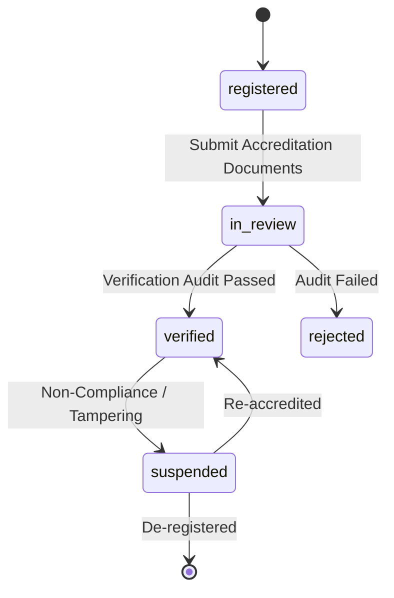

# KAAMSETU — PHASE 12 INSTITUTIONAL ECOSYSTEM REPORT
## State Skilling Missions, ITI Accreditation, Micro-Credentials & Institutional Governance

**Protocol:** KAAMSETU Institutional Ecosystem  
**Target Bodies:** State Skill Missions, ITIs, Polytechnics, NGOs & Industry Councils  
**Date:** November 15, 2026  

---

### 1. Executive Summary & Institutional Purpose

Informal artisans and skilled technicians across India acquire world-class capabilities through years of on-the-job apprenticeship, yet remain shut out of formal employment because they lack paper diplomas from accredited universities.

KAAMSETU bridges this divide through the **Institutional Micro-Credential Network**. Accredited institutions—including State Skill Development Missions, Industrial Training Institutes (ITIs), polytechnics, and industry sector skill councils—can issue auditable, tamper-evident digital skill credentials to workers who demonstrate competency through practical assessment.

---

### 2. Institutional Accreditation & Gatekeeping Model

To prevent credential fraud or diploma mills from polluting the registry, Phase 12 introduces a formal **institutional gatekeeping lifecycle** managed via `public.institutions.verification_status`:

- **Registered:** Self-onboarded institution with sandbox-only API access.
- **In Review:** State mission or ITI undergoing verification audit (DGT / NCVT affiliation verification).
- **Verified:** Officially certified issuer with permission to issue production credentials.
- **Suspended / Rejected:** Restricted from issuing new credentials; historical credentials remain visible with explicit suspension/revocation warnings.

---

### 3. Institutional Partner Directory (Operational & Sandbox)

| Institution Name | State | District | Institution Type | Verification Status | Partner Status | Primary Trades |
|---|---|---|---|---|---|---|
| **Assam Skill Development Mission (ASDM)** | Assam | Kamrup Metro | `state_mission` | `verified` | Operational | Solar PV, Industrial Electrical, Healthcare |
| **Industrial Training Institute (ITI) Guwahati** | Assam | Kamrup Metro | `vocational_iti` | `verified` | Operational | Arc & TIG Welding, CNC Machining, HVAC |
| **Nagaon Polytechnic Institute** | Assam | Nagaon | `polytechnic` | `in_review` | Contacted | Civil Construction, Auto Repair |
| **North East Cane & Bamboo Dev Council (NECBDC)** | Assam | Kamrup Rural | `ngo` | `verified` | Operational | Cane & Bamboo Joinery, Handicrafts |
| **Meghalaya State Skill Dev Society (MSSDS)** | Meghalaya | East Khasi Hills | `state_mission` | `verified` | Operational | Sustainable Agri, Masonry, Plumbing |
| **Tripura Skill Development Mission (TSDM)** | Tripura | West Tripura | `state_mission` | `in_review` | Pilot Proposal | Electrical Wiring, Tile Fitting |

---

### 4. Partner API Security, Sandboxing & Key Rotation

Institutions access KAAMSETU's credential issuance engine via authenticated REST endpoints governed by `public.institutional_partner_api_keys`.

1. **Cryptographic Hashing:** API keys are never stored in plaintext. They are hashed using SHA-256 (`api_key_hash`) upon generation.
2. **Sandbox vs Production Scoping:**
   - Keys with `is_sandbox: true` can issue credentials only against simulated test cohorts. They are strictly blocked from writing to public worker registries.
   - Keys with `is_sandbox: false` require `institutions.verification_status = 'verified'`.
3. **Zero-Downtime Key Rotation:** When an institution rotates its API key, the new key (V2) is activated immediately while the old key (V1) is granted a controlled 24-hour overlap before automated revocation.
4. **Worker Consent Invariant:** An institution **cannot** issue a credential and attach it to a worker's public identity without explicit, affirmative worker consent (`learner_consent_obtained: true`).
