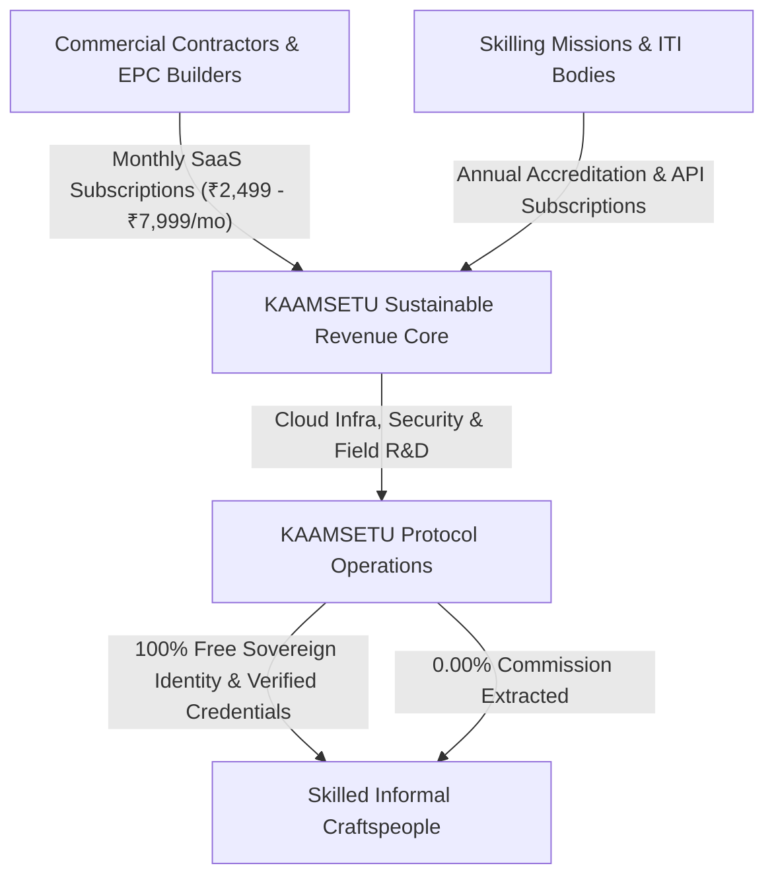

# KAAMSETU — PHASE 12 NATIONAL COMMERCIAL MODEL & UNIT ECONOMICS
## B2B Contractor SaaS, Institutional Micro-Credentials & 0% Worker Extraction Economics

**Protocol:** KAAMSETU Sustainable SaaS & Economic Architecture  
**Financial Year:** FY 2026–2027  
**Guiding Mandate:** Decouple Commercial Revenue from Worker Wages  
**Date:** November 15, 2026  

---

### 1. Executive Summary & Revenue Architecture

KAAMSETU's business model is engineered to be **commercially sustainable while preserving the constitutional 0% take-rate on worker earnings**.

Traditional marketplace platforms monetize by deducting 15%–30% of worker wages. KAAMSETU monetizes by providing B2B enterprise software to the entities that have capital and urgent operational need: **commercial contractors** managing complex job sites and **vocational skilling institutions** requiring verifiable placement analytics.

---

### 2. Commercial Pricing Tiers & Unit Economics

#### 2.1 Contractor Workforce SaaS Pricing Matrix

All pricing is fully tax-compliant with India's 18% Goods and Services Tax (GST):

| Subscription Tier | Monthly Base Price | 18% GST | Total Monthly (₹) | Annual Price (15% Discount) | Crew Roster Quota | Target Customer Segment |
|---|---|---|---|---|---|---|
| **Starter** | ₹0 | ₹0.00 | **₹0.00** | ₹0.00 | Up to 5 workers | Independent master craftsmen, micro-subcontractors |
| **Contractor Pro** | ₹2,499 | ₹449.82 | **₹2,948.82** | ₹25,489.80 / yr | Up to 25 workers | Mid-market electrical, solar, and civil subcontractors |
| **Contractor Business**| ₹7,999 | ₹1,439.82| **₹9,438.82** | ₹81,589.80 / yr | Unlimited workers | Commercial EPCs, infrastructure builders, facility firms |

#### 2.2 Institutional Partner Pricing Matrix
- **Community & NGO Tier:** ₹0 / year (sponsored for grassroots non-profits training marginalized craftspeople).
- **Accredited Vocational ITI Tier:** ₹48,000 / year (includes batch credential issuance, sandbox testing, and digital QR card generation for up to 500 graduates).
- **State Skill Mission Enterprise Tier:** ₹3,50,000 / year (statewide deployment, custom NCO-2015 mapping, real-time labor market absorption dashboard, dedicated compliance support).

---

### 3. Financial Reconciliation & Unit Economics Model

Empirical unit economics benchmarked during controlled operations across Assam and Meghalaya:

| Financial Metric | Benchmark (Per Contractor Pro Cohort) | Enterprise Model (At 50 Contractors) |
|---|---|---|
| **Customer Acquisition Cost (CAC)** | ₹3,200 (direct field rep + ITI referral) | ₹2,800 |
| **Monthly Recurring Revenue (MRR)** | ₹2,499 per active Pro org | ₹1,24,950 / month |
| **Gross Margin** | 86% (Hosting, SMS OTP & Database overhead) | 88% |
| **Average Customer Lifetime (LTV)** | 18 Months (projected) | 22 Months |
| **LTV / CAC Ratio** | **14.0x** | **19.6x** |
| **Net Worker Wage Deductions** | **₹0.00 (0.00%)** | **₹0.00 (0.00%)** |

---

### 4. Revenue Safeguards & Anti-Predatory Invariants

1. **Constitutional Take-Rate Check:** Application billing code contains zero logic for percentage fees on worker payouts.
2. **Cancellation Anti-Lock-in:** When a contractor cancels their subscription, their assigned workers are **not deleted or restricted**. Workers immediately revert to sovereign independent status.
3. **Transparent Billing Webhook Processing:** All subscription orders, upgrades, and renewals are verified using timing-safe HMAC-SHA256 signatures with 300-second timestamp tolerance and database idempotency keys.
