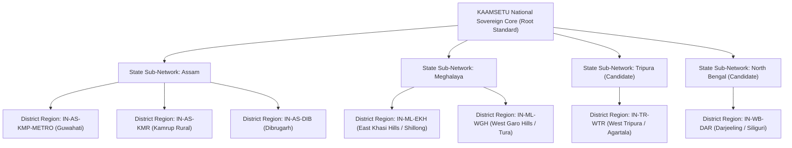

# KAAMSETU — PHASE 12 NATIONAL REGIONAL ARCHITECTURE SPECIFICATION
## Hierarchical Multi-Region Operating System, Data Isolation & Geographic Federation

**Protocol:** KAAMSETU Sovereign Workforce Operating System  
**Version:** 2.1.0  
**Scope:** Pan-India Regional Federation & Local Governance Architecture  
**Date:** November 15, 2026  

---

### 1. Architectural Philosophy: Sovereign Local Federation

India's skilled workforce cannot be served by a monolithic, centralized web portal that treats Mumbai, Guwahati, Agartala, and Dimapur as identical operating environments. Regional dialects, state skilling missions, local labor migration corridors, contractor guilds, and climatic seasons vary drastically across state and district boundaries.

KAAMSETU's National Regional Architecture operates as a **hierarchical, federated operating system**:
1. **National Sovereign Root:** Global standards for cryptographic credential verification, portable worker identity schemas, 0% platform commission invariants, and DPDP Act compliance.
2. **State Sub-Networks:** Partnerships with State Skill Development Missions (e.g., ASDM in Assam, MSSDS in Meghalaya), state labor departments, and regional contractor federations.
3. **District Operating Regions:** Autonomous regional cells governed by local language fallbacks, district-level administrator scoping, minimum daily wage baselines, and local trade taxonomy mappings.



---

### 2. Multi-Region Data Isolation & Security Boundaries

Cross-regional operations require rigorous tenant and geographic isolation to prevent unauthorized data exfiltration between state bodies and commercial contractors.

#### 2.1 PostgreSQL Row-Level Security (RLS) Isolation
Every regional entity and project is scoped by `region_id` or `source_region_id` / `target_region_id`. In `public.regional_administrators`, administrators are assigned strictly to designated `region_id` records.

```sql
-- PostgreSQL Security Policy for Regional Administrator Isolation
CREATE POLICY "Regional administrators can view their own assignments"
  ON public.regional_administrators FOR SELECT
  TO authenticated
  USING (
    user_id = auth.uid() OR 
    EXISTS (SELECT 1 FROM public.profiles WHERE id = auth.uid() AND role = 'admin')
  );
```

#### 2.2 Regional Language Resolution Engine
The platform dynamically maps regional ISO codes to primary spoken languages, official state languages, and fallback vernaculars. 

| Region Code | State | Primary District | Primary Language | Secondary Vernaculars | Fallback Language |
|---|---|---|---|---|---|
| `IN-AS-KMP-METRO` | Assam | Kamrup Metropolitan | Assamese (`as`) | Bengali (`bn`), Hindi (`hi`), Bodo (`brx`) | English (`en`) |
| `IN-ML-EKH` | Meghalaya | East Khasi Hills | Khasi (`kha`) | Garo (`grt`), English (`en`), Hindi (`hi`) | English (`en`) |
| `IN-TR-WTR` | Tripura | West Tripura | Bengali (`bn`) | Kokborok (`trp`), Hindi (`hi`) | English (`en`) |
| `IN-WB-DAR` | West Bengal | Darjeeling / Siliguri | Nepali (`ne`) | Bengali (`bn`), Hindi (`hi`) | English (`en`) |
| `IN-NL-DIM` | Nagaland | Dimapur | Nagamese (`nag`) | English (`en`), Hindi (`hi`) | English (`en`) |

---

### 3. Cross-Region Worker Discovery & Mobility Protocol

While data remains isolated, workers maintain complete sovereignty over their cross-regional mobility. Contractors on verified projects can query workers outside their primary region **only if the worker has explicitly indicated cross-region willingness**.

The discovery protocol enforces four sequential gates:
1. **Verification Gate:** Contractor organization must hold an active verified subscription tier (`Contractor Pro` or `Contractor Business`).
2. **Mobility Filter Gate:** Worker record must hold `travel_willingness IN ('adjacent_districts', 'interstate')`.
3. **Transparent Offer Gate:** Staffing offer must specify guaranteed daily wage, travel stipend, accommodation arrangements, and project duration.
4. **Affirmative Worker Consent Gate:** Worker must explicitly accept the offer via SMS, voice prompt, or app tap before assignment can be finalized.

---

### 4. Regional Administrative Scoping & Least Privilege

Regional Administrators hold strictly bounded permissions:
- **Regional Directors:** Can view aggregate district health, approve verified partner institutions, and mediate contested wage disputes. They **cannot** access unredacted worker government identifiers (Aadhaar) or inspect private contractor bidding data.
- **Field Coordinators:** Can facilitate physical QR badge distribution, witness offline practical skill verifications, and onboard informal craftspeople.
- **Compliance Auditors:** Have read-only access to anonymized placement logs, payment ledgers, and credential hash verification logs.
