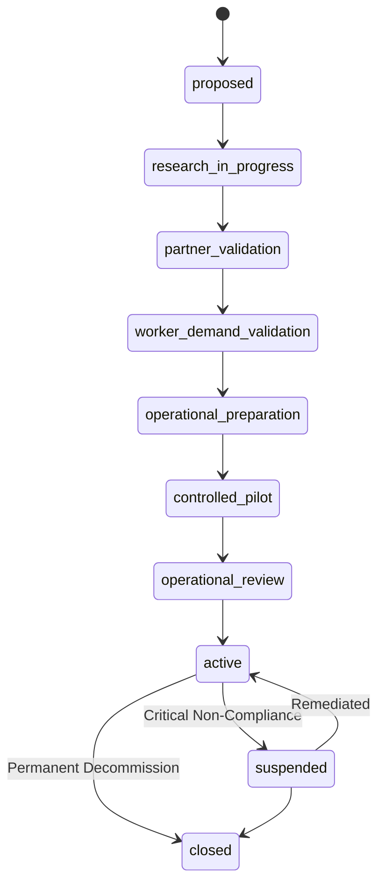

# KAAMSETU — PHASE 12 REGIONAL LAUNCH FRAMEWORK
## Repeatable 10-Stage Lifecycle, Readiness Scorecard & State Expansion Protocol

**Protocol:** KAAMSETU Regional Expansion Framework  
**Version:** 2.1.0  
**Scope:** Replicable State & District Launch Methodology  
**Date:** November 15, 2026  

---

### 1. Executive Summary & Philosophy of Controlled Expansion

Scaling a workforce infrastructure platform across India requires discipline. Prematurely expanding into a new state without grassroots anchor partners, vernacular voice extraction models, local skilling mission alignment, and contractor demand creates "ghost directories" that erode worker trust.

KAAMSETU establishes a **formal 10-stage state machine** for regional expansion. No region can advance to an active commercial state without mathematically satisfying a rigorous 10-dimension readiness scorecard.



---

### 2. The 10-Stage Regional Lifecycle State Machine

Each transition is auditable and immutably recorded in `public.regional_launch_transitions`.

| Stage | Name | Description & Exit Criteria | Primary Stakeholders |
|---|---|---|---|
| **Stage 1** | `proposed` | Initial geographic proposal identified through state economic corridors or contractor migration flows. | Expansion Lead |
| **Stage 2** | `research_in_progress` | Field research into local trade clusters, vernacular dialects, prevailing daily wages, and existing apprenticeship infrastructure. | Field Research Team |
| **Stage 3** | `partner_validation` | Institutional partnership validation with State Skill Missions (e.g. ASDM, MSSDS) or accredited vocational ITIs. | Institutional Director |
| **Stage 4** | `worker_demand_validation` | Structured worker outreach via local labor chowks and shansi centers confirming worker need and appetite for digital proof of skill. | Community Coordinator |
| **Stage 5** | `operational_preparation` | Technical configuration: dialect NLP tuning, field coordinator onboarding, QR card printing logistics, and partner API sandbox provisioning. | Technical DevOps Lead |
| **Stage 6** | `controlled_pilot` | Closed field pilot with cohort of 25–50 workers across 2–3 priority trades and 2–4 verified local contractors. | Field Operations Manager |
| **Stage 7** | `operational_review` | Post-pilot audit: wage fulfillment rate, QR scan reliability, dispute rates, and worker satisfaction measurement. | Compliance Auditor |
| **Stage 8** | `active` | Full operational deployment: public worker onboarding, active contractor project staffing, and live institutional credentialing. | Regional Director |
| **Stage 9** | `suspended` | Temporary emergency halt triggered by systemic non-payment, labor violence, or security non-compliance. | Chief Operating Officer |
| **Stage 10** | `closed` | Orderly regional wind-down with 100% preservation of all worker digital identities and historical credentials. | Board of Directors |

---

### 3. The 10-Dimension Readiness Scorecard

A region must achieve a **total score ≥ 80 out of 100 points** with **0 critical blocking gaps** before transitioning from `controlled_pilot` to `active`.

| # | Readiness Dimension | Weight | Minimum Threshold | Scoring Rubric |
|---|---|---|---|---|
| 1 | **Language Dialect & NLP Support** | 10 pts | 8 pts | Speech-to-text accuracy in primary regional dialect ≥ 90%. |
| 2 | **Institutional Anchor Partner** | 10 pts | 8 pts | At least 1 verified state skill mission or accredited ITI partner under active MoU. |
| 3 | **Contractor Demand Density** | 10 pts | 7 pts | Minimum 3 registered, KYC-verified contractors with active upcoming project rosters. |
| 4 | **Worker Community Density** | 10 pts | 8 pts | Minimum 50 onboarded skilled workers across at least 3 distinct trades. |
| 5 | **Field Operations Team** | 10 pts | 8 pts | Dedicated local field coordinator trained in biometric assistance and QR badge issuance. |
| 6 | **Payment Transparency Channel** | 10 pts | 8 pts | Established zero-commission payment transparency ledger and digital UPI verification. |
| 7 | **Dispute Resolution Mechanism** | 10 pts | 8 pts | Bounded dispute mediation protocol with maximum 7-day resolution SLA. |
| 8 | **Legal & Regulatory Compliance** | 10 pts | 9 pts | Compliance with state Inter-State Migrant Workmen rules and DPDP Act 2023. |
| 9 | **Low-Connectivity QR Offline Infra** | 10 pts | 8 pts | Field-tested offline QR verification with key rotation and tamper-detection. |
| 10 | **Whistleblower & Worker Safety** | 10 pts | 8 pts | Active anonymous safety reporting and anti-retaliation review mitigation. |

---

### 4. Candidate Region Evaluation: Tripura, North Bengal & Nagaland

Using the Phase 12 lifecycle engine `evaluateRegionalReadinessScorecard()`, three candidate expansion regions were benchmarked against operational baselines:

```
=================================================================
REGIONAL READINESS SCORECARD BENCHMARK (PHASE 12)
=================================================================
Region: IN-TR-WTR (West Tripura / Agartala)
Total Score: 68 / 100
Current Stage: research_in_progress
Advance to Active Permitted: NO (Score < 80)
Blocking Gaps:
- Institutional partner MoU pending formal state signature
- Contractor demand density below active threshold (requires >=3 verified orgs)
- Local field coordinator training incomplete

Region: IN-WB-DAR (North Bengal / Siliguri & Darjeeling)
Total Score: 64 / 100
Current Stage: research_in_progress
Advance to Active Permitted: NO (Score < 80)
Blocking Gaps:
- Nepali/Bengali code-switched voice extraction validation pending
- ITI Siliguri API integration in sandbox testing
- Cross-border migration legal review incomplete

Region: IN-NL-DIM (Nagaland / Dimapur)
Total Score: 52 / 100
Current Stage: proposed
Advance to Active Permitted: NO (Score < 80)
Blocking Gaps:
- Nagamese dialect audio corpora collection in progress
- Traditional artisan tribal guild council consultations ongoing
- Local dispute arbitration integration unmapped
=================================================================
```

**Conclusion:** The launch framework strictly prevents premature national announcements. Active status is reserved solely for regions that have proven operational stability, institutional anchoring, and worker protection.
