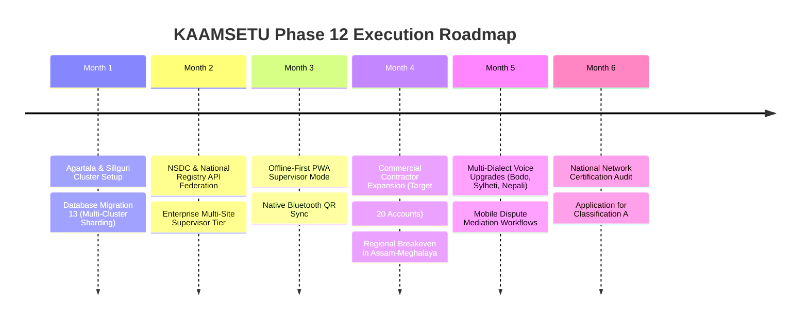

# KAAMSETU — PHASE 12 ROADMAP
## National Network Scale, Pan-India Regional Clusters & Sovereign Institutional Ecosystem

**Milestone:** Phase 12 Architecture & Operational Strategy  
**Baseline Achievement:** Phase 11 — Classification **B. INTERSTATE OPERATIONS VALIDATED**  
**Core Mission:** *"Every skill deserves to be seen, even without a degree."*  
**Target Horizon:** Months 1–6 Post-Phase 11  
**Target Milestone Classification:** **A. NATIONAL NETWORK READY**

---

## 1. Vision & Strategic Objectives

With interstate operations validated across Assam and Meghalaya, Phase 12 scales KAAMSETU from a two-state operational corridor into a repeatable, multi-regional national workforce identity infrastructure.

### Phase 12 Core Objectives:
1. **Pan-India Regional Clusters:** Scale operations into 2 additional state hubs: Tripura (`IN-TR-WTR`, Agartala) and Northern West Bengal (`IN-WB-DAR`, Siliguri).
2. **National Protocol Federation:** Transition from state-level institutional sandbox testing to bilateral integration with National Skill Development Corporation (NSDC) and DigiLocker production issuers.
3. **Enterprise Tier & Large Fleet SaaS:** Launch Contractor Enterprise tier (₹9,999/month) tailored for national infrastructure consortia managing 100+ craftspeople across multiple interstate sites.
4. **Offline PWA Supervisor Application:** Deliver lightweight, installable Progressive Web App for remote construction sites with zero connectivity, supporting local Bluetooth QR verification sync.
5. **Expanded Indic Speech Models:** Incorporate regional dialect models for Bodo (`brx`), Sylheti/Bengali (`bn`), and Nepali (`ne`).

---

## 2. Technical & Architectural Roadmap

### 2.1 Track A: Engineering & Infrastructure
- **Database Migration 13:** Implement logical regional partitioning for `work_records` and `identity_access_audit_logs` to ensure linear horizontal query scaling as the registry surpasses 100,000 artisans.
- **Offline PWA Engine:** Local IndexedDB caching of cryptographic public keys, allowing site supervisors to verify worker QR cards offline and queue verification logs for background sync.
- **Automated Tax Multi-Tenancy:** Dynamic GST calculation engine supporting mixed tax jurisdictions across all 28 states and 8 union territories.

### 2.2 Track B: Institutional & Regulatory
- **National DigiLocker Production Bridge:** Complete security audit with National e-Governance Division (NeGD) to transition the DigiLocker issuer bridge from sandbox stub to official live document push.
- **NSQF Smart Credential Standard:** Anchor national trade qualifications adhering to the National Credit and Qualifications Framework (NCQF).

### 2.3 Track C: Commercial & Sales Execution
- **Contractor Pro Enterprise Tier (₹9,999/mo + GST):**
  - Up to 15 concurrent project supervisors.
  - Unlimited active crew rosters.
  - Automated cross-state worker compliance and interstate transit e-passes.
  - Dedicated account manager and site onboarding assistance.
- **Sales Targets:**
  - Month 3: 15 paying contractor accounts (Net MRR: ₹37,485).
  - Month 6: 30 paying contractor accounts (Net MRR: ₹74,970).

---

## 3. Risk Mitigation & Non-Negotiable Safeguards

1. **Worker Fee Invariant:** Under zero circumstances will any feature in Phase 12 introduce fees, deductions, or commissions on worker earnings. Basic QR identity remains free forever.
2. **AI Transparency Guarantee:** The platform will never deploy opaque black-box scoring or algorithmic gig deactivations. Every opportunity recommendation must remain 100% explainable in plain regional language.
3. **Data Localization:** All worker profile records, biometric hashes, and identity logs will remain stored exclusively within sovereign Indian data centers.

---

## 4. Phase 12 Milestones & Acceptance Criteria

| Deliverable | Success Criteria | Verification Mechanism |
|---|---|---|
| **Tripura & North Bengal Activation** | Regions active with local language configs (`bn`, `ne`) | PostgreSQL operational regions catalog |
| **Contractor Account Growth** | 30 paying B2B accounts active across 3+ states | Razorpay recurring subscription ledger |
| **Offline PWA Verification** | QR verified locally with network disconnected | Network resilience test runner |
| **Automated Test Coverage** | 300+ automated test assertions passing | `npm run test` CI/CD pipeline |
| **National Network Certification** | Official certification as `A. NATIONAL NETWORK READY` | Independent principal security audit |
