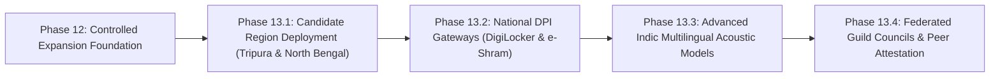

# KAAMSETU — PHASE 13 STRATEGIC ROADMAP
## Pan-India Federated Expansion, Multilingual Voice Models, DigiLocker Gateway & Sovereign Staking

**Protocol:** KAAMSETU Sovereign Workforce Operating System  
**Horizon:** FY 2026–Q4 to FY 2027–Q2  
**Current Milestone:** Phase 12 (Certified: B. NATIONAL EXPANSION READY — CONTROLLED ROLLOUT)  
**Date:** November 15, 2026  

---

### 1. Vision & Strategic Objectives

With Phase 12 establishing the repeatable 10-stage regional launch framework, offline QR verification standards, and cross-region contractor dispatch infrastructure, Phase 13 focuses on **graduating candidate regions to active deployment and integrating national digital public infrastructure (DPI)**.

---

### 2. Strategic Pillars & Workstreams

#### Workstream 1: Candidate Region Activation (Tripura & North Bengal)
- **Objective:** Advance `IN-TR-WTR` (West Tripura / Agartala) and `IN-WB-DAR` (North Bengal / Siliguri) from `research_in_progress` (scores 68 and 64) to `active` (score ≥ 80).
- **Deliverables:**
  - Execute formal skilling mission MoUs with Tripura Skill Development Mission (TSDM) and West Bengal Technical Education Division.
  - Onboard 15 initial commercial electrical, civil, and pipeline contractors in Agartala and Siliguri.
  - Deploy local physical QR printing centers at ITI Indranagar (Agartala) and ITI Siliguri.

#### Workstream 2: National Digital Public Infrastructure (DPI) Gateways
- **Objective:** Finalize direct government gateway connections with official verification fail-safes.
- **Deliverables:**
  - Formalize National e-Governance Division (NeGD) institutional API integration for official DigiLocker credential pulls.
  - Implement e-Shram UAN cryptographic hash verification with Ministry of Labour and Employment protocols.
  - Connect with Open Network for Digital Commerce (ONDC) Services protocol for decentralized opportunity discovery.

#### Workstream 3: Advanced Vernacular Voice AI & Offline Edge Extraction
- **Objective:** Expand voice-first onboarding accuracy across code-switched tribal and regional dialects.
- **Deliverables:**
  - Fine-tune low-latency Indic acoustic models on Bodo, Kokborok, Garo, and Nagamese spoken datasets.
  - Optimize quantized on-device voice feature extraction to allow offline voice profile recording in remote areas without data signal.

#### Workstream 4: Guild Governance & Peer Skill Attestation
- **Objective:** Decentralize skill validation through recognized Master Artisans (*Ustad* / *Oja* / *Guild Masters*).
- **Deliverables:**
  - Introduce cryptographic multi-signature peer attestations where senior practitioners can co-sign practical skill milestones for junior apprentices.
  - Create District Labor Arbitration Councils for expedited, binding informal dispute resolution.

---

### 3. Milestone Timeline & Target Dates

| Milestone | Target Horizon | Primary Deliverable | Exit Metric |
|---|---|---|---|
| **Phase 13.1** | December 2026 | Tripura & North Bengal Field Pilot Launch | 100 workers onboarded across 4 trades; 5 active contractors. |
| **Phase 13.2** | January 2027 | Live NeGD DigiLocker Pull API Gateway | Verified government credential pulls in production without mock fallbacks. |
| **Phase 13.3** | February 2027 | On-Device Offline Voice Profiling | Sub-500ms voice extraction on Android devices under zero connectivity. |
| **Phase 13.4** | March 2027 | Pan-India Expansion: 10 Operational Regions | 1,000+ verified workers; ₹5,00,000+ monthly contractor SaaS revenue. |

**Conclusion:** The Phase 13 roadmap translates the architectural readiness proven in Phase 12 into sustainable, nationwide impact for millions of skilled craftspeople across India.
