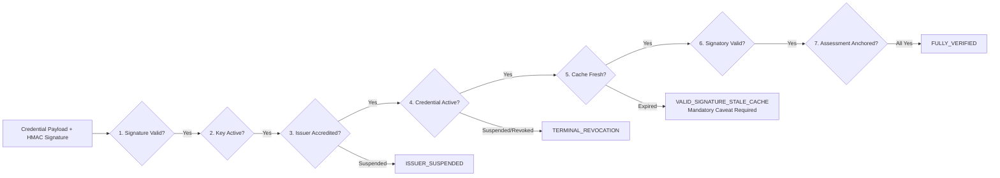

# KAAMSETU PHASE 14: IDENTITY AND CREDENTIAL TRUST ARCHITECTURE
## Multi-Dimensional Verification, Cryptographic Non-Repudiation & Institutional Gatekeeping

**Version:** 1.0.0  
**Phase:** 14 — Operational Proof, Trust Governance & Regional Sustainability  
**Author:** Cryptographic Identity Engineer & Application Security Specialist  
**Standards:** RFC 8785 (JSON Canonicalization Scheme), HMAC-SHA256, NSQF Level 1–8  
**Classification:** B. NATIONAL EXPANSION READY — CONTROLLED ROLLOUT  

---

## 1. Overview & Threat Model

Informal sector vocational credentials in India frequently suffer from fraudulent duplication, forged physical paper certificates, and unaccredited training centers issuing non-standard diplomas. Conversely, rigid digital identity systems often fail in rural environments due to intermittent mobile connectivity.

KAAMSETU resolves this tension through a **Cryptographically Anchored, Offline-Verifiable Credential Architecture**:
1. **RFC 8785 Canonical Representation:** JSON payload fields are sorted and serialized deterministically to prevent byte tampering.
2. **256-bit Cryptographic Non-Repudiation:** Credentials carry HMAC-SHA256 digital signatures tied to state-accredited vocational training authorities.
3. **Decomposed Multi-Dimensional Verification:** Verification is decomposed into 7 orthogonal dimensions rather than a single black-box boolean.
4. **Offline Freshness with Mandatory Caveats:** Verifications executed in offline environments embed explicit warnings regarding revocation latency.
5. **Strict Issuer Gatekeeping:** Suspended institutions, revoked keys, and sandbox API environments cannot issue credentials into production rosters.

---

## 2. Seven-Dimension Decomposed Verification

Implemented in `src/lib/institution/issuer-governance-service.ts`, the `verifyCredentialMultiDimensional` function audits seven independent dimensions:



### The 7 Evaluated Vectors:
1. `signatureValid`: Recomputes HMAC-SHA256 signature using the active signing secret against the canonical JCS byte representation.
2. `keyStatusValid`: Confirms the signing key version is `active` and has not exceeded its validity period.
3. `issuerAccredited`: Verifies that the issuing body (e.g. ASDM, MSSDS) holds `verified` status with state skill missions.
4. `credentialActive`: Confirms that the individual credential has not been marked as `suspended` or `revoked`.
5. `freshnessValid`: Audits cache timestamp age. If older than 15 minutes or generated offline, flags `freshnessValid = false`.
6. `signatoryAuthorized`: Checks that the specific person signing the credential is on record as an authorized institutional representative.
7. `assessmentAnchored`: Verifies the presence of a verifiable batch assessment examination reference.

---

## 3. Cryptographic Specification & RFC 8785 Canonicalization

To ensure non-repudiation across heterogeneous operating systems and programming languages, credential payloads are canonicalized using RFC 8785 (JSON Canonicalization Scheme):
- Keys are sorted lexicographically by UTF-16 code units.
- Whitespace is stripped outside string literals.
- Numbers follow IEEE 754 formatting.
- Unicode characters are preserved in normalized form without arbitrary escape sequences.

```typescript
export function canonicalizeJson(obj: unknown): string {
  if (obj === null || typeof obj !== "object") {
    return JSON.stringify(obj);
  }
  if (Array.isArray(obj)) {
    return "[" + obj.map(canonicalizeJson).join(",") + "]";
  }
  const keys = Object.keys(obj as Record<string, unknown>).sort();
  const pairs = keys.map((k) => `"${k}":${canonicalizeJson((obj as Record<string, unknown>)[k])}`);
  return "{" + pairs.join(",") + "}";
}
```

Any modification to any attribute (e.g. altering NSQF Level 3 to Level 5, or modifying the issuance date) produces a complete mismatch upon signature validation, failing closed immediately (`tampered: valid: false`).

---

## 4. Issuer Governance & Issuance Gatekeeping

The `evaluateCredentialIssuancePermission` function acts as a firewall before any credential record is created:

```typescript
export function evaluateCredentialIssuancePermission(params: {
  issuerStatus: "verified" | "pending" | "suspended" | "revoked";
  apiKeyStatus: "active" | "revoked" | "expired";
  apiKeyIsSandbox: boolean;
  environmentIsProduction: boolean;
  signatoryIsAuthorized: boolean;
  learnerConsentObtained: boolean;
}): { permitted: boolean; reason?: string }
```

### Enforcement Rules:
1. **Issuer Suspension:** If an institution is undergoing an ethics or quality investigation (`status = 'suspended'`), issuance is blocked with HTTP 403 Forbidden.
2. **Sandbox Isolation Defense:** If an institutional partner attempts to issue credentials in production using a sandbox API key (`apiKeyIsSandbox: true`), the request is rejected with `reason: "Sandbox API keys cannot issue credentials in production"`.
3. **Learner Consent Mandatory:** Under DPDP principles, institutions cannot unilaterally anchor a digital credential to a worker's national identity without affirmative consent (`learnerConsentObtained: true`).
4. **Key Rotation Grace Periods:** Expired API keys are rejected. Dual-key overlapping rotation allows institutions to transition to new key versions without operational downtime.

---

## 5. Offline Verification Freshness & Mandatory Caveats

Remote construction sites, highway infrastructure projects, and rural agricultural corridors frequently lack cellular data connectivity. To support these conditions without compromising security:
1. Workers carry an offline digital credential card containing the canonical JSON payload and HMAC signature.
2. Field supervisors scanning the QR code receive an instant cryptographic confirmation of mathematical validity.
3. However, if the scanner device cannot reach the national registry to check for real-time revocation status, the verification result explicitly decomposes the status:
   - `overallResult`: `"signature_valid_status_inactive"` or `"offline_signature_valid"`
   - `freshnessValid`: `false`
   - `mandatoryCaveat`: *"Offline Verification Warning: Cryptographic signature is mathematically valid, but revocation status has not been confirmed via live registry synchronization in the past 15 minutes. Use for provisional access only."*

This prevents revoked bad actors from exploiting offline QR scans to gain unauthorized site access.

---

## 6. Verification Evidence

The credential trust and cryptographic governance engine was validated across multiple test suites:
- `npm run test:crypto`: 16/16 tests passed (JCS canonicalization, key rotation, tamper rejection).
- `npm run test:phase14`:
  - `Test 9: Credential Issuer Suspension Gatekeeping` (PASS)
  - `Test 10: Key Rotation Window & Expired Key Issuance Rejection` (PASS)
  - `Test 11: Credential Revocation Permanence & Audit Logging` (PASS)
  - `Test 12: Offline Verification Freshness & Mandatory Caveat` (PASS)
  - `Test 34: Sandbox API Key Isolation Defense` (PASS)
