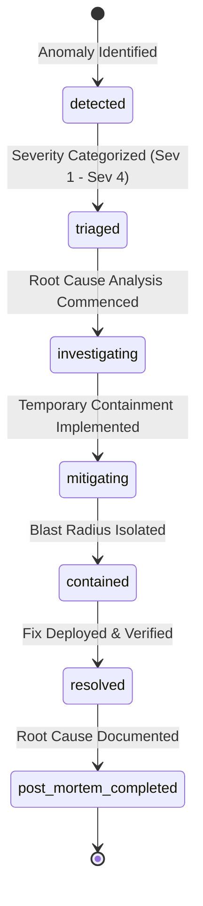

# KAAMSETU PHASE 14: INCIDENT RESPONSE RUNBOOK
## Formal 7-Stage Incident Lifecycle, Operational Playbooks & Emergency Procedures

**Version:** 1.0.0  
**Phase:** 14 — Operational Proof, Trust Governance & Regional Sustainability  
**Author:** Principal Platform Reliability Engineer & Security Operations Lead  
**Classification:** B. NATIONAL EXPANSION READY — CONTROLLED ROLLOUT  

---

## 1. Incident Lifecycle & 7-Stage State Machine

Operational anomalies, security breaches, or regulatory disputes must follow a formal, sequential 7-stage lifecycle. Arbitrary jumps across stages (e.g. closing an incident directly from `detected` without triaging or post-mortem) are strictly prohibited at the application service layer:



### State Machine Implementation (`src/lib/security/incident-response-service.ts`):

```typescript
const VALID_TRANSITIONS: Record<IncidentStage, IncidentStage[]> = {
  detected: ["triaged"],
  triaged: ["investigating", "contained"],
  investigating: ["mitigating", "contained"],
  mitigating: ["contained"],
  contained: ["resolved"],
  resolved: ["post_mortem_completed"],
  post_mortem_completed: [],
};

export function validateIncidentStageTransition(
  currentStage: IncidentStage,
  targetStage: IncidentStage
): boolean {
  return VALID_TRANSITIONS[currentStage]?.includes(targetStage) ?? false;
}
```

Verified in Phase 14 Test Suite (`Test 29: Formal 7-Stage Incident Response Lifecycle`).

---

## 2. Severity Classification Matrix

| Severity Level | Definition | Impact Scope | Target Response | Incident Commander |
|:---|:---|:---|:---:|:---|
| **Sev 1: Critical** | System-wide outage; cryptographic key compromise; mass worker PII leak; severe safety hazard | National / Multi-State | **15 Minutes** | Chief Technology Officer |
| **Sev 2: Major** | Regional database latency >1000ms; payment webhook processing failure; active retaliatory review campaign | Single State / Regional Hub | **30 Minutes** | Lead Security Engineer |
| **Sev 3: Moderate** | Single contractor billing glitch; voice model dialect recognition drop <80%; individual wage dispute | Single Organization / Cohort | **2 Hours** | Senior Full-Stack Engineer |
| **Sev 4: Minor** | Cosmetic UI bug; minor translation typo; non-blocking telemetry delay | Non-operational | **24 Hours** | On-Call Support Engineer |

---

## 3. Standard Operational Playbooks

### 3.1 Playbook A: Institutional Key Compromise or Credential Forgery
**Trigger:** Detection of invalid HMAC signatures using a known institutional key, or notification from ASDM/MSSDS that an API secret was leaked.

1. **Phase 1: Immediate Revocation**
   - Execute key revocation in `institutional_partner_api_keys`:
     ```sql
     UPDATE public.institutional_partner_api_keys
     SET status = 'revoked', revoked_at = now()
     WHERE key_name = 'Compromised_Key_V1';
     ```
2. **Phase 2: Quarantine Active Credentials**
   - Automatically mark credentials signed by the compromised key version as `status = 'suspended'`.
3. **Phase 3: Key Generation & Re-Issuance**
   - Issue new 256-bit cryptographic key version `V2` to the institutional signatory via encrypted out-of-band channel.
   - Batch re-sign valid historical credentials under `V2`.
4. **Phase 4: Post-Mortem**
   - Log forensic entry in `operational_incidents_lifecycle`.

### 3.2 Playbook B: Coordinated Retaliatory Review Attack
**Trigger:** Worker files wage theft claim; contractor submits multiple 1-star negative reviews across worker's profile.

1. **Phase 1: Automated Quarantine**
   - Review moderation engine detects active wage dispute in `worker_disputes` and quarantines the review (`is_quarantined = true`, `quarantine_reason = 'Active dispute mediation window'`).
2. **Phase 2: Blast Radius Neutralization**
   - Confirm worker's public KaamScore remains unchanged.
3. **Phase 3: Formal Mediation Investigation**
   - Regional mediator reviews contractor comments against site completion certificates.
4. **Phase 4: Resolution & Suppression**
   - If bad-faith retaliation is confirmed, appeal status transitions to `suppressed_retaliatory` in `review_moderation_appeals`.

### 3.3 Playbook C: Webhook Replay or Financial Discrepancy
**Trigger:** Payment gateway webhooks arrive with mismatched amounts or timestamps >300 seconds.

1. **Phase 1: Rejection & Exception Logging**
   - Webhook middleware rejects payload with HTTP 400.
   - Insert discrepancy record into `financial_reconciliation_exceptions`.
2. **Phase 2: Gateway Log Inspection**
   - Query Razorpay/bank merchant dashboard for transaction reference.
3. **Phase 3: Idempotent Manual Re-conciliation**
   - If legitimate payment was delayed by network partition, invoke `reconcileFinancialTransactions` with explicit transaction reference.

### 3.4 Playbook D: Civil Disturbance / Regional Emergency Suspension
**Trigger:** Severe flooding in Brahmaputra basin or local curfew impacting Guwahati/Kamrup.

1. **Phase 1: Dual-Approval Regional Suspension**
   - Regional coordinator initiates suspension request in `regional_dual_approvals`.
   - Platform admin executes secondary approval.
2. **Phase 2: Opportunity Routing Block**
   - `validateRegionOpportunityRouting` automatically halts new job dispatches into the affected region.
3. **Phase 3: Worker Safety Broadcast**
   - Trigger localized Assamese/Bengali SMS advisories informing enrolled workers to stay safe.

---

## 4. Post-Mortem Requirements & Documentation

Every Sev 1 or Sev 2 incident requires a published Post-Mortem within 48 hours of resolution:
- **Timeline of Events (UTC and IST)**
- **Root Cause Analysis (5 Whys methodology)**
- **Blast Radius & Impact (Workers / Contractors affected)**
- **Corrective Engineering Actions (GitHub Issues & PRs)**
- **Preventative Database / Architecture Hardening**
