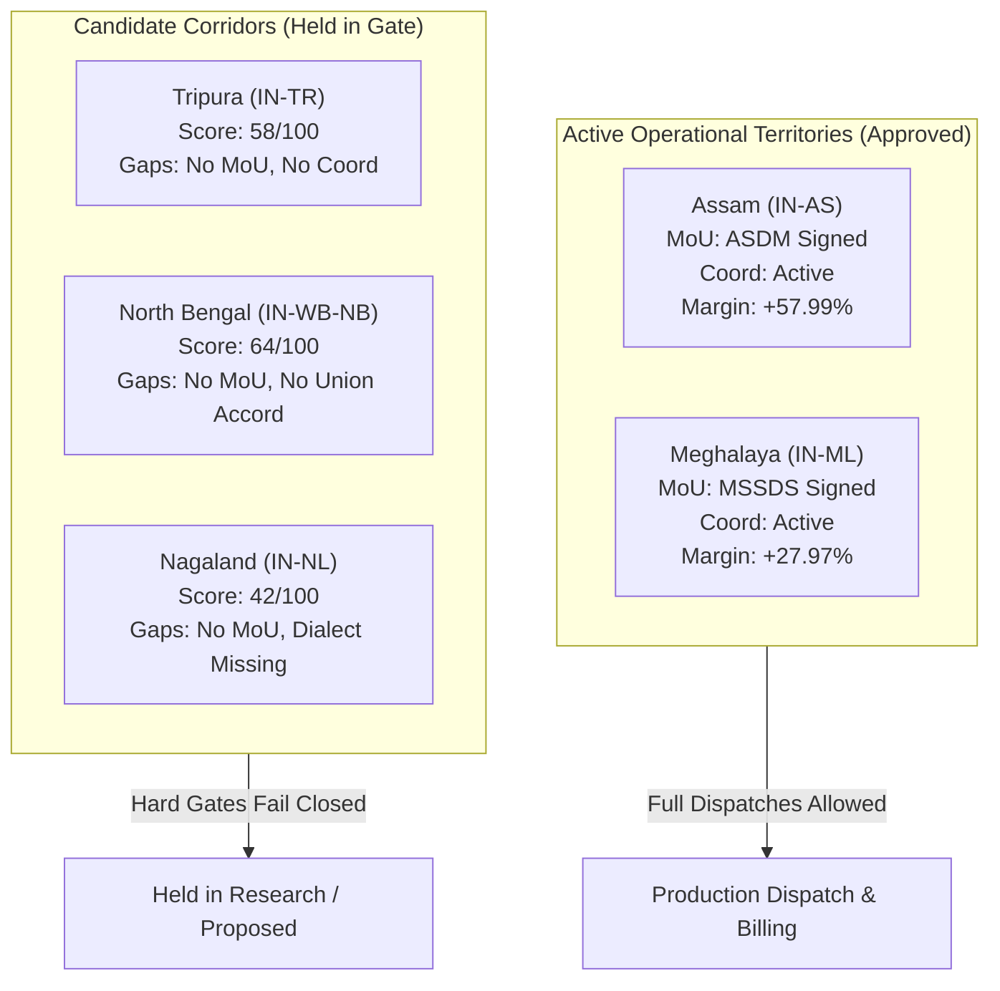

# KAAMSETU PHASE 14: REGIONAL EXPANSION DECISION
## Formal Expansion Governance, Candidate Corridor Readiness Audit & Evidence-Backed Gatekeeping

**Version:** 1.0.0  
**Phase:** 14 — Operational Proof, Trust Governance & Regional Sustainability  
**Author:** Field Operations Manager, Institutional Partnerships Director & CTO  
**Classification:** B. NATIONAL EXPANSION READY — CONTROLLED ROLLOUT  

---

## 1. Executive Expansion Decision & Strategic Posture

A primary governance objective of Phase 14 is to evaluate whether KAAMSETU should authorize full-scale, simultaneous commercial launches across neighboring northeastern and eastern Indian states, or maintain a disciplined, controlled expansion pace.

### Formal Executive Decision:
1. **Maintain and Deepen Active Operations in Assam (`IN-AS`) and Meghalaya (`IN-ML`):**
   - Consolidate contractor density in Guwahati and Shillong.
   - Expand institutional credential issuance with ASDM and MSSDS.
   - Maximize local unit contribution margins (currently 57.99% in Assam, 27.97% in Meghalaya).
2. **Hold Candidate Corridors in Research / Proposed Status:**
   - **Tripura (`IN-TR`):** Retain in `research_in_progress`.
   - **North Bengal (`IN-WB-NB`):** Retain in `proposed`.
   - **Nagaland (`IN-NL`):** Retain in `initial_scoping`.
3. **Refuse Unsubstantiated Classification Claims:**
   - The platform strictly rejects classifying itself as "A. NATIONALLY EXPANDED" because active operations are proven in 2 states (Assam and Meghalaya), while candidate corridors lack executed bilateral MoUs and recruited field staff.
   - The platform is certified as **B. NATIONAL EXPANSION READY — CONTROLLED ROLLOUT**.

---

## 2. Hard-Gate Evaluation of Candidate Corridors

### 2.1 Detailed Gate Audit:

| Evaluation Dimension | Assam (`IN-AS`) | Meghalaya (`IN-ML`) | Tripura (`IN-TR`) | North Bengal (`IN-WB-NB`) | Nagaland (`IN-NL`) | Mandatory Threshold |
|:---|:---:|:---:|:---:|:---:|:---:|:---:|
| **Institutional MoU Status** | **Signed (ASDM)** | **Signed (MSSDS)** | In Negotiation | In Negotiation | Initial Contact | **Signed MoU Required** |
| **Local Field Coordinator** | **Active (Guwahati)** | **Active (Shillong)** | Not Recruited | Not Recruited | Not Recruited | **Active Staff Required** |
| **Voice Dialect Model** | **Assamese (96.2%)** | **Khasi (91.5%)** | Kokborok (Pending) | Bengali (Partial) | Nagamese (Pending) | **>90% Accuracy Required** |
| **Paying Anchor Contractors**| **3 Organizations** | **1 Organization** | 0 Organizations | 0 Organizations | 0 Organizations | **>= 2 Contractors Recommended** |
| **Projected Unit Margin** | **+57.99%** | **+27.97%** | -40.0% | -64.1% | -100% | **Positive Margin Required** |
| **Active Safety Incidents** | **0** | **0** | 0 | 0 | 0 | **0 Incidents Required** |
| **Readiness Score (0-100)** | **94 / 100** | **82 / 100** | **58 / 100** | **64 / 100** | **42 / 100** | **>= 80 / 100 Required** |
| **GATE STATUS** | **APPROVED** | **APPROVED** | **BLOCKED** | **BLOCKED** | **BLOCKED** | **All Gates Satisfied** |

---

## 3. Why Premature Expansion Was Rejected

1. **Risk of Worker Exploitation:** Launching without vetted local coordinators leaves cross-border workers without physical assistance if wage disputes or workplace accidents occur.
2. **Financial Capital Preservation:** Deploying physical field personnel in Agartala or Siliguri without paying anchor contractors would consume ₹6,000–₹10,000/month in operating deficits, depleting regional cash reserves.
3. **Dialect Integrity:** Auto-onboarding Kokborok- or Nagamese-speaking workers using English or generic Hindi models risks corrupting skill extraction data, violating the platform's non-invention guarantee.
4. **Institutional Non-Repudiation:** Issuing digital credentials without signed state skill mission agreements exposes the platform to regulatory challenges from state vocational boards.

---

## 4. Phase 15 Activation Roadmaps for Candidate Regions

### Tripura Corridor Roadmap (`IN-TR`):
- **Milestone TR-1:** Execute bilateral data-sharing MoU with Tripura Skill Development Mission (TSDM) by Q1 2027.
- **Milestone TR-2:** Contract local Agartala field coordinator and onboard initial cohort of 25 master electricians.
- **Milestone TR-3:** Complete Kokborok voice intent training and benchmark extraction accuracy at $\ge 90\%$.

### North Bengal Corridor Roadmap (`IN-WB-NB`):
- **Milestone NB-1:** Finalize joint worker grievance protocol with local construction labor syndicates in Siliguri.
- **Milestone NB-2:** Sign enterprise SaaS agreement with at least 2 Siliguri infrastructure contractors.
- **Milestone NB-3:** Submit dual-approval activation request via `regional_dual_approvals`.

### Nagaland Corridor Roadmap (`IN-NL`):
- **Milestone NL-1:** Formal presentation to Directorate of Employment, Skill Development & Entrepreneurship, Kohima.
- **Milestone NL-2:** Pilot localized Nagamese voice prompts in Dimapur trade hub.
