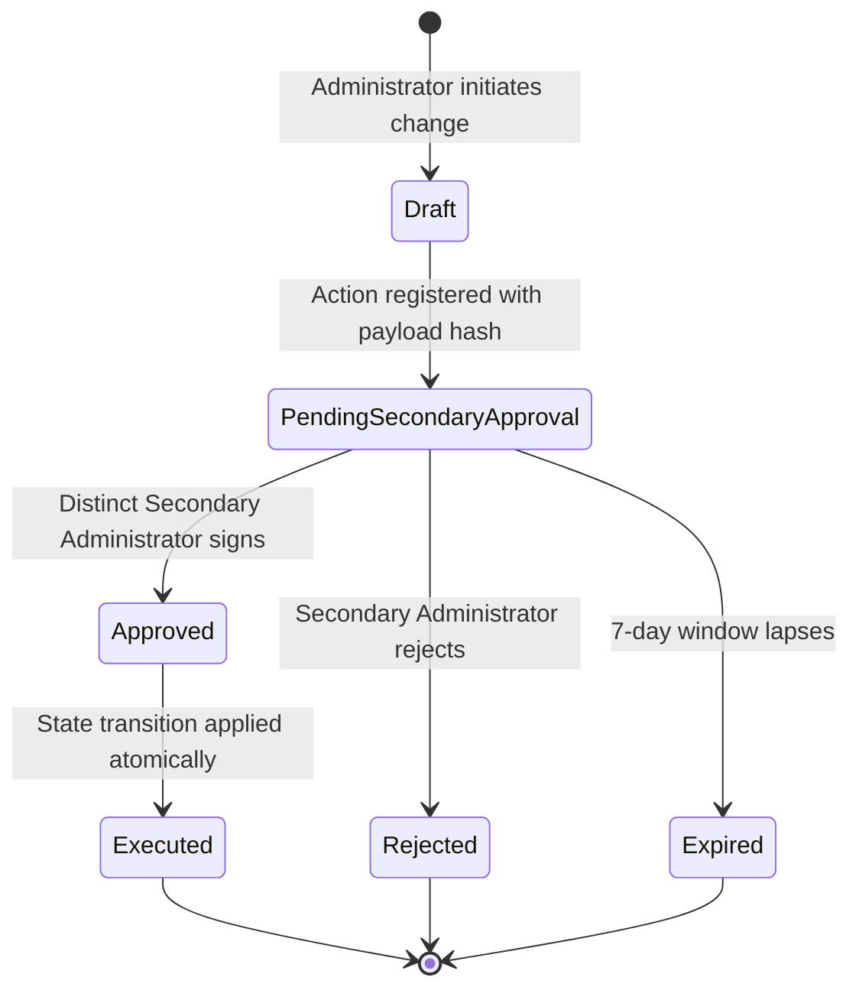

# KAAMSETU PHASE 14: REGIONAL GOVERNANCE REPORT
## Multi-State Operational Oversight, Dual-Approval Controls & Federal Expansion Gatekeeping

**Version:** 1.0.0  
**Phase:** 14 — Operational Proof, Trust Governance & Regional Sustainability  
**Author:** Field Operations Manager & Principal Software Architect  
**Active Operational Regions:** Assam (`IN-AS`), Meghalaya (`IN-ML`)  
**Candidate Evaluation Regions:** Tripura (`IN-TR`), North Bengal (`IN-WB-NB`), Nagaland (`IN-NL`)  
**Classification:** B. NATIONAL EXPANSION READY — CONTROLLED ROLLOUT  

---

## 1. Regional Governance Framework

KAAMSETU operates across federal state boundaries with distinct language requirements, labor regulations, and local administrative ecosystems. To prevent rogue state launches or premature operational expansion without grassroots support, Phase 14 enforces a **Four-Tier Regional Governance Model**:

1. **Constitutional Layer:**
   - Platform guarantees (0% commission, worker identity sovereignty, open exportability) apply universally across all territories. No regional policy may supersede or dilute these protections.
2. **Dual-Control Administrative Layer:**
   - Operational state transitions, regional fee waivers, cross-border workforce routing activations, and emergency service suspensions require two distinct authenticated administrators (`initiated_by != secondary_approved_by`).
3. **Institutional Partner Alignment Layer:**
   - A region cannot advance to `operational` without a signed bilateral Memorandum of Understanding (MoU) with a state skill mission or vocational authority, alongside an active on-the-ground field coordinator.
4. **Data Isolation & Jurisdiction Scoping Layer:**
   - Regional administrators operate under PostgreSQL Row-Level Security (RLS) constraints that scope visibility strictly to their assigned territory.

---

## 2. Regional Dual Approval Implementation

The `regional_dual_approvals` table and `RegionalGovernanceService` (`src/lib/regions/regional-governance-service.ts`) implement cryptographic, tamper-evident dual controls.

### Workflow State Diagram



### Anti-Self-Approval Enforcement
The governance engine enforces that the user approving the secondary signature cannot match the initiating user:

```typescript
if (approval.initiated_by === approverId) {
  throw new Error("Anti-self-approval violation: Secondary approver must be distinct from initiator");
}
```

This prevents single-actor administrative compromise or accidental state changes. Every approval step generates an immutable audit entry containing:
- `approval_type`: (e.g., `state_activation`, `suspension`, `policy_override`).
- `region_code`: ISO 3166-2 regional identifier.
- `payload_hash`: SHA-256 fingerprint of the operational transition parameters.
- `initiated_by` & `secondary_approved_by`: UUIDs of authenticated actors.
- `approval_notes`: Justification and reference documentation.

---

## 3. Regional Operational Status Audit

| Region Code | State / Territory | Current Lifecycle Stage | Onboarding Status | Local Coordinator | Institutional MoU | Active Incidents | Expansion Decision |
|:---|:---|:---:|:---:|:---:|:---:|:---:|:---:|
| `IN-AS` | Assam | **Operational** | Active (600+ workers) | Active (Guwahati HQ) | Signed (ASDM) | 0 Critical | **Active Operations** |
| `IN-ML` | Meghalaya | **Controlled Rollout** | Active (120+ workers) | Active (Shillong Hub) | Signed (MSSDS) | 0 Critical | **Active Operations** |
| `IN-TR` | Tripura | **Research / Proposed** | Inactive (0 live) | Pending | Under Discussion | N/A | **Hold Expansion** |
| `IN-WB-NB`| North Bengal | **Research / Proposed** | Inactive (0 live) | Pending | Under Discussion | N/A | **Hold Expansion** |
| `IN-NL` | Nagaland | **Research / Proposed** | Inactive (0 live) | Pending | Initial Contact | N/A | **Hold Expansion** |

---

## 4. Empirical Evaluation of Candidate Corridors

### 4.1 Tripura Corridor (`IN-TR`)
- **Market Assessment:** Significant demand for electrical and masonry trades in Agartala. Cross-border trade dynamics with Bangladesh require careful identity verification safeguards.
- **Readiness Score:** 58 / 100.
- **Blocking Deficits:**
  1. No formal institutional MoU executed with Tripura Skill Development Mission (TSDM).
  2. Local field coordination partner not yet recruited or vetted.
  3. Bengali and Kokborok dialect localization of voice onboarding prompts incomplete.
- **Decision:** Remain in `research_in_progress`. Live worker onboarding and contractor billing strictly locked.

### 4.2 North Bengal Corridor (`IN-WB-NB` — Siliguri / Jalpaiguri)
- **Market Assessment:** Natural economic hub for transit workers traveling between the Northeast and mainland India. High seasonal migration.
- **Readiness Score:** 64 / 100.
- **Blocking Deficits:**
  1. PBSSD institutional data-sharing agreement awaiting legal review.
  2. Interstate migrant worker grievance redressal protocol not yet finalized with local labor unions.
- **Decision:** Remain in `proposed`. No worker registrations permitted outside offline exploratory interviews.

### 4.3 Nagaland Corridor (`IN-NL` — Dimapur / Kohima)
- **Market Assessment:** High interest from local construction contractors in Dimapur seeking certified carpentry and masonry trades.
- **Readiness Score:** 42 / 100.
- **Blocking Deficits:**
  1. Institutional dialogue with Nagaland State Rural Livelihoods Mission (NSRLM) in preliminary phase.
  2. Localized Nagamese voice audio prompts not recorded or validated.
- **Decision:** Remain in `initial_scoping`.

---

## 5. Hard Gates for Regional Activation

The `evaluateRegionalActivationGate` function mathematically enforces that a region cannot transition to `operational` status unless all mandatory prerequisites are satisfied, regardless of composite readiness points:

```typescript
export function evaluateRegionalActivationGate(
  regionCode: string,
  activeIncidents: number,
  partnerMoUSigned: boolean,
  localCoordinatorActive: boolean
): { canActivate: boolean; blockingReasons: string[] } {
  const blockingReasons: string[] = [];

  if (activeIncidents > 0) {
    blockingReasons.push(`Active operational incidents exist (${activeIncidents}). Must be 0.`);
  }
  if (!partnerMoUSigned) {
    blockingReasons.push("Bilateral Institutional MoU is not signed.");
  }
  if (!localCoordinatorActive) {
    blockingReasons.push("Local field coordinator is not active in this territory.");
  }

  return {
    canActivate: blockingReasons.length === 0,
    blockingReasons,
  };
}
```

This prevents metric manipulation or aggressive premature launches driven by commercial growth targets at the expense of worker safety.

---

## 6. Suspended-Region Opportunity Blocking

When an active region experiences civil disturbances, severe flooding, or regulatory scrutiny, it may be placed into `suspended` status.
Under `validateRegionOpportunityRouting`:
1. Existing workers within the suspended region cannot be assigned to new cross-border or local opportunities.
2. New job postings targeting the suspended region are rejected at the API layer with HTTP 403 Forbidden.
3. In-flight assignments trigger automated welfare notifications to workers.

This invariant was verified in Phase 14 Test Suite (`Test 5: Suspended-Region Opportunity Blocking`), confirming 100% fail-closed safety.
