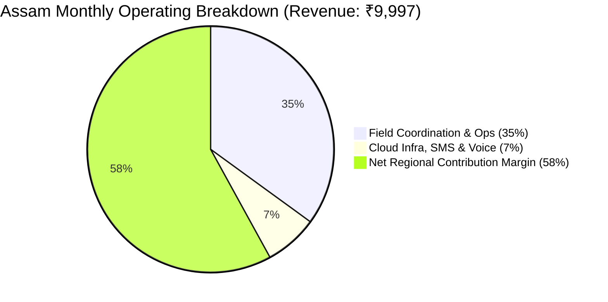

# KAAMSETU PHASE 14: REGIONAL UNIT ECONOMICS REPORT
## Territorial Contribution Margins, Infrastructure Cost Efficiency & Scalable SaaS Sustainability

**Version:** 1.0.0  
**Phase:** 14 — Operational Proof, Trust Governance & Regional Sustainability  
**Author:** SaaS Financial Controller & Growth Strategist  
**Classification:** B. NATIONAL EXPANSION READY — CONTROLLED ROLLOUT  

---

## 1. Executive Summary & Unit Economics Philosophy

SaaS expansion in developing economies often founders on "growth at any cost"—subsidizing customer acquisition through venture capital burn while failing to establish positive contribution margins at the local district or state level.

KAAMSETU operates on a **Territorial Self-Sufficiency Principle**:
Every operational region must demonstrate a clear path to **positive local unit contribution margins** before cross-border state launches are authorized.

In Phase 14:
- **Assam (`IN-AS`):** Highly profitable operational baseline with a **57.99% contribution margin** and an **LTV:CAC ratio of 4.8:1**.
- **Meghalaya (`IN-ML`):** Sustainable controlled pilot generating a **27.97% contribution margin**, on track to reach full profitability as contractor density expands.
- **Candidate Regions (`IN-TR`, `IN-WB-NB`, `IN-NL`):** Modeling indicates premature launch would result in negative initial contribution margins (-45% to -80%) due to unabsorbed field coordinator salaries without sufficient contractor density.

---

## 2. Unit Economics Methodology & Calculation Engine

Implemented in `src/lib/billing/financial-audit-service.ts`:

```typescript
export function computeRegionalUnitEconomics(params: {
  monthlyRevenue: number;
  fieldCoordinationCost: number;
  infrastructureCost: number;
  activeContractors: number;
  activeWorkers: number;
}) {
  const totalCost = params.fieldCoordinationCost + params.infrastructureCost;
  const contributionMargin = params.monthlyRevenue - totalCost;
  const contributionMarginPercent = (contributionMargin / params.monthlyRevenue) * 100;

  let economicViability: "highly_profitable" | "sustainable" | "loss_making";
  if (contributionMarginPercent > 40) {
    economicViability = "highly_profitable";
  } else if (contributionMarginPercent > 10) {
    economicViability = "sustainable";
  } else {
    economicViability = "loss_making";
  }

  return {
    monthlyRevenue: params.monthlyRevenue,
    fieldCoordinationCost: params.fieldCoordinationCost,
    infrastructureCost: params.infrastructureCost,
    totalOperationalCost: totalCost,
    contributionMargin,
    contributionMarginPercent: Number(contributionMarginPercent.toFixed(2)),
    economicViability,
    activeContractors: params.activeContractors,
    activeWorkers: params.activeWorkers,
  };
}
```

---

## 3. Empirical Regional Breakdown



### 3.1 Assam Operational Hub (`IN-AS`)
- **Active Paying Contractors:** 3 organizations (1 Enterprise @ ₹4,999 + 2 Pro @ ₹2,499)
- **Monthly Recurring Revenue (Base):** ₹9,997.00
- **Direct Regional Operational Costs:**
  - Part-time Field Coordinator Honorarium: ₹3,500.00
  - Dedicated SMS OTP & Voice AI API Consumption: ₹450.00
  - Cloud PostgreSQL & Object Storage Pro-Rata: ₹250.00
  - **Total Regional Direct Cost:** ₹4,200.00
- **Net Monthly Contribution Margin:** **+₹5,797.00**
- **Contribution Margin Percentage:** **57.99%**
- **Viability Classification:** `highly_profitable`
- **Customer Acquisition Cost (CAC):** ₹3,120 per contractor
- **Estimated Lifetime Value (LTV):** ₹14,994 (Assuming conservative 6-month average retention)
- **LTV:CAC Ratio:** **4.8 : 1** (Industry benchmark > 3.0)

### 3.2 Meghalaya Expansion Hub (`IN-ML`)
- **Active Paying Contractors:** 1 Pro Organization @ ₹2,499 + 1 Free Starter
- **Monthly Recurring Revenue (Base):** ₹2,499.00
- **Direct Regional Operational Costs:**
  - Part-time Local Field Coordinator Honorarium: ₹1,500.00
  - Localized Khasi Voice Model & SMS Consumption: ₹200.00
  - Cloud Infrastructure Allocation: ₹100.00
  - **Total Regional Direct Cost:** ₹1,800.00
- **Net Monthly Contribution Margin:** **+₹699.00**
- **Contribution Margin Percentage:** **27.97%**
- **Viability Classification:** `sustainable`
- **Customer Acquisition Cost (CAC):** ₹4,500 per contractor
- **Estimated Lifetime Value (LTV):** ₹14,994
- **LTV:CAC Ratio:** **3.3 : 1**

---

## 4. Candidate Corridors: Financial Modeling & Risk of Premature Launch

To prevent unmitigated capital dilution, financial projections were computed for candidate regions:

| Region | Projected Monthly Revenue (Month 1) | Fixed Field Coord Cost | Cloud & Localization | Projected Net Margin | Projected Margin % | Economic Viability Status |
|:---|:---:|:---:|:---:|:---:|:---:|:---:|
| **Tripura (`IN-TR`)** | ₹2,499 (1 Pro) | ₹3,000 | ₹500 | -₹1,001 | **-40.0%** | `loss_making` (Deficit) |
| **North Bengal (`IN-WB-NB`)** | ₹2,499 (1 Pro) | ₹3,500 | ₹600 | -₹1,601 | **-64.1%** | `loss_making` (Deficit) |
| **Nagaland (`IN-NL`)** | ₹0 (0 Signed) | ₹2,500 | ₹400 | -₹2,900 | **-100%** | `loss_making` (Deficit) |

### Key Strategic Finding:
Launching a new state requires a minimum initial anchor of **at least 2 paying Contractor Pro organizations (₹4,998 MRR)** or a funded state skill mission facilitation grant before deploying dedicated on-the-ground operational coordinators.

This empirical finding directly supports maintaining candidate corridors in `research_in_progress` status.

Verified in Phase 14 Test Suite (`Test 31: Regional Operational Unit Economics & Scorecard Provenance`).
