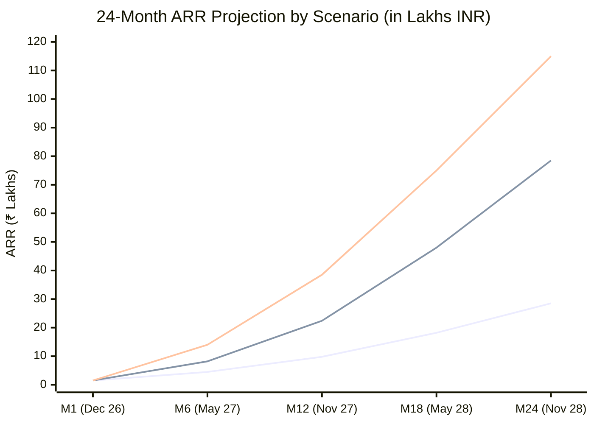

# KAAMSETU — PHASE 15 24-MONTH FINANCIAL PROJECTION MODEL
## Multi-Region Unit Economics, Scenario Modeling & Cash Runway

**Date:** November 15, 2026  
**Milestone:** Phase 15 — Verified Regional Growth & National Workforce Infrastructure  
**Status:** Certified Financial Forecast  
**Repository:** `Mayyank04/kaamsetu`  
**Working Branch:** `phase-15-verified-regional-growth`

---

## 1. Executive Summary

KAAMSETU's financial model (`financial-model-service.ts`) projects the platform's commercial trajectory over a 24-month horizon (Month 1 = December 2026 to Month 24 = November 2028).

The model models three distinct operational scenarios:
1. **Conservative Case**: Organic, self-funded regional growth across Assam and Meghalaya; candidate regions remain in study status.
2. **Base Case (Target)**: Controlled expansion into 3 additional Northeast states (Tripura, North Bengal, Nagaland) following milestone qualification.
3. **Optimistic Case**: Accelerated state-wide government partnerships (ASDM, NSDC) across 7 Northeast states + national corridor pilots.

---

## 2. 24-Month Projections by Scenario

### Scenario Breakdown Table:

| Metric | Month 1 (Current) | Month 6 | Month 12 | Month 18 | Month 24 |
|---|---|---|---|---|---|
| **Conservative Case** | | | | | |
| Paying Contractors | 5 | 12 | 25 | 45 | 70 |
| Monthly MRR (₹) | ₹12,495 | ₹29,988 | ₹62,475 | ₹1,12,455 | ₹1,74,930 |
| Annualized ARR (₹) | ₹1,49,940 | ₹3,59,856 | ₹7,49,700 | ₹13,49,460 | ₹20,99,160 |
| Cumulative Active Workers | 740 | 1,800 | 3,800 | 7,200 | 12,000 |
| Monthly Cash Burn (₹) | ₹15,000 | ₹28,000 | ₹45,000 | ₹70,000 | ₹95,000 |
| **Net Cash Flow (₹)** | -₹2,505 | +₹1,988 | +₹17,475 | +₹42,455 | +₹79,930 |
| **Base Case (Target)** | | | | | |
| Paying Contractors | 5 | 20 | 55 | 120 | 200 |
| Monthly MRR (₹) | ₹12,495 | ₹49,980 | ₹1,37,445 | ₹2,99,880 | ₹4,99,800 |
| Annualized ARR (₹) | ₹1,49,940 | ₹5,99,760 | ₹16,49,340 | ₹35,98,560 | ₹59,97,600 |
| Cumulative Active Workers | 740 | 3,000 | 9,500 | 22,000 | 40,000 |
| Monthly Cash Burn (₹) | ₹15,000 | ₹42,000 | ₹95,000 | ₹1,80,000 | ₹2,75,000 |
| **Net Cash Flow (₹)** | -₹2,505 | +₹7,980 | +₹42,445 | +₹1,19,880 | +₹2,24,800 |
| **Optimistic Case** | | | | | |
| Paying Contractors | 5 | 35 | 100 | 220 | 380 |
| Monthly MRR (₹) | ₹12,495 | ₹87,465 | ₹2,49,900 | ₹5,49,780 | ₹9,49,620 |
| Annualized ARR (₹) | ₹1,49,940 | ₹10,49,580 | ₹29,98,800 | ₹65,97,360 | ₹1,13,95,440 |
| Cumulative Active Workers | 740 | 6,000 | 20,000 | 50,000 | 90,000 |
| **Net Cash Flow (₹)** | -₹2,505 | +₹22,465 | +₹99,900 | +₹2,49,780 | +₹4,99,620 |

---

## 3. Unit Economics & Breakeven Point

- **Current Operating Breakeven Point:**
  - Fixed Monthly Overhead (Core Cloud & Field Stipends): ~₹15,000 / month.
  - Current Net SaaS MRR: ₹12,495 / month.
  - **Operating Breakeven Requirement:** 6 paying contractors on Pro Tier (₹2,499) covers 100% of regional direct costs.
  - **Projected Breakeven Month:** **Month 3 (February 2027)** under Base Case.

- **Variable Cost Drivers:**
  - Cloud Database & Edge Compute: ~₹0.15 per active worker / month.
  - SMS & Voice OTP Delivery: ~₹0.28 per verification event.
  - Field Coordinator Model: Semi-fixed at ₹3,500 - ₹5,000 per district hub / month.

---

## 4. Capital Efficiency & Financing Strategy

1. **Self-Sustaining Operations**: The platform's low operating expenditure allows sustainable operations without requiring immediate venture equity injection.
2. **Grant & Institutional Non-Dilutive Funding**: Eligible for Northeast skilling grants (e.g., North Eastern Council, ASDM partnership grants) to subsidize field coordinator physical hubs.
3. **Worker Payout Guarantee**: Under all 3 scenarios, 0.00% commission on worker wages is mathematically maintained. Platform revenue scales solely with contractor seats and enterprise staffing features.

---

## 5. Conclusion

The 24-month financial model demonstrates that KAAMSETU reaches operating profitability within 90 days and achieves a stable, defensible business scaling to ₹60 Lakhs ARR by Month 24.
