# KAAMSETU — PHASE 15 IDENTITY AND CREDENTIAL PORTABILITY REPORT
## Self-Sovereign Worker Identity, Offline Verification & Non-Repudiation

**Date:** November 15, 2026  
**Milestone:** Phase 15 — Verified Regional Growth & National Workforce Infrastructure  
**Status:** Certified Cryptographic Specification  
**Repository:** `Mayyank04/kaamsetu`  
**Working Branch:** `phase-15-verified-regional-growth`

---

## 1. Executive Summary

KAAMSETU's digital identity framework guarantees that a worker's professional reputation, skill attestations, and institutional credentials belong unconditionally to the worker. If a contractor cancels their SaaS subscription or an institution closes, the worker's verified identity remains 100% active, portable, and tamper-evident.

---

## 2. Multi-Dimensional Credential Verification Model

In Phase 15, credential evaluation adheres to an orthogonal 7-dimension verification standard (`issuer-governance-service.ts`):

```mermaid
flowchart LR
    A[Incoming Credential Payload] --> D1[1. RFC 8785 Canonical JCS Hash]
    D1 --> D2[2. HMAC-SHA256 Signature Match]
    D2 --> D3[3. Issuer Status Verified in DB]
    D3 --> D4[4. Signatory Authorized for Trade]
    D4 --> D5[5. Status Check: Active vs Revoked/Suspended]
    D5 --> D6[6. Freshness & Key Window Check]
    D6 --> D7[7. Claim Truth vs Signature Validity Distinction]
    D7 --> DEC[Overall Result: verified_valid]
```

### The 7 Orthogonal Verification Dimensions:

1. **Cryptographic Signature Validity**: The payload is canonicalized using RFC 8785 (deterministic sorting of keys, Unicode normalization, IEEE 754 float representation) and checked against the HMAC-SHA256 digest.
2. **Issuer Identity & Active Status**: The institution must have `status = 'verified'` in `public.institutional_partners`. Suspended or revoked institutions are rejected.
3. **Issuer Authorization & Signatory Scope**: The issuing official must be an active registered signatory authorized for that specific trade.
4. **Credential Status**: The credential must be `active`. Suspended, revoked, or expired records fail verification.
5. **Freshness & Rotation Window**: Signatures generated with keys rotated over 180 days ago or expired keys are flagged.
6. **Separation of Signature Validity vs Claim Truth**: A valid signature proves the issuer signed this payload, but does not guarantee the truth of unverified claims without institutional accreditation.
7. **Offline Revocation Caveat**: Offline cached verifications embed a mandatory warning: *"Offline verification valid as of cache timestamp; real-time revocation status cannot be verified without network connectivity."*

---

## 3. Worker-Controlled Granular Field Disclosure

Under the Digital Personal Data Protection (DPDP) Act, 2023, consent must be specific, informed, and revocable. KAAMSETU implements `public.worker_identity_access_grants`:

| Data Field Category | Default State | Worker Consent Required | Masking Behavior |
|---|---|---|---|
| Full Legal Name | Disclosed | No | Rendered |
| Primary Trade & Skills | Disclosed | No | Rendered |
| KaamScore & Review Stats | Disclosed | No | Rendered |
| Institutional Credentials | Disclosed | No | Rendered with Verification Seal |
| Phone Number | **Hidden** | **Yes** (Granular Grant) | Masked as `+91 98*** ***10` |
| Aadhaar / Govt ID | **Hidden** | **Explicit One-Time Grant** | Redacted completely; hash only |
| Payout & Wage History | **Private** | **Explicit Self-Export Only** | Never shared with contractors |

### Instant Access Grant Revocation:
Workers can revoke any contractor's access grant with a single click. When revoked, the access grant token is immediately marked `is_revoked = true` in PostgreSQL, instantly failing subsequent API authorization checks.

---

## 4. Cryptographic Key Rotation Architecture

KAAMSETU enforces multi-version HMAC key rotation (`credential-service.ts`):
- **Current Version:** `v2` (Active signing and verification).
- **Grace Period Version:** `v1` (Active verification only; new issuance strictly blocked).
- **Revoked Keys:** Any compromised key version is immediately flagged in `key_rotations`, instantly invalidating credentials issued under that key version.
- **Fail-Closed Secret Resolver:** If `CREDENTIAL_SIGNING_SECRET` is unset or weak (<32 bytes) in production, the service aborts with a fatal configuration error.

---

## 5. Offline QR & PWA Portability

- **Compact QR Encoding**: Credentials serialize into compressed Base64url QR payloads readable by standard camera scanners.
- **Zero-App Requirement**: Verification works in any modern browser without downloading proprietary apps.
- **Self-Sovereign Identity Export**: Workers can download their complete identity ledger as an offline JSON-LD document with embedded SHA-256 integrity proofs.

---

## 6. Conclusion

KAAMSETU's Phase 15 cryptographic architecture provides nation-grade trust, preventing credential forgery while preserving worker sovereignty and data privacy.
