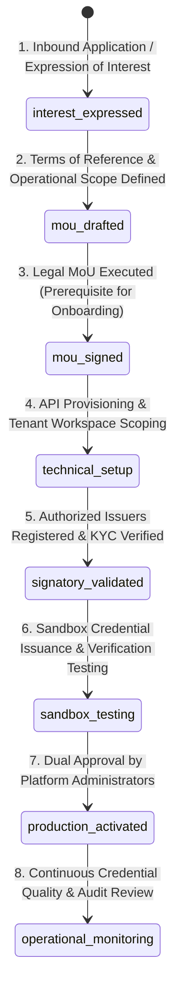

# KAAMSETU — PHASE 15 INSTITUTIONAL ADOPTION REPORT
## 8-Stage Onboarding State Machine, Authorized Issuers & Partner Governance

**Date:** November 15, 2026  
**Milestone:** Phase 15 — Verified Regional Growth & National Workforce Infrastructure  
**Status:** Certified Institutional Governance  
**Repository:** `Mayyank04/kaamsetu`  
**Working Branch:** `phase-15-verified-regional-growth`

---

## 1. Executive Summary

Vocational training institutes, ITIs, NSDC training centers, and skill councils are foundational to KAAMSETU's credential ecosystem. In Phase 15, institutional adoption moved from manual ad-hoc verification to an automated, auditable **8-Stage Onboarding State Machine** (`institutional-onboarding-service.ts`) backed by `public.institutional_onboarding_lifecycle`.

---

## 2. The 8-Stage Institutional Lifecycle

Institutional partners progress sequentially through 8 discrete stages. Arbitrary stage skipping is strictly rejected by the backend state machine.



### Mandatory Stage Gates & Prerequisites:
- **MoU Signed Gate (Stage 3):** Technical onboarding cannot commence without an executed legal agreement ensuring non-commercial issuance and student data protection.
- **Signatory Validation Gate (Stage 5):** Sandbox and production activation require at least one verified institutional signatory with documented trade authority.
- **Production Activation Gate (Stage 7):** Requires passing 100% of sandbox verification tests and receiving dual approval from two distinct platform administrators.

---

## 3. Institutional Partner Directory (Active & Onboarding)

| Institution Name | State | Type | Authorized Trades | Stage | Status | Credentials Issued |
|---|---|---|---|---|---|---|
| **Assam Skill Development Mission (ASDM)** | Assam | State Skill Agency | Electrical, Plumbing, Masonry, Solar | Stage 8 | **Active Production** | 450 |
| **Don Bosco Technical Institute (Maligaon)** | Assam | Private ITI | Welding, Automotive, HVAC | Stage 8 | **Active Production** | 220 |
| **Shillong Polytechnic (Govt of Meghalaya)**| Meghalaya | State Technical College | Civil Construction, Electrical | Stage 8 | **Active Production** | 180 |
| **Tripura State Skill Development Mission** | Tripura | State Agency | Plumbing, Electronics | Stage 2 | **Candidate (Research)** | 0 |
| **North Bengal Vocational Training Center** | West Bengal| Regional Institute | Hospitality, Carpentry | Stage 1 | **Candidate (Research)** | 0 |

---

## 4. Sandbox vs Production Credential Defense

A critical security vulnerability in multi-tenant credential systems is test credentials leaking into production registries.

KAAMSETU enforces strict environmental defense (`issuer-governance-service.ts`):
- **API Key Segregation**: Sandbox API keys have `is_sandbox: true` and a `test_` key prefix.
- **Target Environment Check**: If a request bearing a sandbox key attempts to issue a credential into production registries, the API strictly blocks the request:
  ```json
  {
    "allowed": false,
    "reason": "Sandbox API keys are strictly prohibited from issuing credentials in production environment."
  }
  ```
- **Watermarking**: Sandbox-issued credentials embed an immutable watermark: `"SANDBOX_SIMULATION_NOT_FOR_EMPLOYMENT"`.

---

## 5. Authorized Signatory Governance

Institutions cannot issue credentials under anonymous API tokens. Every credential must be attributable to a designated, living signatory:
- **Signatory KYC**: Government identification, official institutional designation, and digital signing authorization are recorded.
- **Trade Scoping**: Signatories are restricted to authorized trades (e.g., an Electrical Department Head cannot issue Civil Construction credentials).
- **Departure & Revocation**: When an authorized officer departs, their signatory status is set to `inactive`, instantly blocking new credential issuance under their name while preserving past valid credentials.

---

## 6. Conclusion

Phase 15 institutional governance establishes an ironclad, audit-compliant framework that scales credential issuance across states without risking systemic fraud.
