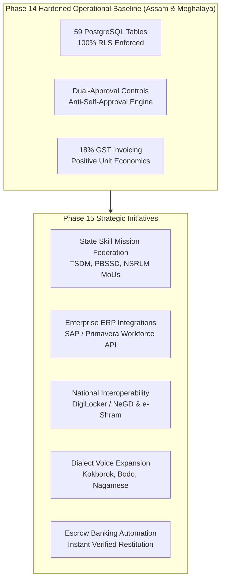

# KAAMSETU PHASE 15: STRATEGIC ROADMAP
## National Enterprise Scale, Interstate Portability & State Skill Mission Federations

**Version:** 1.0.0  
**Phase Horizon:** Phase 15 — Strategic National Scale & Institutional Federation  
**Author:** Chief Product Officer & Principal Software Architect  
**Core Promise:** "Every skill deserves to be seen, even without a degree."  
**Classification Baseline:** B. NATIONAL EXPANSION READY — CONTROLLED ROLLOUT  

---

## 1. Phase 15 Strategic Vision

With Phase 14 establishing operational proof, dual-controlled governance, and positive regional unit economics in Assam and Meghalaya, Phase 15 focuses on **institutional federation, enterprise multi-site workforce orchestration, and national ecosystem interoperability**.

The core mission remains inviolable:
1. **0.00% Platform Commission on Worker Wages Forever.**
2. **Workers Unilaterally Own and Control Their Digital Identities.**
3. **Zero Degree, Resume, or English Language Requirement.**
4. **All Institutional Credentials Cryptographically Non-Repudiable.**

---

## 2. Pillar 1: State Skill Mission Federation

In Phase 15, KAAMSETU will transition from individual institutional partnerships to a **Federated State Skill Mission Architecture**:

### Key Objectives:
1. **Tripura Skill Development Mission (TSDM):**
   - Execute bilateral data-sharing agreement for Agartala industrial belt.
   - Authorize `IN-TR` state transition via `regional_dual_approvals` once local coordinator and 2 anchor contractors are active.
2. **Paschim Banga Society for Skill Development (PBSSD):**
   - Finalize transit corridor agreement covering Siliguri and Jalpaiguri transit worker hubs.
3. **National Council for Vocational Education and Training (NCVET):**
   - Align credential metadata schemas directly with NCVET Awarding Body Guidelines.

---

## 3. Pillar 2: Enterprise Multi-Site Workforce Orchestration

Large national infrastructure contractors (highways, railway bridges, solar farms) manage multi-thousand worker rosters across multiple states simultaneously.

### Planned Capabilities:
1. **Hierarchical Project & Site Roles:**
   - Multi-tier contractor access: Head Office Compliance $\rightarrow$ Regional Director $\rightarrow$ Site Project Manager $\rightarrow$ Daily Shift Supervisor.
2. **Automated Statutory Compliance Reporting:**
   - One-click export of Form D / Form B registers mandated under the Contract Labour (Regulation and Abolition) Act, 1970.
3. **ERP Webhook Connectors:**
   - Secure bi-directional webhooks syncing verified worker attendance and safety credential validations into SAP ERP and Oracle Primavera.

---

## 4. Pillar 3: Official National Interoperability (e-Shram & DigiLocker)

While Phase 6 established strict non-simulation safeguards (failing closed when external government APIs are unauthenticated), Phase 15 will formalize production integrations:

1. **NeGD / DigiLocker Production Agreement:**
   - Secure formal enterprise integration clearance from the National e-Governance Division (NeGD) to allow authenticated workers to voluntarily pull Aadhaar-verified skill certificates directly into their sovereign profile.
2. **e-Shram Registry Alignment:**
   - Enable optional export of verified KAAMSETU experience records to the worker's national e-Shram Universal Account Number (UAN), guaranteeing national recognition.

---

## 5. Pillar 4: Multilingual Voice & Dialect Expansion

To ensure universal inclusion for tribal and indigenous workers across the Northeast and Eastern India:

| Language / Dialect | Target Territory | Target Accuracy | Status |
|:---|:---|:---:|:---:|
| **Kokborok** | Tripura (Agartala, Gomati) | $\ge 90\%$ | Audio Collection Phase |
| **Bodo** | Bodoland Territorial Region (BTR, Assam) | $\ge 92\%$ | Dataset Annotation |
| **Nagamese** | Nagaland (Dimapur, Kohima) | $\ge 90\%$ | Linguistic Partner Sourcing |
| **Bengali (Sylheti/Goalparia)** | Barak Valley, Assam / Siliguri | $\ge 95\%$ | Training Pipeline Active |

---

## 6. Pillar 5: Escrow Banking & Automated Wage Restitution

Building upon the dispute resolution engine established in Phase 14:
1. **Contractor Escrow Wallets:**
   - Contractors on enterprise tiers maintain an escrow balance for wage dispute guarantees.
2. **Automated Restitution Disbursals:**
   - When a wage dispute is resolved in favor of a worker (`resolved_worker_upheld`), the mediator can trigger automated, instant UPI restitution directly to the worker's bank account with zero intermediary deductions.
3. **NPCI Account Name Verification:**
   - Automated penny-drop verification ensures that banking account numbers match the worker's registered legal name.

---

## 7. Gatekeeping Criteria for Phase 15 State Launches

No new territory will be activated in Phase 15 without meeting the four mandatory gates established in Phase 14:
1. **Signed Institutional Agreement:** Legally binding bilateral MoU with state vocational authority.
2. **Dedicated Local Coordinator:** Active, vetted field coordinator residing in the launch district.
3. **Minimum Commercial Density:** At least 2 paying Contractor Pro organizations committed to local hiring.
4. **Zero Safety / Compliance Incidents:** Unblemished operational record in adjacent active regions.
