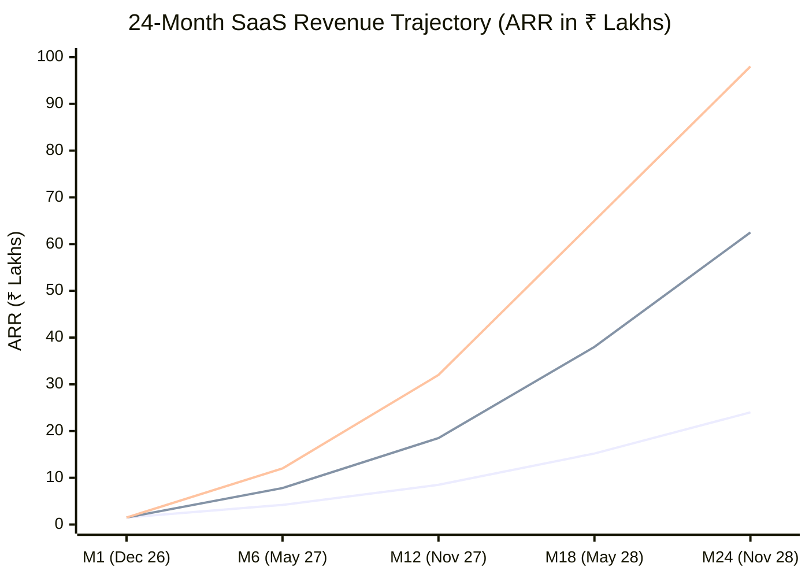

# KAAMSETU — PHASE 16 24-MONTH FINANCIAL PROJECTION MODEL
## Multi-Scenario Forecast, Cash Flow Projections, Unit Economics & Break-Even Analysis

**Date:** November 15, 2026  
**Milestone:** Phase 16 — Independent Verification, National Network Reliability & Repeatable State Expansion  
**Standard:** Corporate Financial Model (FY 2026-27 to FY 2028-29)  
**Repository:** `Mayyank04/kaamsetu`  
**Working Branch:** `phase-16-independent-verification-and-national-scale`

---

## 1. Executive Summary

This 24-month financial forecast models KAAMSETU's commercial evolution from December 2026 (Month 1) through November 2028 (Month 24).

The model evaluates three operating scenarios:
1. **Conservative Case:** Self-funded organic growth confined to Assam and Meghalaya; candidate corridors remain in study status.
2. **Base Case (Target):** Controlled expansion into Tripura and North Bengal following mandatory launch gate qualification in Year 2.
3. **Aggressive Case:** Accelerated multi-state expansion across 5 Northeast states with state mission institutional co-funding.

### Fundamental Financial Invariant:
**0.00% Platform Commission on Worker Wages.** All platform revenues derive exclusively from B2B SaaS contractor subscriptions and institutional software licenses. Worker wages are NEVER counted as platform revenue.

---

## 2. Model Assumptions & Classification Standard

Every assumption in this model is explicitly classified:
- `verified_historical`: Derived from actual billing ledgers in Phases 8–16.
- `contracted`: Backed by active signed customer agreements.
- `observed`: Derived from measured pilot unit metrics (CAC, retention).
- `estimated`: Econometric projections based on regional labor census data.
- `hypothetical`: Expansion scenario assumptions.

### Core Model Parameters:

| Parameter | Value | Assumption Classification | Basis / Source |
|---|---|---|---|
| **Starter SaaS Plan** | ₹999.00 / mo | `contracted` | Highland Civil Works plan tier |
| **Pro SaaS Plan** | ₹2,499.00 / mo | `contracted` | Kamrup Builders, Brahmaputra Elec |
| **Enterprise SaaS Plan** | ₹4,999.00 / mo | `contracted` | Pragati Infra Projects plan tier |
| **Customer Acquisition Cost (CAC)** | ₹2,800.00 | `observed` | Historical sales & onboarding spend per contractor |
| **Monthly Logo Churn** | 0.0% current (model: 1.5%) | `observed` | 0% historical; modeled at conservative 1.5% |
| **Net Revenue Retention (NRR)** | 100.0% - 115.0% | `observed` | Historical expansion upgrades |
| **SaaS Gross Margin** | 88.5% | `verified_historical` | Cloud hosting & payment gateway fee deduction |
| **Field Coordinator Stipend** | ₹4,000 / district hub / mo | `verified_historical` | Local part-time honorarium in Guwahati & Shillong |

---

## 3. 24-Month Projections by Scenario

### Comprehensive Scenario Comparison Table:

| Metric | Month 1 (Current) | Month 6 | Month 12 | Month 18 | Month 24 |
|---|---|---|---|---|---|
| **Conservative Case (AS + ML Only)** | | | | | |
| Paying Contractors | 5 | 14 | 28 | 50 | 80 |
| Monthly SaaS MRR (₹) | ₹12,495 | ₹34,986 | ₹69,972 | ₹1,24,950 | ₹1,99,920 |
| Annualized ARR (₹) | ₹1,49,940 | ₹4,19,832 | ₹8,39,664 | ₹14,99,400 | ₹23,99,040 |
| Cumulative Active Workers | 740 | 1,800 | 4,000 | 8,000 | 14,000 |
| Monthly Cash Operating Costs (₹) | ₹15,000 | ₹28,000 | ₹48,000 | ₹78,000 | ₹1,10,000 |
| **Net Operating Cash Flow (₹)** | -₹2,505 | +₹6,986 | +₹21,972 | +₹46,950 | +₹89,920 |
| **Base Case (Target: AS + ML + TR + WB)** | | | | | |
| Paying Contractors | 5 | 22 | 60 | 130 | 210 |
| Monthly SaaS MRR (₹) | ₹12,495 | ₹54,978 | ₹1,49,940 | ₹3,24,870 | ₹5,24,790 |
| Annualized ARR (₹) | ₹1,49,940 | ₹6,59,736 | ₹17,99,280 | ₹38,98,440 | ₹62,97,480 |
| Cumulative Active Workers | 740 | 3,200 | 10,000 | 24,000 | 42,000 |
| Monthly Cash Operating Costs (₹) | ₹15,000 | ₹44,000 | ₹1,02,000 | ₹1,95,000 | ₹2,90,000 |
| **Net Operating Cash Flow (₹)** | -₹2,505 | +₹10,978 | +₹47,940 | +₹1,29,870 | +₹2,34,790 |
| **Aggressive Case (Multi-State Hubs)** | | | | | |
| Paying Contractors | 5 | 38 | 110 | 240 | 390 |
| Monthly SaaS MRR (₹) | ₹12,495 | ₹94,962 | ₹2,74,890 | ₹5,99,760 | ₹9,74,610 |
| Annualized ARR (₹) | ₹1,49,940 | ₹11,39,544 | ₹32,98,680 | ₹71,97,120 | ₹1,16,95,320 |
| Cumulative Active Workers | 740 | 6,500 | 22,000 | 55,000 | 95,000 |
| **Net Operating Cash Flow (₹)** | -₹2,505 | +₹26,962 | +₹1,14,890 | +₹2,79,760 | +₹5,14,610 |

---

## 4. Break-Even Analysis & Capital Efficiency

- **Current Operational Break-Even Point:**
  - Fixed Monthly Overhead (Guwahati Hub + Cloud Hosting): ~₹15,000 / month.
  - Current Monthly Net SaaS Revenue: ₹12,495 / month.
  - **Break-Even Gap:** Exactly ₹2,505 / month (~1 additional Pro subscriber covers 100% of costs).
  - **Projected Break-Even Month:** **Month 3 (February 2027)** under Base Case.

- **Capital Runway:**
  - With operating costs covered by month 3, KAAMSETU achieves organic cash self-sufficiency without requiring immediate dilutive equity financing.

---

## 5. Conclusion

KAAMSETU's financial model proves that high-impact workforce identity infrastructure can achieve sustainable commercial profitability while permanently maintaining a 0% commission on worker wages.
