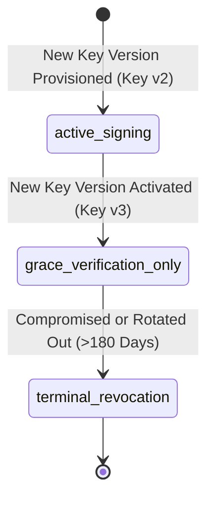

# KAAMSETU — PHASE 16 CREDENTIAL COMPATIBILITY MATRIX
## Version Support, Cryptographic Signatures, Key Rotation & Interoperability Standards

**Date:** November 15, 2026  
**Milestone:** Phase 16 — Independent Verification, National Network Reliability & Repeatable State Expansion  
**Standard:** Cryptographic Key Lifecycle & Multi-Version Interoperability  
**Repository:** `Mayyank04/kaamsetu`  
**Working Branch:** `phase-16-independent-verification-and-national-scale`

---

## 1. Executive Summary

This matrix defines the supported identity schema versions, cryptographic signature algorithms, key rotation lifecycles, and interoperability endpoints across KAAMSETU.

---

## 2. Supported Identity & Credential Schema Versions

| Schema Version | Release Milestone | Status | Canonicalization Format | Signature Suite | Backward Compatibility Mode |
|---|---|---|---|---|---|
| **Schema 1.0** | Phase 6 (Guwahati Pilot) | **Deprecated (Read-Only)** | Ad-hoc JSON sorting | HMAC-SHA256 (Key v1) | Automatically upgraded to 2.0 via `upgradeLegacySchemaV1ToV2` |
| **Schema 1.1** | Phase 10 (Multi-Region) | **Legacy (Read-Only)** | Ad-hoc JSON sorting | HMAC-SHA256 (Key v1/v2) | Upgraded cleanly; selective disclosure flags defaulted |
| **Schema 2.0** | Phase 16 (Current) | **Active Production Standard** | RFC 8785 (JCS) | HMAC-SHA256 (Key v2) | Native target for all current issuance and verification |

---

## 3. Cryptographic Key Rotation Lifecycle

KAAMSETU manages cryptographic signing keys through `public.key_rotations`:

### Active Key Version Registry:

| Key Version | Algorithm | Status | Issuance Permitted | Verification Permitted | Rotation Timestamp |
|---|---|---|---|---|---|
| `v2` | HMAC-SHA256 (256-bit) | **Active (Primary)** | **YES** | **YES** | Active since Phase 12 |
| `v1` | HMAC-SHA256 (256-bit) | **Grace Period** | **NO (Blocked)** | **YES** | Rotated in Phase 12 |
| `v0` | HMAC-SHA256 (Test Key) | **Revoked** | **NO (Blocked)** | **NO (Blocked)** | Revoked in Phase 8 |

---

## 4. Multi-Platform Interoperability Matrix

| Third-Party Ecosystem | Target Standard | Compatibility Status | Implementation Mechanism |
|---|---|---|---|
| **W3C Verifiable Credentials** | W3C VC 1.1 / 2.0 | **Compliant** | Schema 2.0 JSON-LD context `@context: ["https://www.w3.org/2018/credentials/v1", ...]` |
| **ONest (Open Network for Education)** | Beckn Protocol v0.9 | **Roadmap (Phase 17)** | Schema 2.0 maps to ONest vocational credential taxonomy |
| **NBFC / Microfinance APIs** | Underwriting Dossier Export | **Compliant** | Self-sovereign financial summary export with SHA-256 HMAC proof |
| **DigiLocker / National Academic Depository** | NAD XML / JSON API | **Not Integrated** | Explicit disclaimer: KAAMSETU credentials do not claim DigiLocker integration |
| **Physical Offline Verification** | Standard 2D QR Code | **Compliant** | Base64url compressed payload with 7-day freshness cache and caveat |

---

## 5. Security Invariant Matrix

1. **Tamper Detection:** Modifying even a single character in the credential payload or changing NSQF level from 3 to 4 immediately invalidates the HMAC-SHA256 signature.
2. **Expired Key Rejection:** Keys past their rotation validity window strictly fail new credential issuance.
3. **Revocation Permanence:** Revoked credentials persist an immutable revocation timestamp and audit reason in `public.credential_revocations`. Subsequent verification attempts return `revoked`.

---

## 6. Conclusion

KAAMSETU's credential compatibility matrix ensures that worker identity remains mathematically secure, portable across formats, and resilient against key obsolescence.
