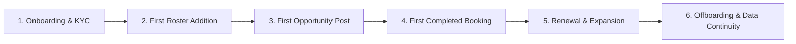

# KAAMSETU — PHASE 16 CUSTOMER SUCCESS OPERATIONS MANUAL
## B2B Contractor Onboarding, First-Time-to-Value, Renewal Workflows & Offboarding

**Date:** November 15, 2026  
**Milestone:** Phase 16 — Independent Verification, National Network Reliability & Repeatable State Expansion  
**Standard:** Enterprise Customer Success Standard Operating Procedure (SOP)  
**Repository:** `Mayyank04/kaamsetu`  
**Working Branch:** `phase-16-independent-verification-and-national-scale`

---

## 1. Executive Vision

Customer Success at KAAMSETU is designed to ensure that construction contractors, EPC firms, and facility management agencies rapidly find, dispatch, and manage verified tradespeople while upholding worker safety and fair wages.

---

## 2. The 6-Stage Customer Success Lifecycle

### Stage 1: Onboarding & KYC Verification (Day 1 - 3)
- Account provisioning under Starter, Pro, or Enterprise tier.
- Collection of company GSTIN, trade license, and authorized administrator credentials.
- 30-minute interactive mobile walkthrough with the local Field Coordinator.

### Stage 2: First Roster Addition (Day 3 - 7)
- Contractor imports or invites up to 25 verified trade crew members.
- Workers receive SMS / voice invites and grant two-sided consent.
- Target: $>80\%$ worker invite acceptance within 72 hours.

### Stage 3: First Opportunity Post (Day 7 - 14)
- Contractor creates an opportunity specifying trade, location, and statutory daily wage range.
- Explainable matching engine produces instant ranked candidate list.

### Stage 4: First Completed Booking & Affirmative Payout (Day 14 - 30)
- Worker completes assigned project milestone.
- Contractor initiates direct wage disbursement and marks payout in dashboard.
- Worker affirmatively confirms receipt via SMS / voice prompt.
- **First Time-to-Value (TTV) Target:** $< 21$ days from signup.

### Stage 5: Renewal Readiness & Expansion Review (Day 60 - 90)
- Automated review of contractor health score ($\ge 80$).
- Review of roster expansion options (e.g., upgrading from Starter to Pro).
- Zero churn trigger: proactive outreach if login frequency drops below 1 per week.

### Stage 6: Offboarding & Data Continuity
- In the event of subscription cancellation, contractor access to dispatch tools is deactivated.
- **Worker Preservation Rule:** Worker profiles, ratings, and institutional credentials remain 100% active, portable, and unaffected.

---

## 3. Churn Warning Triggers & Intervention Playbook

| Warning Trigger | Threshold | Automated Alert | Customer Success Action |
|---|---|---|---|
| **Inactivity Alert** | No login for 14 days | Yellow Alert in CRM | Customer Success Manager calls site engineer to check project status. |
| **Grievance Alert** | 1 open wage dispute | Red Alert in CRM | Field Coordinator dispatched within 24 hours to mediate restitution. |
| **Low Utilization** | $< 30\%$ roster utilized | Advisory Notice | Provide assistance with project roster allocation and skill gap mapping. |
| **Payment Failure** | Webhook payment failed | Grace Period Notice | 7-day grace period; retry payment via alternative UPI / Netbanking. |

---

## 4. Conclusion

KAAMSETU's Customer Success operations ensure that contractor subscriptions deliver measurable staffing efficiency while protecting worker welfare and preserving data integrity.
