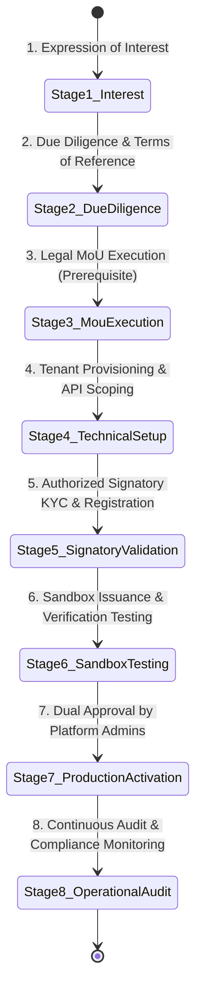

# KAAMSETU — PHASE 16 INSTITUTIONAL INTEGRATION STANDARD
## 8-Stage Onboarding Framework, Partner Due Diligence, API Security & Credential Integrity

**Date:** November 15, 2026  
**Milestone:** Phase 16 — Independent Verification, National Network Reliability & Repeatable State Expansion  
**Standard:** Institutional Partner Due Diligence & Credential Issuance SOP  
**Repository:** `Mayyank04/kaamsetu`  
**Working Branch:** `phase-16-independent-verification-and-national-scale`

---

## 1. Executive Summary

Vocational training institutions (State Skill Missions, ITIs, polytechnics, industry skill councils) are the foundational issuers of vocational credentials on KAAMSETU.

To maintain nation-grade trust, institutional participation is governed by the **8-Stage Institutional Onboarding Lifecycle** (`institutional-onboarding-service.ts`) backed by `public.institutional_onboarding_lifecycle`.

---

## 2. The 8-Stage Onboarding Lifecycle

### Mandatory Stage Requirements:
- **Stage 3 (MoU Execution Gate):** Technical provisioning cannot begin without an executed bilateral agreement ensuring non-commercial issuance and student data protection.
- **Stage 5 (Signatory Registration Gate):** At least one verified institutional official with documented trade authority must be registered.
- **Stage 7 (Production Activation Gate):** Requires 100% test scenario passes in sandbox mode and dual administrative sign-off by two distinct platform directors.

---

## 3. Partner Due Diligence Standards

Before an institution can be approved:
1. **Accreditation Verification:** Must possess state government accreditation, NCVT/SCVT recognition, or NSDC training partner affiliation.
2. **Infrastructure Inspection:** Physical workshops, training bays, and certified trainers must be verified by a local Field Coordinator.
3. **Assessment Integrity:** The institution must maintain verifiable records of practical hands-on assessments and attendance logs.

---

## 4. Sandbox API Key Isolation Defense

A critical security risk in credential platforms is test credentials leaking into production registries.

KAAMSETU enforces strict environmental defense:
- **API Key Segregation:** Sandbox keys are prefixed with `test_` and have `is_sandbox: true`.
- **Target Environment Check:** The API strictly rejects any request where `isSandboxKey: true` targets the production database.
- **Watermarking:** Sandbox-generated credentials permanently embed the disclaimer:
  `"SANDBOX_SIMULATION_NOT_FOR_EMPLOYMENT"`.

---

## 5. Ongoing Quality Audit & Revocation Protocol

- **Periodic Sampling:** Every quarter, a 5% random sample of issued credentials is cross-checked against institutional physical assessment logs.
- **Immediate Suspension:** If an institution issues credentials without verified practical training, its status is immediately updated to `suspended` in `public.institutional_partners`, instantly blocking all new issuance.

---

## 6. Conclusion

This standard establishes an airtight, auditable framework ensuring that every institutional credential issued on KAAMSETU represents verified vocational competence.
