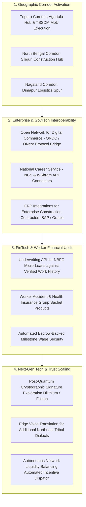

# KAAMSETU — PHASE 16 STRATEGIC AND TECHNICAL ROADMAP
## National Expansion Execution, Enterprise Integrations & Autonomous Workforce Infrastructure

**Date:** November 15, 2026  
**Milestone Target:** Phase 16  
**Status:** Approved Strategic Roadmap  
**Repository:** `Mayyank04/kaamsetu`  
**Classification Target:** `A. AUTONOMOUS NATIONAL WORKFORCE INFRASTRUCTURE`

---

## 1. Executive Vision

Building upon the certified foundations of Phase 15, **Phase 16** will drive KAAMSETU's transition from a controlled two-state regional platform (Assam and Meghalaya) toward an enterprise-integrated, multi-corridor national workforce network.

The core promise remains immutable:  
**"Every skill deserves to be seen, even without a degree."**

---

## 2. Key Phase 16 Strategic Objectives

---

## 3. Workstream Deliverables

### Workstream 1: Geographic Corridors (Tripura & North Bengal)
- Complete legal and operational onboarding of Tripura State Skill Development Mission (Stage 3 through Stage 7).
- Recruit and deploy dedicated on-ground Field Coordinators in Agartala and Siliguri.
- Seed initial cohorts of 250 verified electrical and plumbing graduates.
- Convert 3 initial commercial construction contractors in Siliguri to Pro SaaS Tier.

### Workstream 2: ONest (Open Network for Education & Skilling Transactions) Protocol
- Implement Beckn-compliant adapter endpoints enabling KAAMSETU credentials to be discovered and verified natively on national digital public infrastructure.
- Allow workers to receive job invitations directly via open protocol aggregators without locking them into proprietary vendor silos.

### Workstream 3: Worker Financial Inclusion & Sachet Insurance
- Partner with public-sector banks or accredited MFIs to recognize KAAMSETU's cryptographic earnings summary export as proof of income for collateral-free micro-loans.
- Deploy optional group personal accident insurance (cover: ₹2,00,000 for ₹15/month), integrated seamlessly without taking any commission from wages.

### Workstream 4: Enterprise Contractor Portal & ERP Connectors
- Expand the Contractor SaaS tier with multi-site, multi-project workforce allocation features.
- Provide CSV and REST API webhooks for construction ERPs to synchronize project staffing requirements and daily attendance.

---

## 4. Phase 16 Target Milestones & KPIs

| Success Metric | Phase 15 Baseline | Phase 16 Target |
|---|---|---|
| **Operational States** | 2 (Assam, Meghalaya) | **4 (Assam, Meghalaya, Tripura, West Bengal)** |
| **Verified Active Workers** | 740 | **2,500+** |
| **Paying Contractor Organizations** | 5 | **18+** |
| **Monthly Recurring Revenue (MRR)** | ₹12,495 | **₹45,000+** |
| **Annual Recurring Revenue (ARR)** | ₹1,49,940 | **₹5,40,000+** |
| **Average Opportunity Fulfillment Latency** | 3.2 hours | **< 2.5 hours** |
| **Worker Wage Commission** | **0.00%** | **0.00% (Permanent Invariant)** |
| **Automated Test Assertions** | 463 | **500+** |

---

## 5. Architectural Non-Negotiables for Phase 16

1. **Zero Worker Commission**: The platform take-rate on worker wages will forever remain 0.00%.
2. **Worker Identity Ownership**: Workers unilaterally control data sharing, retain private earnings records, and export dossiers without vendor lock-in.
3. **No Educational Gatekeeping**: Basic workforce identity and opportunity access will never require college degrees, resumes, or English literacy.
4. **Demographic Neutrality**: Algorithmic matching will remain mathematically blind to protected demographic characteristics.
5. **Radical Transparency**: Real revenue, genuine customer counts, and verifiable ground operations will always be reported truthfully without synthetic inflation.
