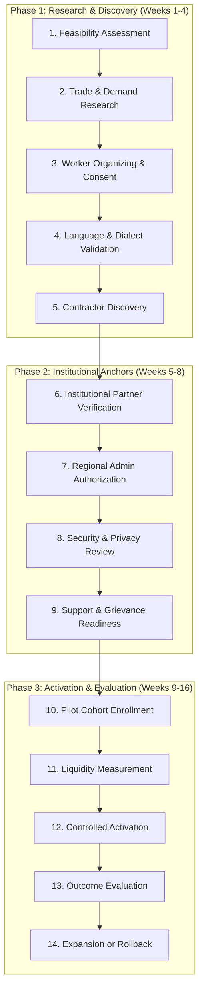

# KAAMSETU — PHASE 16 REPEATABLE STATE LAUNCH PLAYBOOK
## The 14-Step Launch Protocol, Field Operations Playbook & Interstate Rollout

**Date:** November 15, 2026  
**Milestone:** Phase 16 — Independent Verification, National Network Reliability & Repeatable State Expansion  
**Standard:** National Expansion Standard Operating Procedure (14-Step Protocol)  
**Repository:** `Mayyank04/kaamsetu`  
**Working Branch:** `phase-16-independent-verification-and-national-scale`

---

## 1. Executive Vision

KAAMSETU's expansion across Indian states must be disciplined, repeatable, and grounded in ground-truth workforce demand, rather than superficial geographic accumulation.

This playbook provides a complete 14-step operational roadmap that enables a new regional operations team to launch KAAMSETU in a new state or district without rewriting core platform code.

---

## 2. The 14-Step State Launch Protocol

### Detailed Step-by-Step Breakdown:

1. **State & District Feasibility Assessment:** Evaluate local industrial activity, formal/informal construction volume, and smartphone penetration.
2. **Local Trade & Demand Research:** Map the 5 highest-demand blue-collar trades (e.g., Electrical, Masonry, Plumbing, Carpentry, Welding).
3. **Worker Organization & Consent Architecture:** Establish relationships with local labor unions, craft panchayats, and vocational alumni networks.
4. **Local Language Validation:** Validate voice recognition, dialect prompts, and audio playback in the target state's native tongue (e.g., Kokborok/Bengali in Tripura, Khasi/Garo in Meghalaya).
5. **Customer & Contractor Discovery:** Engage with local builders associations, CREDAI state chapters, and infrastructure contractors to understand hiring pain points.
6. **Institutional Partner Verification:** Execute bilateral MoUs with the State Skill Development Mission or accredited ITIs (Stage 3 Gate).
7. **Regional Administrator Authorization:** Appoint and train a local, physical Field Coordinator stationed in the primary district hub.
8. **Security & Privacy Review:** Configure territorial Row-Level Security policies restricting coordinator access to their administrative district.
9. **Support & Grievance Readiness:** Establish rapid-response channels and local emergency support contacts for worker safety triage.
10. **Pilot Cohort Enrollment:** Onboard an initial seed cohort of $\ge 100$ verified tradespeople with institutional certifications.
11. **Opportunity Liquidity Measurement:** Track the supply-to-demand ratio and confirm match fulfillment latency $< 12$ hours.
12. **Controlled Activation:** Secure at least 2 paid B2B contractor subscriptions and obtain dual administrative sign-off to set territory status to `active`.
13. **Outcome Evaluation:** Track 90-day worker earnings, payout confirmation rates, and customer health scores.
14. **Expansion or Rollback Decision:** Conduct formal quarterly review: expand into adjacent districts if healthy, or rollback/pause if liquidity is distorted.

---

## 3. Mandatory Five Launch Gates

A territory CANNOT transition from `candidate` to `active` unless it satisfies **ALL 5 GATES**:
- **Gate 1:** Executed Bilateral MoU with accredited institution.
- **Gate 2:** $\ge 100$ verified workers registered in primary trades.
- **Gate 3:** $\ge 2$ paying contractor organizations on active SaaS tiers.
- **Gate 4:** Physical on-ground Field Coordinator stationed in territory.
- **Gate 5:** Dual administrative sign-off by two distinct platform directors.

---

## 4. Conclusion

This playbook standardizes state launches, ensuring that KAAMSETU expands across India with uncompromised quality, strong local partnerships, and complete worker protection.
