# KAAMSETU — PHASE 16 WORKER IMPACT METHODOLOGY
## Econometric Framework, Counterfactual Baselines & Confounding Variable Controls

**Date:** November 15, 2026  
**Milestone:** Phase 16 — Independent Verification, National Network Reliability & Repeatable State Expansion  
**Methodological Standard:** Quasi-Experimental Difference-in-Means with Selection Bias Controls  
**Repository:** `Mayyank04/kaamsetu`  
**Working Branch:** `phase-16-independent-verification-and-national-scale`

---

## 1. Methodological Purpose

Measuring the economic and welfare impact of digital workforce platforms on informal labor in India presents major econometric challenges:
1. **Lack of Formal Documentation**: Informal workers do not file income tax returns or receive formal pay slips.
2. **Seasonal Fluctuation**: Construction and home service demand fluctuates dramatically with agricultural harvests and monsoon seasons (especially in Assam and Meghalaya).
3. **Selection Bias**: Workers registering on digital platforms are self-selected and may differ systematically in motivation, literacy, and smartphone access.
4. **Inflation & Macroeconomic Trends**: General cost-of-living adjustments can falsely appear as platform-induced gains.

This document formalizes the rigorous econometric methodology used by KAAMSETU to evaluate worker outcomes.

---

## 2. Research Design & Study Architecture

KAAMSETU utilizes a **Quasi-Experimental Longitudinal Cohort Design**:

```mermaid
flowchart LR
    CohortEnrollment[Cohort Enrollment: Baseline Intake] --> T0[T0: Baseline Period 3-6 Months Prior]
    T0 --> PlatformParticipation[Active Platform Matching & Verification]
    PlatformParticipation --> T1[T1: Follow-Up Period 6 Months Active]
    T1 --> DiffMeans[Difference-in-Means Calculation]
    DiffMeans --> Controls[Macroeconomic & Seasonal Controls]
    Controls --> NetAttributableImpact[Net Attributable Economic Impact]
```

### Key Measurement Intervals:
- **Baseline Period ($T_0$):** 3 to 6 months prior to platform registration, documented through intake recall and verified past client contacts.
- **Follow-up Period ($T_1$):** 6 months post-verification, tracked continuously through confirmed bookings and payout records.

---

## 3. Confounding Variables & Control Mechanisms

| Confounding Factor | Risk of Distortion | KAAMSETU Methodological Control |
|---|---|---|
| **Seasonality (Monsoon)** | Heavy Northeast monsoon (June-September) depresses outdoor civil construction. | Cohort evaluations compare identical calendar quarters year-over-year (e.g., Q3 2025 vs Q3 2026). |
| **Selection Bias** | Tech-savvy or highly motivated workers onboard first. | Cohorts report explicit caveats regarding self-selection; results are not generalized to unmotivated non-participants. |
| **Inflation / Wage Inflation** | General state minimum wage revisions increase nominal earnings. | Baseline earnings are inflation-adjusted using the RBI Consumer Price Index (CPI-Rural/Urban for Assam). |
| **Attrition Bias** | Disillusioned or low-earning workers drop out, leaving only successful earners in sample. | Attrition rates are tracked and reported explicitly (target: $< 15\%$). Intent-to-treat (ITT) bounds are computed. |

---

## 4. Four-Tier Data Triangulation

To eliminate reliance on pure self-reporting, KAAMSETU triangulates data across 4 independent sources:
$$\text{Verified Earnings} = f(\text{Worker Reports}, \text{Contractor Attendance}, \text{Platform Payout Logs}, \text{Bank Settlements})$$

1. **Self-Reported Claims ($E_1$):** Collected via automated Assamese/Hindi voice calls.
2. **Contractor Confirmed ($E_2$):** Site manager marks project milestones completed.
3. **Ledger Backed ($E_3$):** Direct recording in `public.worker_payout_confirmations`.
4. **Bank Reconciled ($E_4$):** Bank statement verification for worker financial dossier exports.

---

## 5. Statistical Estimation Equations

For a cohort of $N$ opted-in workers:

1. **Mean Baseline Income:**
   $$\bar{Y}_0 = \frac{1}{N} \sum_{i=1}^{N} Y_{i,0}$$

2. **Mean Follow-up Income:**
   $$\bar{Y}_1 = \frac{1}{N} \sum_{i=1}^{N} Y_{i,1}$$

3. **Absolute Economic Uplift:**
   $$\Delta \bar{Y} = \bar{Y}_1 - \bar{Y}_0$$

4. **Standard Error of the Difference:**
   $$SE(\Delta \bar{Y}) = \sqrt{\frac{s_d^2}{N}}$$
   where $s_d^2$ is the sample variance of the individual differences $d_i = Y_{i,1} - Y_{i,0}$.

5. **95% Confidence Interval:**
   $$CI_{95\%} = \left[ \Delta \bar{Y} - 1.96 \cdot SE(\Delta \bar{Y}),\; \Delta \bar{Y} + 1.96 \cdot SE(\Delta \bar{Y}) \right]$$

---

## 6. Ethical Safeguards & Consent Architecture

- **No Compulsory Tracking**: Workers can opt out of outcome surveys at any time. Opting out does NOT affect KaamScore, matching eligibility, or credential verification.
- **Data Minimization**: Individual financial figures are aggregated into anonymized cohort statistics. No worker's individual income is ever shared with other contractors or displayed on public profiles.

---

## 7. Conclusion

By applying rigorous econometrics, controlling for seasonality and selection bias, and triangulating multiple data tiers, KAAMSETU ensures that workforce impact claims are methodologically unimpeachable.
