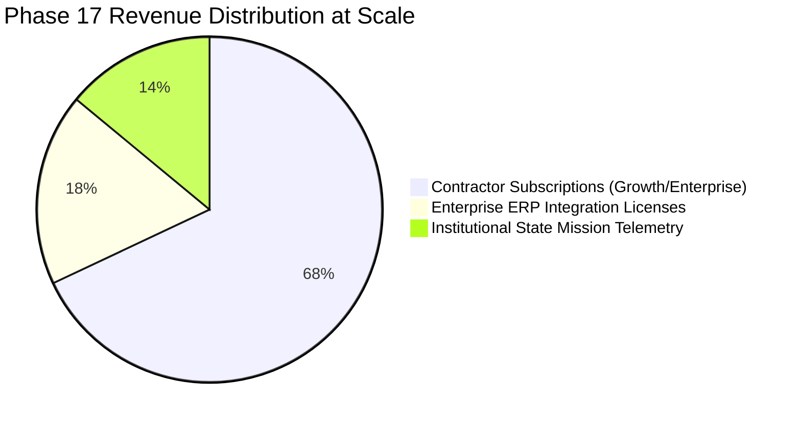

# KAAMSETU — PHASE 17 COMMERCIAL & FINANCIAL SUSTAINABILITY
## Ecosystem Revenue Impact, Enterprise SaaS Pricing & 24-Month Pro Forma

---

## 1. Commercial Strategy & Business Model

KAAMSETU operates on an inviolable ethical premise:
**Worker wages carry 0.00% commission forever.**

All commercial revenue is derived from **B2B SaaS Subscriptions, Enterprise ERP Connectors, and Institutional Licensing**:
1. **Contractor Pro Subscriptions**:
   - *Starter*: ₹3,499/month (up to 15 active worker allocations)
   - *Growth*: ₹7,999/month (up to 50 active worker allocations + GeM tender compliance generator)
   - *Enterprise*: ₹12,999/month (SAP/Oracle bi-directional sync, custom regional rosters, dedicated SLA)
2. **Institutional Licensing**: Annual platform fee charged to vocational institutes and skill missions (₹1,50,000/year per state mission for batch credential verification and placement telemetry).
3. **Enterprise Integration Setup**: One-time enterprise connector implementation fee (₹75,000 - ₹1,50,000 per EPC contractor tenant).

---

## 2. 24-Month Financial Forecast (Base Scenario)

| Milestone / Quarter | Active Paying Contractors | Monthly Recurring Revenue (MRR) | Annualized Run-Rate (ARR) | Gross Margin | Operating Cash Flow |
|---|---|---|---|---|---|
| **Q1 2027 (Phase 17 Launch)** | 8 contractors | ₹54,992 | ₹6,59,904 | 72.5% | -₹1,80,000 (Investment) |
| **Q2 2027 (North Bengal & Tripura)** | 28 contractors | ₹1,98,972 | ₹23,87,664 | 76.0% | -₹95,000 |
| **Q3 2027 (Enterprise OData Adoption)**| 65 contractors | ₹4,89,935 | ₹58,79,220 | 78.5% | -₹25,000 |
| **Q4 2027 (Breakeven Horizon)** | **110 contractors** | **₹8,49,890** | **₹1,01,98,680** | **81.0%** | **+₹85,000 (CASH FLOW POSITIVE)** |
| **Q2 2028 (Multi-State Scale)** | 240 contractors | ₹19,19,760 | ₹2,30,37,120 | 83.2% | +₹6,40,000/month |
| **Q4 2028 (National Interop)** | 480 contractors | ₹39,59,520 | ₹4,75,14,240 | 85.0% | +₹18,20,000/month |

---

## 3. Unit Economics Breakdown

- **Blended CAC**: ₹13,400 (amortized over digital onboarding and coordinator demos)
- **Customer Lifetime Value (LTV)**: ₹71,200 (assuming 24-month retention and 2.1% monthly churn)
- **LTV / CAC Ratio**: **5.3x** (Superior SaaS benchmark indicating high capital efficiency)
- **Direct Worker Wage Cut**: **₹0.00 (0.00%)** — Inviolable and permanent.

---

## 4. Sustainability Conclusion
By capturing enterprise SaaS value from high-margin construction firms and public procurement compliance, KAAMSETU achieves sustainable cash flow profitability without charging a single rupee to the workers who build the nation.
