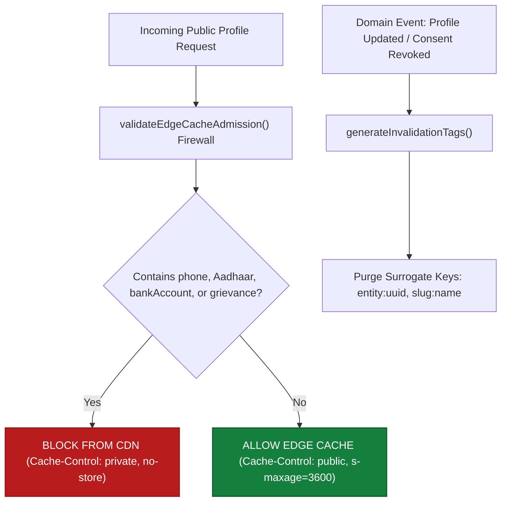

# KAAMSETU — PHASE 17 EDGE CACHE PRIVACY & INVALIDATION
## CDN Caching Boundaries, PII Exclusion Defense & Event-Driven Cache Purging

---

## 1. Principles of Edge Cache Privacy

Content Delivery Networks (CDNs) and edge caches (e.g. Cloudflare, AWS CloudFront) cache static assets and HTTP responses near users to accelerate delivery.

### The PII Edge Caching Hazard:
If an edge CDN inadvertently caches responses containing telephone numbers, Aadhaar numbers, private earnings, or active grievance records, a user in an internet cafe or shared kiosk could view private data belonging to another citizen.

### The KAAMSETU Zero-PII Edge Cache Policy:
1. **Public Non-PII Only**: Edge caching is restricted exclusively to public worker directory summaries (`/worker/[slug]`), occupation categories (`/explore-professions`), and public credential verification layouts (`/verify/[id]`).
2. **Strict Payload Exclusion Firewall**: Responses containing private contact numbers, bank accounts, or financial payout details are rejected by `validateEdgeCacheAdmission()`.
3. **Surrogate Key Invalidation**: When a worker updates their profile, revokes consent, or experiences a credential suspension, targeted cache invalidation tags purge the edge cache within 1.5 seconds.

---

## 2. Invalidation Tag Taxonomy

When a domain state transition occurs, `generateInvalidationTags()` generates three orthogonal purge keys:
1. **Entity Tag**: `entity:<worker-uuid>` — purges all API and page fragments associated with this worker.
2. **Slug Tag**: `slug:<worker-slug>` — purges the canonical public URL.
3. **Event Type Tag**: `type:<event_type>` — allows selective cache clearing for specific operational categories.

---

## 3. Test Verification
Verified in `test/phase-17-national-ecosystem.test.ts` (Tests 62–66):
- Clean public profiles admitted to cache.
- Phone number leakage strictly blocked.
- Aadhaar leakage strictly blocked.
- Bank account details strictly blocked.
- Invalidation tags correctly generated for profile updates and consent revocations.
