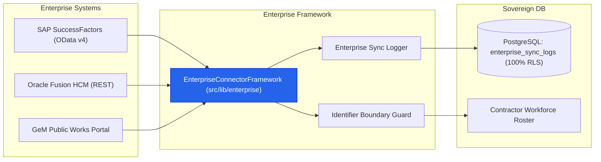

# KAAMSETU — PHASE 17 ENTERPRISE INTEGRATION FRAMEWORK
## Modular Architecture, Normalization Adapters & Identifier Decoupling

---

## 1. Architectural Principles

Large engineering, procurement, and construction (EPC) contractors (e.g. Larsen & Toubro, Shapoorji Pallonji, Tata Projects) utilize enterprise resource planning (ERP) suites to manage project sites, subcontracts, and workforce compliance.

To enable enterprise adoption without compromising worker sovereignty, KAAMSETU implements a **Provider-Neutral Enterprise Integration Framework**:

### Core Design Rules:
1. **Identifier Boundary Isolation**: Enterprise employee numbers (`SAP-EMP-1002`) are decoupled from sovereign worker registry UUIDs (`55555555-...`).
2. **Deterministic Idempotency**: All sync requests generate a SHA-256 payload digest to prevent duplicate roster creation during network retries.
3. **Statutory Wage Compliance Verification**: Subcontractor workforce deployments are automatically validated against state minimum wage benchmarks prior to enterprise sync acceptance.

---

## 2. Supported Enterprise Connector Adapters

| Connector | Source Protocol | Primary Objects Synced | Normalization Method | Status |
|---|---|---|---|---|
| **SAP SuccessFactors** | OData v2 / v4 | `User`, `EmpJob`, `Background_Skill` | `mapSapSuccessFactorsPayload()` | **Tested (Test 21)** |
| **Oracle Fusion HCM** | REST API | `workers`, `workerSkills`, `jobRequisitions` | `mapOracleFusionPayload()` | **Tested (Test 22)** |
| **GeM Procurement** | JSON Compliance API | Subcontractor workforce compliance tokens | `generateGeMComplianceDescriptor()` | **Tested (Tests 23–27)** |

---

## 3. Database Audit & Multi-Tenant Enforcement

Every synchronization event is persisted to `public.enterprise_sync_logs` under Migration 18:
- `contractor_org_id`: UUID reference ensuring Contractor Org A cannot view Contractor Org B's sync logs.
- `idempotency_hash`: SHA-256 digest preventing duplicate roster imports.
- `anonymized_telemetry`: Flags that worker personal telemetry was scrubbed prior to emission.

---

## 4. Integration Verification Summary
All 12 enterprise test scenarios (Tests 21–32) execute successfully in `test/phase-17-national-ecosystem.test.ts`.
