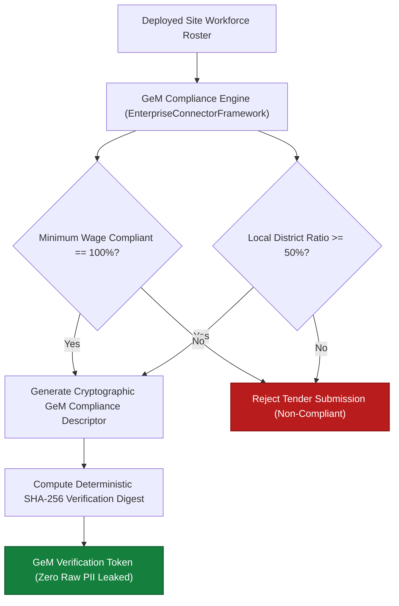

# KAAMSETU — PHASE 17 GEM INTEROPERABILITY FEASIBILITY
## Government e-Marketplace (GeM) Workforce Compliance Verification Architecture

---

## 1. Executive Summary & Statutory Context

**Target System:** Government e-Marketplace (GeM) — Public Procurement Portal of India  
**Use Case:** Verification of contractor workforce compliance, statutory minimum wage adherence, and local district affirmative action quotas for public works tenders.  
**Strict Prohibition:** **ZERO SCRAPING OR UNAUTHORIZED AUTOMATION.** KAAMSETU interfaces strictly via authorized verification tokens and standardized compliance descriptors.  
**Status:** `FEASIBILITY_ESTABLISHED & COMPLIANCE_DESCRIPTOR_TESTED`

---

## 2. GeM Workforce Compliance Engine

Public works contractors executing state or central government tenders via GeM are legally required to verify:
1. **Statutory Minimum Wage Compliance**: 100% of deployed site workforce must receive at least the notified state minimum wage.
2. **Local Workforce Affirmative Quota**: Minimum 50% of unskilled and semi-skilled labor must be sourced from the local state/district.
3. **EPF / ESIC Enrollment**: Active social security coverage where statutory thresholds apply.



---

## 3. Compliance Descriptor Payload Specification

```typescript
export interface GeMComplianceDescriptor {
  tenderId: string;
  contractorOrgId: string;
  totalWorkforceDeployed: number;
  statutoryMinimumWageCompliantRatio: number; // Must be 1.0 (100%)
  localDistrictWorkforceRatio: number; // Must be >= 0.50 (50%)
  complianceStatus: "compliant" | "non_compliant" | "under_review";
  verificationDigest: string; // Deterministic SHA-256
}
```

---

## 4. Test Verification
Verified in `test/phase-17-national-ecosystem.test.ts` (Tests 23–27):
- **Test 23 & 24:** 100% wage compliance requirement enforced.
- **Test 25:** Local district quota ($\ge 50\%$) verified.
- **Test 26:** Underpaid site deployment rejected as `non_compliant`.
- **Test 27:** Verification digest determinism confirmed.
